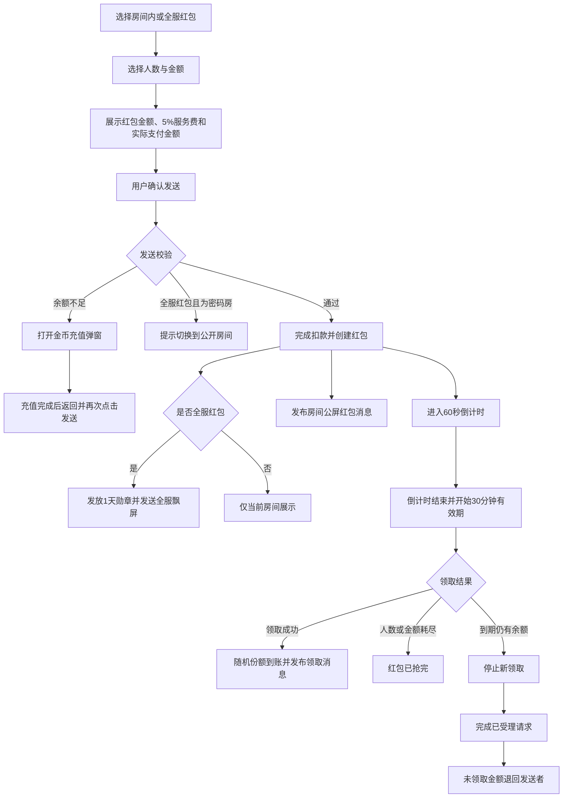

# 房间红包精简版 PRD

> 原型位置：`2025-05-01 / 房间互动功能 / 房间红包`  
> 原型源文件：`file:///Users/gorkella/Files/Works/YYLY/原型/AYO原型/index.html?view_mode=read_only`  
> 本文规则均为本期确定口径。

## 一、需求概述

房间红包是语聊房内的 金币 随机分发玩法。用户支付红包金额及服务费后，可向当前房间或全服在线用户发送红包；其他用户在倒计时结束后领取随机金额。红包到期时，未领取金额自动退回发送者。

### 1.1 功能范围

- 房间右下角浮窗入口
- 发送房间内红包
- 发送全服红包
- 60 秒倒计时及领取
- 红包记录与详情
- 房间公屏红包消息
- 全服红包飘屏及跨房跳转
- 过期退款
- 全服红包专属勋章

### 1.2 角色权限

| 用户类型 | 发送房间内红包 | 发送全服红包 | 领取红包 |
|---|---:|---:|---:|
| 房主、管理员、会员、普通访客 | 可以 | 仅公开房间可以 | 可以 |
| 红包发送者 | 可以 | 仅公开房间可以 | 不可领取自己发送的红包 |
| 游客或未登录用户 | 不可以 | 不可以 | 不可以 |
| 被房间封禁或无进入权限的用户 | 不可以 | 不可以 | 不可以 |

发送与领取红包均不增加用户经验值。

## 二、核心业务规则

### 2.1 红包类型与固定档位

| 类型 | 可领取人数 | 红包金额（金币） | 传播范围 |
|---|---|---|---|
| 房间内红包 | 10、20、30、50 | 1,000、2,000、5,000、10,000 | 当前房间 |
| 全服红包 | 10、20、30、50 | 20,000、40,000、50,000、100,000 | 全服在线用户 |

- 用户只能选择当前启用的固定档位，不支持自由输入。
- 档位由后台配置；配置变化只影响新创建的红包。
- 已创建红包继续使用创建时的人数、金额、服务费及时间规则，不受后续配置变化影响。

### 2.2 支付与服务费

平台在红包金额之外收取 5% 服务费：

> 服务费 = 红包金额 × 5%  
> 实际支付金额 = 红包金额 + 服务费

例如发送 10,000 金币 红包：

- 红包可领取总额：10,000 金币
- 服务费：500 金币
- 实际支付金额：10,500 金币

规则：

1. 发送前按实际支付金额校验余额。
2. 发送确认信息必须同时展示红包金额、服务费和实际支付金额。
3. 红包金额全部进入可领取奖池，服务费不从奖池内扣除。
4. 服务费一经红包创建成功即不退还；系统异常导致红包创建失败或被全额撤销时，红包金额和服务费全部原路退回。

### 2.3 倒计时与有效期

1. 红包创建成功后进入 60 秒倒计时，倒计时期间不可领取。
2. 倒计时结束后进入可领取状态，并从该时刻开始计算 30 分钟有效期。
3. 领取请求在过期时刻前被系统成功受理，可以继续完成领取；等于或晚于过期时刻到达的请求按已过期处理。
4. 过期处理须等待已受理的领取请求完成，再计算未领取金额。
5. 领取人数已满或奖池已全部分配时，红包立即结束，不再等待有效期结束。

### 2.4 随机份额

1. 创建红包时，根据红包金额和领取人数预先生成等量的随机整数份额。
2. 每份金额至少为 1 金币，所有份额之和必须等于红包金额。
3. 生成后随机打乱份额顺序；用户领取时依次占用一个未领取份额。
4. 领取前不向客户端公开份额结果。
5. 不设置单份最高占比限制。
6. 同一个红包的预生成结果需保留，异常恢复或请求重试不得重新随机。

### 2.5 领取与重复操作

1. 同一账号对同一红包最多领取一次。
2. 领取顺序以系统成功受理请求的先后顺序为准，不以客户端点击时间、动画结束时间或返回顺序为准。
3. 点击领取后立即进入“领取中”，金币 图标循环旋转，请求结束前禁止重复点击。
4. 请求超时后允许重试；重试必须返回首次处理结果，不得再次占用份额。
5. 领取名额、随机份额、到账结果和领取记录必须保持一致；任一环节未完成，不得展示领取成功或发送领取公屏消息。
6. 发送者打开自己的红包时直接进入详情，不展示领取按钮。

### 2.6 过期退款

> 退款金额 = 红包金额 - 已成功领取总额

- 红包过期后，未领取金额自动退回发送者。
- 服务费不退；红包无人领取时同样只退红包金额。
- 退款金额不得小于 0，也不得大于红包金额。
- 退款生成独立的“房间红包退款”资产记录。
- 退款失败进入“退款处理中”，系统继续补偿，禁止重复退款。

### 2.7 全服红包专属勋章

1. 全服红包创建并扣款成功后，发送者获得 1 天专属勋章。
2. 同一红包只发放一次勋章权益。
3. 勋章未生效或已过期时，从本次发放成功时刻起计算 1 天。
4. 勋章仍有效时，从当前到期时间继续延长 1 天。
5. 多次发送全服红包可以累计延长，不设置每日累计上限和总有效期上限。
6. 红包无人领取、未领完或正常过期退款，不撤销勋章。
7. 红包创建失败不发放；因系统异常被全额撤销时，已发放权益同步撤销。

## 三、核心流程

### 3.1 发送失败与补偿

- 扣款和红包创建作为一个完整业务动作：创建失败时不得保留扣款。
- 若扣款成功但创建失败，红包金额与服务费自动全部退回。
- 公屏消息、全服飘屏或勋章发放失败不回滚已创建红包，进入补发处理；补发不得产生重复消息或重复权益。

## 四、页面与交互

## 4.1 房间右下角浮窗入口

- 房间右下角固定展示红包浮窗，作为本功能统一入口。
- 点击浮窗打开“Lucky Packets”红包记录弹窗。
- 记录弹窗保留发送入口；点击后打开“Send Lucky Packet”发送弹窗，默认进入房间内红包页签。
- 房间暂无红包记录时，记录弹窗展示空状态及发送入口。

## 4.2 发送红包弹窗

### 页面字段

| 字段/控件 | 规则 |
|---|---|
| 类型页签 | `In-room`、`Global` |
| Quantity | 10、20、30、50 |
| Amount | 按红包类型展示对应金额档位 |
| 红包金额 | 当前选择金额 |
| Service fee | 当前金额的 5% |
| Total payment | 红包金额 + 服务费 |
| Send | 发起发送确认 |

### 交互

1. 切换类型后更新可选金额档位。
2. 点击 `Send` 后展示发送确认，用户再次确认才扣款。
3. 余额不足时打开金币充值弹窗；充值完成后返回发送页并保留原选择，但不自动发送。
4. 全服红包在密码房点击发送时提示：
   - 英语：`Please switch to a public room to send a Global Packet`
   - 阿拉伯语：`يرجى التبديل إلى غرفة عامة لإرسال الحزمة العالمية`
   - 波斯语：`لطفاً برای ارسال پاکت جهانی به یک اتاق عمومی بروید`
5. 发送处理中按钮不可重复点击；失败后恢复可操作并明确提示资产未扣除或已退回。

## 4.3 红包记录

- 标题：`Lucky Packets`
- 只展示当前房间最近 24 小时内的记录，按发送时间倒序排列。
- 首次加载最多 50 条；继续滚动时分页加载。
- 用户退出房间再进入后，仍可查看保留期内记录。
- 新红包实时插入列表顶部，不强制改变用户当前滚动位置。

### 列表字段与操作

| 内容 | 说明 |
|---|---|
| 发送者 | 头像、昵称 |
| 发送时间 | 红包创建成功时间 |
| 红包金额 | 可领取总额 |
| 类型标识 | 全服红包显示 `Global Packet` |
| 倒计时 | 倒计时期间显示剩余秒数 |
| Open | 可领取且当前用户未领取时展示 |
| Detail | 已领取、未抢到、发送者本人、已抢完或已过期时展示 |
| Expired | 红包已过期 |
| Refunded | 剩余金额已退款 |

空状态：`No Lucky Packets yet...`

## 4.4 开红包弹窗

展示：

- 发送者头像与昵称
- `Lucky Packet from [Username]`
- 全服红包标识
- 金币领取图标
- 倒计时或 `Open`

交互：

- 倒计时未结束：按钮显示 `Open / 剩余秒数`，不可领取。
- 倒计时结束：按钮切换为 `Open`。
- 点击后进入领取中，金币图标循环旋转。
- 成功后进入已领取详情；名额已满、金额耗尽或过期时进入对应详情。

## 4.5 红包详情

展示：

- 发送者头像和昵称
- 红包总金额
- 可领取总人数
- 当前已领取人数/总人数
- 红包类型
- 已领取用户列表：头像、昵称、领取金额
- 单条领取文案：`[Username] grabbed [Amount] 金币`

用户领取成功时展示：

> `You grabbed [Amount] 金币`

用户未抢到且红包已抢完时展示：

> `Better luck next time...`

红包过期时展示过期状态；发送者可查看未领取金额及退款状态。

## 4.6 规则页

规则区域支持上下滚动，展示：

1. 发送红包需要支付红包金额及 5% 服务费。
2. 服务费在红包金额之外收取，红包创建成功后不退。
3. 红包发出后倒计时 60 秒，倒计时结束后开放领取。
4. 每位成功参与者随机获得一份 金币，同一红包每人最多领取一次。
5. 红包开放领取后有效期为 30 分钟，到期后未领取金额自动退回发送者。
6. 发送和领取红包均不增加用户经验值。
7. 全服红包会通知全服在线用户。
8. 每成功发送一个全服红包，可获得 1 天专属勋章，多次发送可累计延长。

## 五、公屏消息与全服飘屏

### 5.1 房间公屏消息

发送成功后展示红包消息：

> `[Username] sent a Lucky Packet`

领取成功后展示领取消息：

> `[Username] grabbed [Amount] 金币`

规则：

- 红包消息气泡使用红色红包及金币元素，与普通消息区分。
- 点击消息时：仍可领取则打开开红包弹窗；已抢完或已过期则打开详情。
- 发送消息每个红包展示一次，不合并。
- 高频领取消息合并展示，例如：`Username and 5 others grabbed a Lucky Packet`；点击聚合消息打开对应红包。

### 5.2 全服飘屏

- 全服红包发送成功后向全服在线用户播放红色红包主题飘屏。
- 飘屏展示发送者头像、红包文案及金币元素。
- 飘屏进入全服展示队列的下一位，不打断正在播放的飘屏。
- 多个全服红包按发送成功时间排序；同一红包只进入队列一次。

点击飘屏：

1. 用户已在目标房间：直接打开对应红包。
2. 用户不在目标房间：弹出跳转确认，确认后进入房间并自动打开对应红包；取消则留在当前页面。
3. 目标房间由公开房切换为密码房：凭该红包获得一次临时进入资格，无需输入密码；资格在红包过期后失效。
4. 房间不存在、已关闭、人数已满、用户被封禁或无权限时，禁止跳转并展示对应提示。
5. 用户正在其他房间上麦或进行不可中断操作时，先走现有切房确认流程，不强制离开。
6. 红包已抢完时直接进入详情；已过期时进入过期详情。

## 六、状态定义

### 6.1 红包状态

| 状态 | 进入条件 | 页面结果 | 退出条件 |
|---|---|---|---|
| 创建中 | 用户确认发送且校验通过 | Send加载，不可重复提交 | 创建成功或失败 |
| 倒计时中 | 红包创建成功 | 展示60秒倒计时，不可领取 | 倒计时结束 |
| 可领取 | 倒计时结束 | 展示Open | 抢完或过期 |
| 已抢完 | 人数已满或奖池分配完毕 | 仅可查看详情 | 终态 |
| 已过期 | 30分钟有效期结束 | 停止新领取 | 进入退款处理 |
| 退款处理中 | 存在未领取金额且退款未完成 | 展示退款处理中 | 退款成功 |
| 已退款 | 剩余金额已退回 | 展示退款金额 | 终态 |
| 创建失败 | 扣款或创建未完成 | 提示失败并恢复操作 | 终态 |

### 6.2 用户领取状态

| 状态 | 页面表现 |
|---|---|
| 未参与 | 按红包状态展示倒计时或Open |
| 领取中 | 金币图标旋转，禁止重复点击 |
| 领取成功 | 展示个人领取金额和Detail |
| 未抢到 | 展示`Better luck next time...` |
| 已过期 | 展示过期详情 |
| 领取失败 | 提示失败；重试查询首次处理结果 |

## 七、资产记录

| 记录类型 | 记录内容 |
|---|---|
| 房间红包发送 | 红包金额、服务费、实际支付金额、红包类型、所属房间、创建时间 |
| 房间红包领取 | 红包来源、领取金额、到账时间 |
| 房间红包退款 | 原红包、未领取金额、退款时间、退款状态 |
| 全服红包勋章 | 来源红包、增加时长、生效时间、到期时间 |

客户端红包详情、资产明细和后台记录必须使用同一份发送、领取、退款结果。

## 八、异常与边界

| 场景 | 处理规则 |
|---|---|
| 余额不足 | 打开充值弹窗；充值后返回并再次点击Send |
| 密码房发送全服红包 | 禁止发送并展示三语提示 |
| 重复点击Send | 发送处理中不重复扣款或创建红包 |
| 重复点击Open | 返回首次领取结果，不重复领取 |
| 最后名额并发领取 | 按系统受理顺序分配，超出者进入未抢到详情 |
| 创建失败 | 红包金额和服务费均不扣除或自动全额退回 |
| 消息、飘屏或勋章发放失败 | 红包不回滚，自动补发且不得重复 |
| 发送者退出房间 | 红包继续倒计时、领取和退款 |
| 房间暂时无人 | 红包继续有效 |
| 房间关闭 | 停止新领取，完成已受理请求后退还剩余奖池，服务费不退 |
| 领取请求超时 | 允许重试并返回首次结果 |
| 退款失败 | 保持退款处理中并继续补偿，不重复退款 |
| 用户已在目标房间点击飘屏 | 不跳房，直接打开对应红包 |
| 飘屏到达时红包已抢完或过期 | 直接展示相应详情，不展示Open |

## 九、后台配置

| 配置项 | 本期规则 |
|---|---|
| 房间内红包人数档位 | 10、20、30、50 |
| 房间内红包金额档位 | 1,000、2,000、5,000、10,000 金币 |
| 全服红包人数档位 | 10、20、30、50 |
| 全服红包金额档位 | 20,000、40,000、50,000、100,000 金币 |
| 服务费比例 | 5% |
| 开放前倒计时 | 60秒 |
| 可领取有效期 | 30分钟 |
| 客户端房间记录保留期 | 24小时 |
| 单次首次加载数量 | 50条 |
| 全服红包勋章时长 | 每次增加1天 |

配置更新仅影响更新后创建的新红包；存量红包继续读取创建时规则。