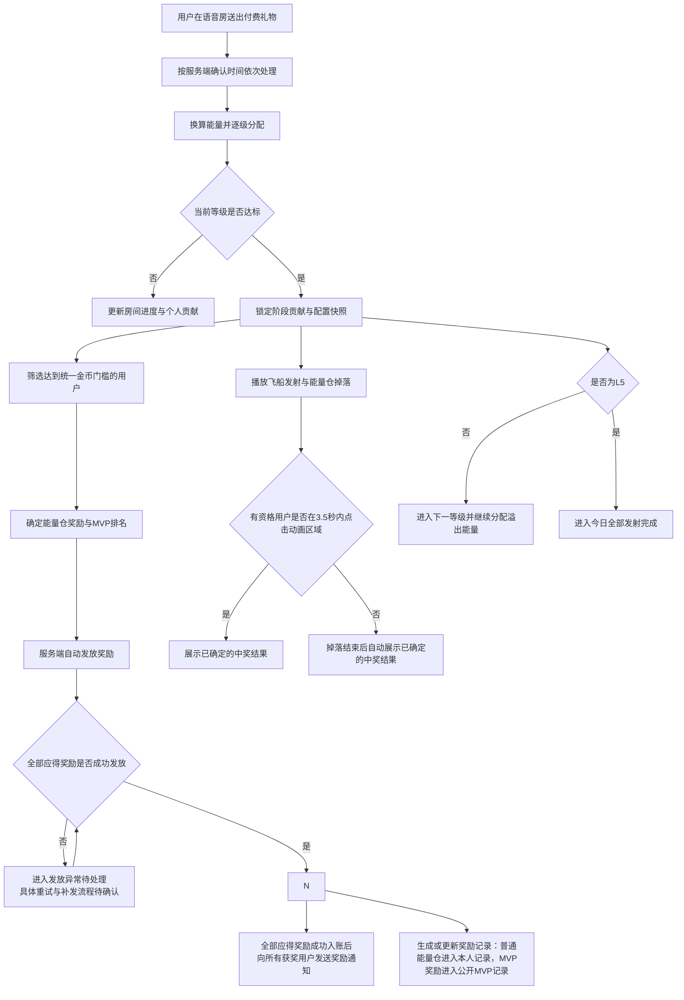
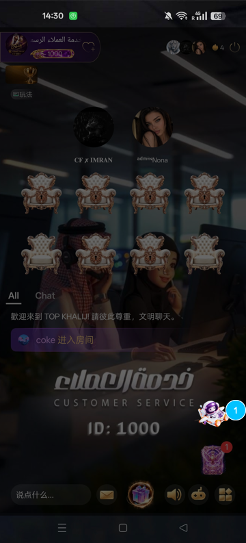
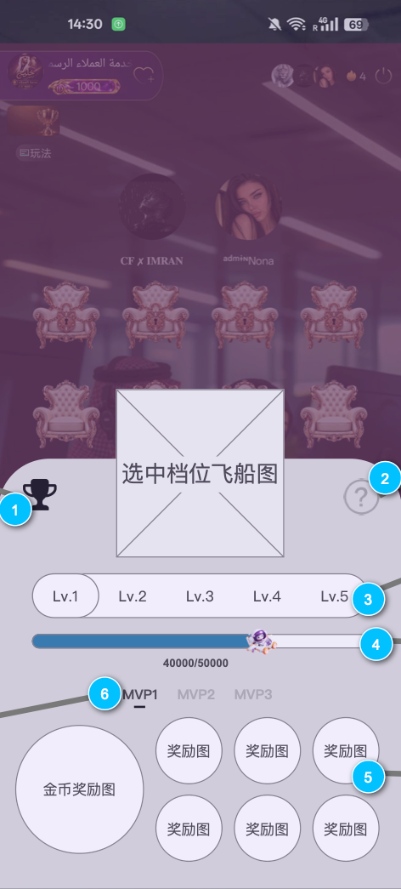
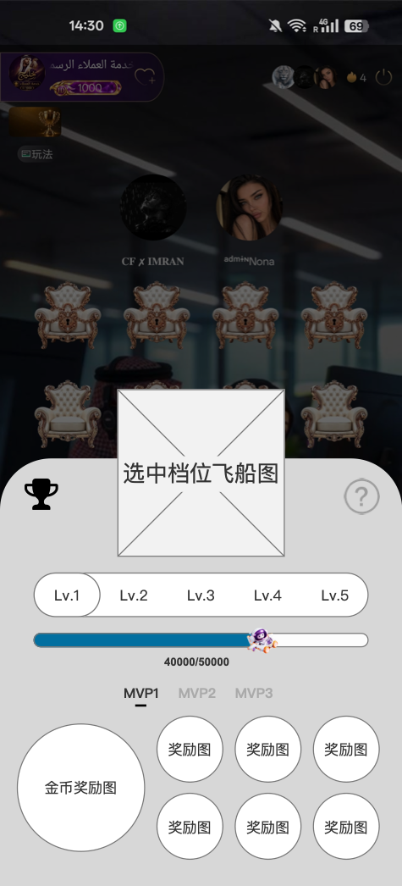
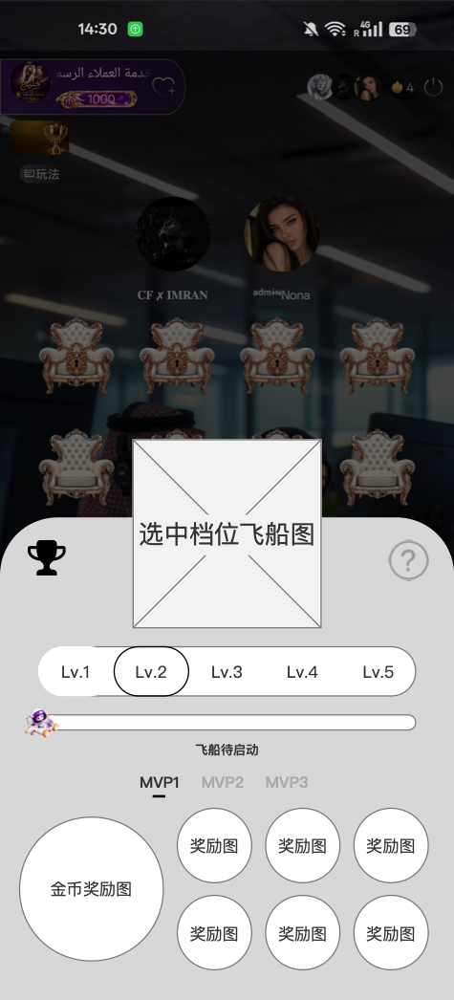
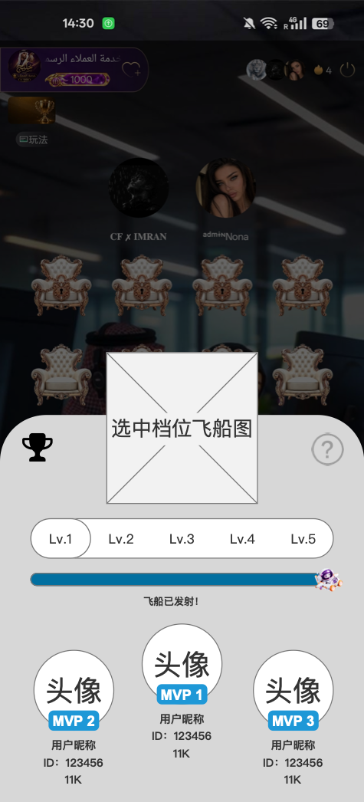
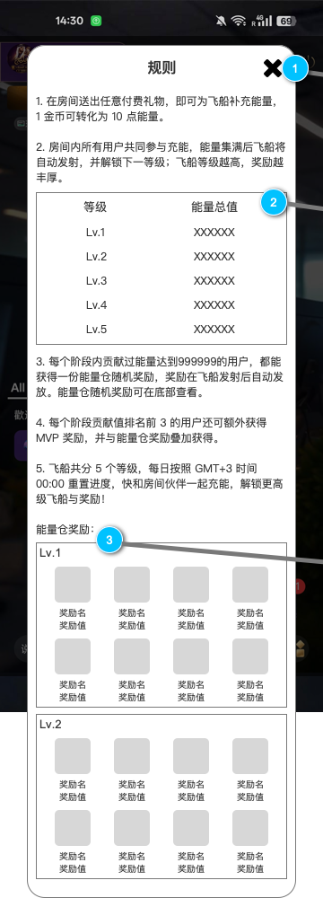
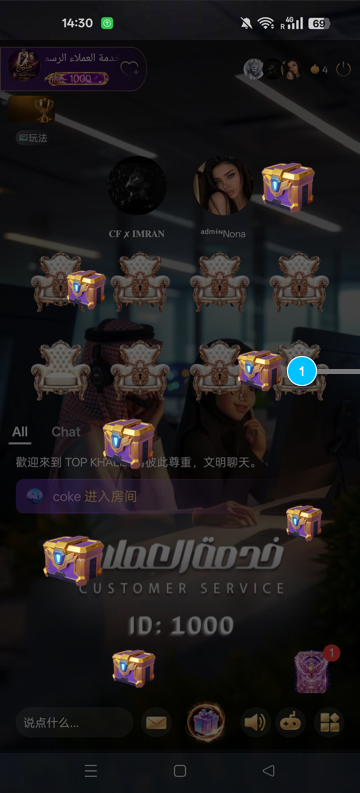
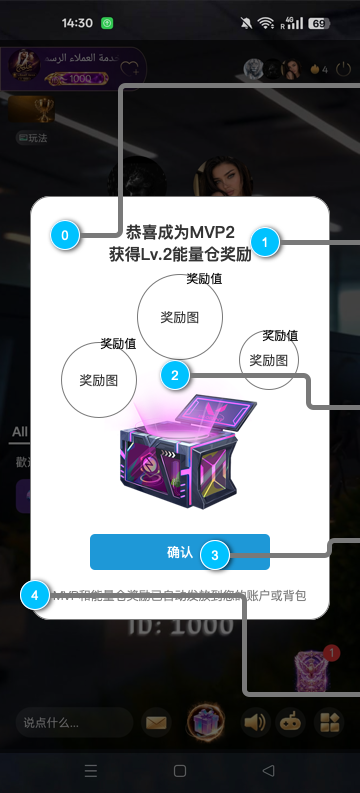
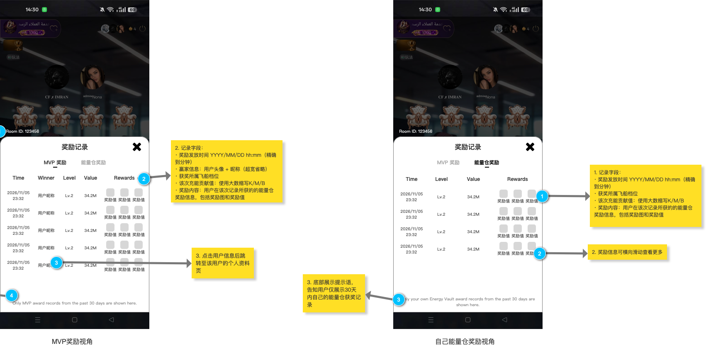

# 房间飞船挑战 PRD

## 一、文档信息

| 项目 | 内容 |
|---|---|
| 需求名称 | 房间飞船挑战 |
| 适用端 | iOS、Android |
| 生效场景 | 语音房 |
| 需求方 |  |
| 期望上线时间 | 2026/11/12 |
| 原型文件 | `/Users/gorkella/Documents/Axure/TOP KHALIJ/TOP KHALIJ.rp` |
| 原型范围 | `房间飞船挑战`文件夹，共7个页面 |
| 业务建模 | `房间飞船挑战-业务流程图.mmd` |
| 统一时区 | GMT+3 |

### 1.1 事实来源与优先级

1. 当前已确认的产品规则；
2. 当前 Axure 文件 `TOP KHALIJ.rp`中`房间飞船挑战`文件夹；
3. 业务建模文件 `房间飞船挑战-业务流程图.mmd`；
4. 既有《星际飞船 PRD》中未与以上材料冲突的规则。

> 原型中的数值仅用于页面示意。奖励准入门槛已确认为44,444金币；五级目标能量、奖励内容及抽取概率仍以最终运营配置为准，不按原型示例值写死。

### 1.2 原型与已确认规则差异

| Axure当前可见标注 | 正式需求口径 | 处理结论 |
|---|---|---|
| 规则页写“阶段贡献达到999999” | 每阶段累计贡献达到44,444金币（按当前币价1 USD=88,888金币，0.5 USD=44,444金币） | `999999`为待替换的旧示例值；页面统一展示44,444金币 |
| 规则页MVP文案未限定参评资格 | 仅达到统一金币门槛的用户参与MVP排名 | 以正式需求为准，规则文案补充“达标贡献用户中” |
| 开奖弹窗旁注写“结算后在房用户自动弹出” | 在房有资格用户可在掉落期间点击打开；未点击时，掉落结束后自动展开 | 原型自动展开方向保留，但自动展开时点统一为3.5秒掉落结束后 |
| 掉落效果页静态摆放7个能量仓，只有1个绑定点击 | 采用一体式全屏掉落动效，仅向有奖励资格用户展示；动画区域内任意位置均可触发开奖 | 原型数量只作视觉示意；具体视觉能量仓数量由UI按3.5秒时长适配，不与奖励份数绑定 |
| 掉落页7个能量仓使用同一资源，开奖页只展示Lv.2打开仓 | L1—L5分别提供关闭态与打开态 | 原型资源待补齐，不得以Lv.2资源复用全部档位 |
| 开奖弹窗使用3个环绕气泡 | 普通与MVP复用弹窗，奖励内容需容纳实际配置；MVP最多8项 | 3个气泡为当前视觉示意；超出3项时按4列×2行规则展示 |
| 主弹窗画布另有“飞船居中、奖励气泡环绕”的待定替代稿 | 采用当前规则布局：飞船主图、进度区、MVP奖励区和能量仓奖池区分区展示 | 替代稿不采用；按当前规则布局交付 |
| 主弹窗静态稿出现MVP1、MVP2、MVP3奖励预览切换 | Top1、Top2、Top3使用相同内容的MVP额外能量仓 | 保留当前规则布局和三个名次页签；三个页签展示同一套奖励内容 |
| 主界面动态面板状态名为“已充满”，内容显示“飞船已发射！” | 已充满/待发射为瞬时态；结算完成后为已发射态 | 原型状态名需拆分或更名，避免一态两义 |
| 原型示例进度为40000/50000 | 五级目标能量仍待运营确认 | 示例值不作为正式配置，确认后页面读取当日配置快照 |
| 记录页包含“MVP奖励/能量仓奖励”双页签 | 展示全房MVP记录及当前用户自己的能量仓记录 | 按当前原型纳入正式范围；两类记录均只展示近30天 |
| 奖励配置页表头写“福袋随机奖励池” | 本玩法统一使用“能量仓随机奖励池” | UI及后续配置文案统一改为“能量仓” |
| 发射与掉落页旁注明确发射≤4秒、掉落3.5秒、10个视觉能量仓参考密度 | 发射≤4秒、掉落3.5秒作为正式时长；视觉数量按原型参考值10个实现 | 时长与数量按最新原型同步；10个仅为视觉对象，不代表奖励份数 |
| 发射与掉落页旁注写“掉落的能量仓可点击”，实际只有1个仓绑定点击 | 正式交互为有资格用户点击整个动画区域任意位置 | 原型需补整块动画热区，不按单个仓逐个绑定 |
| 发射与掉落页未表达资格分流 | 仅有奖励资格用户展示掉落层；无资格用户只观看飞船发射 | 资格分流以正式业务规则为准 |
| 开奖页旁注明确0.85→1.03→1倍，0.22秒＋0.08秒 | 使用客户端原生中心放大及轻微回弹动画 | 参数已与正式需求一致 |
| 主界面部分按钮、档位和页签仍无完整Axure事件 | 记录、规则、Lv.1—Lv.5及MVP1—MVP3按正文交互实现 | 原型需补交互绑定；静态控件不代表取消功能 |

## 二、需求背景与目标

通过语音房内多人共同送礼，为房间飞船积攒能量。飞船按等级逐级发射，每个阶段向达到贡献门槛的用户发放能量仓随机奖励，并向贡献值排名前 3 的用户额外发放 MVP 奖励。

业务目标：

- 让不同付费层级用户共同参与房间阶段目标；
- 通过逐级解锁、掉落效果和开奖反馈增强参与感；
- 通过 MVP 展示与记录强化高贡献用户荣誉；
- 在不依赖用户抢领的前提下，保证奖励发放稳定、可追溯、可补发。

## 三、需求范围

| 模块 | 本期内容 |
|---|---|
| 房间入口 | 房间右下角展示当前阶段飞船入口 |
| 飞船主弹窗 | 展示五级飞船、阶段状态、进度与奖励预览 |
| 规则弹窗 | 展示面向用户的玩法规则 |
| 送礼充能 | 付费礼物换算能量，按房间、阶段累计 |
| 等级推进 | L1 至 L5 顺序推进，支持溢出能量跨级 |
| 能量仓奖励 | 每阶段累计贡献达到44,444金币的用户获得随机奖励 |
| MVP 奖励 | 达标用户中贡献值 Top1—Top3 获得额外奖励 |
| 能量仓掉落 | 发射后仅向有资格用户紧接播放一次3.5秒的全屏能量仓掉落效果 |
| 开奖弹窗 | 有资格用户点击动画区域任意位置，或3.5秒结束后自动展示服务端已确定的结果 |
| 奖励通知 | 奖励入账后向所有获奖用户发送通知 |
| 奖励记录 | 展示当前房间近30天MVP记录及当前用户自己的能量仓记录 |
| 每日重置 | GMT+3 00:00 重置进行中数据 |

### 3.1 非本期范围

- 礼物退款后的能量、贡献和已发奖励回退；
- 免费礼物参与充能；
- 非语音房场景；
- 用户主动领取奖励；
- 点击能量仓后重新抽奖或改变奖励结果。
- 最后一击或阶段完成人额外奖励。

## 四、模块地图与核心对象

### 4.1 页面地图

```text
语音房
└─ 飞船入口
   └─ 飞船主弹窗
      ├─ 五级飞船状态与奖励预览
      ├─ 规则弹窗
      └─ 奖励记录弹窗
         ├─ MVP奖励：全房MVP记录
         └─ 能量仓奖励：当前用户自己的记录

阶段能量充满
├─ 飞船发射动效
├─ 能量仓掉落效果
│  └─ 点击动画区域或3.5秒结束 → 开奖弹窗
├─ 服务端自动发奖
└─ 奖励发放通知
```

### 4.2 核心对象

| 对象 | 定义 | 生命周期 |
|---|---|---|
| 房间实例 | 一次独立存在的语音房业务实例 | 房间正常期间持续存在；本期仅房间封禁会中止玩法能力 |
| 自然日 | GMT+3 00:00 至次日 00:00 | 每日重置并生成配置快照 |
| 飞船等级 | L1 至 L5 的阶段对象 | 按顺序启动、充能、达标并结束 |
| 充能阶段 | 某房间实例、某自然日、某等级的一次完整充能周期 | 等级启动至达到目标能量并锁定 |
| 阶段贡献 | 用户实际分配到该等级的贡献能量与金币值 | 随礼物累计，阶段达标后锁定 |
| 阶段结算结果 | 阶段达标后形成的资格、排名和奖励快照 | 锁定后不可被后续配置或送礼改变 |
| 奖励项 | 能量仓或 MVP 来源下的具体金币、物料或道具 | 待发放、已发放、异常待处理 |
| MVP 记录 | 阶段 Top1—Top3 的公开展示记录 | 保留并展示近30天 |
| 个人能量仓记录 | 当前用户每次获得普通能量仓奖励的个人记录 | 保留并展示近30天 |

### 4.3 用户角色

| 角色 | 定义 | 可获得内容 |
|---|---|---|
| 普通房间用户 | 进入语音房但未送出有效付费礼物 | 可查看入口、主弹窗、规则和 MVP 记录 |
| 未达标贡献用户 | 本阶段有贡献，但未达到统一金币门槛 | 贡献计入房间进度，不获得奖励、不参与 MVP 排名 |
| 达标贡献用户 | 本阶段累计贡献达到统一金币门槛 | 一份能量仓随机奖励 |
| MVP 用户 | 达标贡献用户中的 Top1—Top3 | 能量仓奖励与对应名次 MVP 奖励，可叠加 |

## 五、核心业务规则

### 5.1 能量换算

- 任意付费礼物均参与充能；免费礼物不参与。
- 换算比例：`1 金币 = 10 能量值`。
- 礼物能量同时用于：
  - 增加当前房间当前等级进度；
  - 记录送礼用户在该阶段的个人贡献。
- 不同房间实例独立累计，不跨房间继承。

### 5.2 奖励准入门槛

- 五个等级采用统一固定金币门槛，不按阶段目标能量比例动态增长。
- <span style="color:red"><strong>当前币价固定为 `1 USD = 88,888金币`，每阶段奖励准入门槛固定为 `44,444金币`（0.5 USD × 88,888金币/USD）。</strong></span>
- <span style="color:red"><strong>玩法运行时只比较44,444金币，不实时换算美元；币价或门槛调整时按配置快照规则在下一GMT+3自然日生效。</strong></span>
- 门槛按单个房间、单个等级阶段累计，不要求单笔礼物达到门槛。
- 用户达到门槛后，以本阶段完整贡献值参与 MVP 排名，而不是只计算超过门槛的部分。
- 未达门槛的贡献仍计入房间总进度和个人贡献，但不获得奖励、不参与 MVP 排名。
- 本期不设置“最后一击”“临门一脚”或“阶段完成人”奖励。使阶段能量充满的礼物仅触发阶段结算，不新增奖励来源；避免奖励层级继续增加及小额礼物卡点套利。

### 5.3 等级顺序

五级飞船按顺序解锁，不可跳级。等级越高，所需房间总能量越大，能量仓随机奖励池价值越高。下表仅为待运营确认的初始建议值，不作为本期冻结配置；运营确认后按配置快照生效，暂时写死服务端数据表，客户端不得写死。

| 等级 | 飞船名称 | 所需房间总能量 | 能量仓随机奖励池 | MVP额外奖励 | 阶段状态 |
|---|---|---:|---|---|---|
| L1 | 探索者飞船 | 10,000 | 小额金币、初级道具 | 能量仓（Top1—Top3） | 每日初始等级 |
| L2 | 星际飞船 | 30,000 | 中额金币、中级道具 | 能量仓（Top1—Top3） | L1达标后启动 |
| L3 | 星翰飞船 | 80,000 | 高额金币、高级道具、概率特效 | 能量仓（Top1—Top3） | L2达标后启动 |
| L4 | 银河飞船 | 200,000 | 大额金币、稀有道具、限时座驾 | 能量仓（Top1—Top3） | L3达标后启动 |
| L5 | 宇宙飞船（满级） | 500,000 | 巨额金币、传说道具、专属头像框 | 能量仓（Top1—Top3） | L4达标后启动，最高等级 |

- 五级飞船按顺序推进，不可跳级。
- 各等级目标能量必须配置为 10 的整数倍。
- 表中五级目标能量、金币额度档位和道具等级均为待运营确认的初始建议；具体目标能量、金币数量、道具清单、物料有效期及抽取概率由运营配置。
- 表中“MVP额外奖励”为Top1—Top3额外获得的能量仓；同一飞船等级内，Top1、Top2、Top3使用完全相同的MVP额外能量仓配置、奖池内容和奖励价值，不按名次区分。
- L1 至 L4 达标后立即进入下一等级，不等待动效或奖励发放完成。
- L5 达标后进入“今日已全部发射完成”，当日后续送礼不再计入飞船玩法。

### 5.4 单笔礼物跨级拆分

- 单笔礼物的能量按 L1 至 L5 顺序逐级分配。
- 当前等级只分配达到目标值所需的能量，剩余能量继续进入下一等级。
- 每个等级的个人贡献只记录该笔礼物实际分配至本等级的能量。
- 公式：`阶段贡献金币 = 本等级实际分配能量 ÷ 10`。
- 准入资格、个人贡献和 MVP 排名均使用拆分后的阶段贡献金币。
- 同一笔礼物不得在多个等级重复记录完整贡献。
- 一笔礼物连续触发多个等级达标时，每个等级分别生成独立阶段结算结果。
- L5 达标后的剩余能量及对应贡献金币不再计入。

### 5.5 送礼事件顺序与跨天归属

- 同一房间内的有效礼物按照服务端确认成功时间从早到晚依次处理。
- 时间相同时，按照稳定的唯一事件顺序处理。
- 每笔礼物需完成能量分配、阶段锁定、下一等级创建和溢出分配，才处理下一笔。
- 阶段达标时先锁定贡献数据与配置快照，再进入下一等级。
- 礼物所属自然日以服务端确认成功时间为准：
  - 早于 GMT+3 00:00：归属旧自然日；
  - 等于或晚于 GMT+3 00:00：归属新自然日。
- 每笔礼物只能归属一个自然日。

### 5.6 奖励模型

| 奖励来源 | 获奖对象 | 奖励数量 | 发放方式 | 是否可叠加 |
|---|---|---:|---|---|
| 能量仓奖励 | 本阶段所有达标贡献用户 | 每人 1 份随机奖励 | 服务端自动发放 | 可与 MVP 叠加 |
| MVP Top1 | 达标用户贡献值第 1 名 | 1 个MVP额外能量仓 | 服务端自动发放 | 可与普通能量仓叠加 |
| MVP Top2 | 达标用户贡献值第 2 名 | 1 个MVP额外能量仓 | 服务端自动发放 | 可与普通能量仓叠加 |
| MVP Top3 | 达标用户贡献值第 3 名 | 1 个MVP额外能量仓 | 服务端自动发放 | 可与普通能量仓叠加 |

- 同一等级的Top1、Top2、Top3获得相同内容、相同价值的MVP额外能量仓；名次只用于身份展示、排名记录和通知文案，不改变奖励内容。
- 不为Top1、Top2、Top3分别维护三套MVP奖池或三套奖励配置。
- 达标用户不足 3 名时，按实际人数发放对应名次奖励，不保留空缺名额。
- 无达标用户时，不产生能量仓奖励和 MVP 获奖者。
- <span style="color:red"><strong>MVP排名顺序：阶段贡献金币降序 → 达到该阶段最终贡献值的服务端时间升序 → 用户ID数值升序。</strong></span>
- “达到该阶段最终贡献值的服务端时间”取用户本阶段最后一笔有效贡献完成入账的服务端时间；同一时间仍相同时，用户ID数值较小者优先。

### 5.7 配置快照

- 每个 GMT+3 自然日开始时生成当日配置快照。
- 快照包含五级目标能量、统一金币门槛、各级能量仓随机奖励池和 MVP 额外能量仓配置。
- 当日运营修改统一在下一自然日 00:00 生效。
- 当日正在充能、已锁定和待补发阶段继续使用原配置快照。
- 历史记录和后续补发不得使用最新配置反算。

## 六、核心业务流程

> 业务流程来源：`房间飞船挑战-业务流程图.mmd`。



## 七、页面需求

### 7.1 房间飞船入口

#### 页面定位

在语音房主界面提供飞船挑战的常驻入口，展示当前阶段飞船缩略图，并承接进入飞船主弹窗的操作。

#### 对应原型



#### 前置条件

- 用户已进入语音房；
- 当前房间支持飞船挑战；
- 当日配置快照已生成。

#### 页面字段定义

| 字段/元素 | 展示规则 |
|---|---|
| 飞船入口 | 位于房间右下角、原活动悬浮入口上方 |
| 当前飞船缩略图 | 跟随房间当前实际充能等级变化 |
| 入口点击区域 | 覆盖飞船缩略图完整范围 |

#### 统计与计算口径

- 当前等级读取房间实例在当前自然日的实时等级。
- 页面重进或网络恢复后，以服务端最新状态刷新。

#### 交互逻辑

1. 用户点击飞船入口；
2. 打开飞船主弹窗；
3. 房间音频继续播放；
4. 弹窗打开期间，底层房间麦位和聊天区不可点击。

#### 状态定义

| 状态 | 页面表现 |
|---|---|
| 充能中 | 展示当前充能等级缩略图 |
| 等级切换 | 更新为新等级缩略图 |
| 今日全部完成 | 展示 L5 完成态缩略图 |
| 数据刷新失败 | 保留上次状态；恢复后同步最新等级 |

#### 系统处理规则

- 入口只展示当前房间实例状态，不跨房间继承。
- 用户是否具备奖励资格不影响入口可见性。

#### 异常与测试关注点

- 房间被封禁后，入口立即隐藏且不可操作；未达标进度和已锁定结算的处理方案见待确认事项T-08。

### 7.2 飞船主弹窗

#### 页面定位

展示五级飞船、当前及历史阶段状态、能量进度、奖励预览，并提供规则与 MVP 获奖记录入口。

#### 对应原型

##### 主界面整页总览



> 整页总览用于展示动态面板、画布旁注及下方待定替代稿的位置关系，不代表最终页面需要纵向滚动。正式页面状态以以下三张动态面板状态截图为准。

##### 状态一：充能中



- 原型状态名：`充能中`；
- 选中示例：`Lv.1`；
- 主要表现：展示当前能量/目标能量进度、MVP1—MVP3奖励预览及普通能量仓奖池；
- 原型示例进度`40000/50000`仅作画面示意，不作为正式目标能量。

##### 状态二：待启动



- 原型状态名：`待启动`；
- 选中示例：`Lv.2`；
- 主要表现：进度条为空，展示“飞船待启动”，奖励预览仍按所选等级显示；
- 该状态用于尚未解锁但允许预览的等级。

##### 状态三：已充满（原型实际展示为已发射结果）



- Axure动态面板状态名为`已充满`，但画面实际文案为“飞船已发射！”；
- 进度条为满值，奖励预览区替换为MVP Top1—Top3结果；
- 正式需求仍将“已充满/待发射”定义为短暂过渡态，将“飞船已发射！”定义为结算完成后的稳定结果态；开发不得仅按Axure状态名合并两个业务状态。

#### 前置条件

- 用户通过房间飞船入口打开；
- 房间当前自然日配置与等级状态可读取。

#### 页面字段定义

| 区域 | 字段/元素 | 展示规则 |
|---|---|---|
| 顶部 | 页面标题 | 飞船挑战 |
| 顶部左侧 | 奖励记录入口 | 点击打开当前房间奖励记录弹窗 |
| 顶部右侧 | 规则入口 | 点击打开规则弹窗 |
| 档位区 | Lv.1—Lv.5 | 支持点击切换查看 |
| 飞船区 | 飞船主图 | 按选中档位和阶段状态展示对应飞船主图与轻量动效 |
| 进度区 | 当前能量/目标能量 | 仅充能中状态展示实时数值 |
| 奖励区 | MVP奖励与能量仓奖池预览 | 采用当前规则布局分区展示；保留MVP1、MVP2、MVP3页签，三个页签展示相同的MVP额外能量仓内容；能量仓奖池区展示当前等级普通能量仓奖池 |
| 结果区 | MVP Top1—Top3 | 已发射状态展示实际获奖人数 |

#### 统计与计算口径

- 档位切换仅改变查看对象，不改变房间当前实际充能等级。
- 进度数值读取选中等级在当前自然日的状态快照。
- 奖励预览读取当日配置快照；原型中的奖励圈和示例数值不作为正式奖励配置。
- MVP贡献值展示阶段锁定后的最终值，使用大数缩写规则。
- 主弹窗不采用“飞船居中、奖励气泡环绕”的替代布局；飞船主图、进度、MVP奖励和普通能量仓奖池保持明确分区。

#### 交互逻辑

1. 默认选中房间当前实际充能等级；
2. 用户点击 Lv.1—Lv.5 切换查看对应状态；
3. 点击规则入口打开规则弹窗；
4. 点击奖励记录入口打开奖励记录弹窗；默认进入“MVP奖励”页签；
5. 点击弹窗外空白区域关闭主弹窗并返回房间。

#### 状态定义

| 状态 | 进入条件 | 飞船主图表现 | 进度与结果表现 | 退出条件 |
|---|---|---|---|---|
| 充能中 | 选中等级为当前实际等级且未达标 | 当前档位飞船处于巡航/飞行中，使用低强度尾焰、轻微上下浮动和能量流动效果；不使用发射爆发效果 | 展示当前值/目标值及实时进度 | 目标能量达成 |
| 待启动 | 选中等级高于当前实际等级 | 当前档位飞船处于停靠、未起飞状态；尾焰关闭，飞船静止或仅保留极轻待机呼吸效果 | 展示“飞船待启动”，不展示可贡献进度 | 前置等级达标 |
| 已充满/待发射 | 当前等级刚达到目标能量，发射动效尚未开始 | 不继续使用普通飞行循环；切换为能量核心满亮、尾焰增强、机体轻微蓄力或震动的点火待发射效果 | 进度显示满值，短暂展示“飞船准备发射” | 主弹窗隐藏并开始房间级发射动效 |
| 已发射 | 选中等级已完成结算 | 不继续循环展示飞行中效果；展示已发射后的完成态主图，建议使用飞船远去剪影、航迹残留或完成徽记，避免用户误以为该档位仍在充能 | 展示“飞船已发射！”及MVP结果 | 每日重置 |
| 今日全部完成 | L5已达标 | L1—L5均展示各自已发射完成态；L5可增加满级完成徽记，但不继续播放发射动画 | 展示“今日已全部发射完成” | 次日00:00重置 |

#### 飞船档位视觉规则

- L1—L5均使用独立飞船外观、主体色、尾焰色和能量纹理，不能只替换名称或数字。
- 状态表现必须建立在对应档位飞船上：同一档位至少包含“充能中、待启动、已发射完成”三套视觉状态。
- 充能中只播放主弹窗内部轻量循环动效；全屏发射动效仅在阶段首次达标时播放一次。
- 已充满/待发射为瞬时过渡状态，建议展示0.3—0.5秒；用于承接进度满值到全屏发射，不作为用户可长期查看的稳定状态。
- 待启动与已发射必须视觉可区分：待启动是尚未起飞，已发射是已经完成并离场。
- 用户切换档位时，立即切换到该档位当前状态，不重新播放全屏发射动效。
- 保留MVP1、MVP2、MVP3奖励预览页签；切换页签只改变当前选中名次标识，三个页签展示相同奖励内容。
- MVP奖励配置变化时，一次更新Top1—Top3共用内容，不分别维护三套配置。
- 已发射结果区仍按Top1、Top2、Top3分别展示获奖用户、贡献值和名次，不能因奖励内容相同而合并排名结果。

#### 系统处理规则

- 未启动等级允许预览，但不能通过页面操作提前启动。
- 已发射阶段读取锁定结果，不因后续送礼或配置修改变化。
- 达标用户不足3名时，MVP区域按实际人数展示；无达标用户时展示无MVP结果状态。

#### 异常与测试关注点

- 送礼后进度目标刷新延迟不超过1秒；
- 连续跨级时等级状态按实际结算顺序更新；
- 客户端状态落后时，以服务端结果覆盖本地展示；
- 奖励预览与当天生效配置必须一致。

### 7.3 规则弹窗

#### 页面定位

向用户说明能量换算、等级推进、奖励资格、MVP奖励及每日重置规则。

#### 对应原型



#### 前置条件

- 用户已打开飞船主弹窗；
- 点击右上角规则入口。

#### 页面字段定义

| 字段/元素 | 展示规则 |
|---|---|
| 标题 | 规则 |
| 规则正文 | 按当前正式用户规则展示，支持阿拉伯语和英语 |
| 五级能量表 | 展示L1—L5飞船名称及当日配置的目标能量 |
| 能量仓奖励区 | 按L1—L5分别展示对应奖池的奖励图、奖励名及奖励值；容器高度按奖励数量自适应 |
| 关闭按钮 | 点击关闭规则弹窗，返回主弹窗原查看等级 |

#### 用户规则文案

1. 在房间送出任意付费礼物，即可为飞船补充能量，1金币可转化为10点能量。
2. 房间用户共同参与充能，能量集满后飞船自动发射并进入下一等级；飞船等级越高，奖励越丰厚。
3. 每个阶段累计贡献达到奖励门槛的用户，都能获得一份能量仓随机奖励。奖励由系统自动发放，离开房间也不会错过。
4. 每个阶段达标贡献用户中，贡献值排名前3的用户还可获得MVP奖励，并与能量仓奖励叠加。
5. 飞船共5个等级，每日GMT+3 00:00重置进度。

#### 五级能量与奖励展示

- 能量表读取当日配置快照，不展示`XXXXXX`等占位符。
- 奖励区按等级分容器展示，不把不同等级奖励混在同一列表。
- 原型中的8个奖励格仅表示单个等级的布局容量，不代表每名用户获得8份奖励。
- 奖励项多于当前可见容量时允许在弹窗内容区继续纵向查看；关闭按钮保持可操作。

#### 交互逻辑

- 点击关闭按钮后关闭当前弹窗；
- 返回飞船主弹窗，并保留进入规则前选中的等级。

#### 状态定义

| 状态 | 页面表现 |
|---|---|
| 正常 | 完整显示规则正文 |
| 多语言 | 跟随 App 当前语言，阿拉伯语采用 RTL 排版 |
| 内容超出 | 弹窗正文区域支持纵向查看，关闭按钮固定可操作 |

#### 系统处理规则

- 规则中的门槛文案使用正式金币门槛，不实时展示美元汇率换算。
- 配置数值发生变化时，规则页在新配置生效后同步更新。

#### 异常与测试关注点

- 规则页不得出现“点击领取”口径；
- 不得把所有贡献值大于0的用户描述为必然获奖，必须保留准入门槛；
- 文案与正式配置、PRD正文保持一致。

### 7.4 发射与能量仓掉落效果

#### 页面定位

阶段达标后，先向全房在房前台用户播放不超过4秒的飞船发射动效；发射完成后，仅向有奖励资格用户播放3.5秒能量仓掉落。用户可点击动画区域任意位置打开结果，未点击则在掉落结束后自动展开。

#### 对应原型



#### 前置条件

- 当前等级已达到目标能量并锁定阶段数据；
- 飞船发射动效进入房间动效队列；
- 用户仍在当前房间且App位于前台时可观看发射动效；只有具备本阶段奖励资格的用户继续观看掉落动效。

#### 页面字段定义

| 字段/元素 | 展示规则 |
|---|---|
| 房间背景 | 保持房间主界面可见并降低亮度，不停止房间音频 |
| 主弹窗 | 发射与掉落期间隐藏，避免遮挡全屏动效和能量仓点击区域；效果结束后按用户进入动效前的状态恢复 |
| 发射动效层 | 位于房间背景和遮罩之上、能量仓掉落层之下 |
| 能量仓掉落层 | 位于发射动效层之上，保证能量仓可见、可点击 |
| 开奖弹窗层 | 用户点击或3.5秒掉落结束后展示在最上层，覆盖掉落层；使用原生中心放大及轻微回弹动画 |
| 能量仓元素 | 仅有奖励资格用户展示；固定10个视觉能量仓在3.5秒内错峰掉落，起始X轴位置在安全区内随机 |
| 点击区域 | 使用一体式动画区域热区；有资格用户点击动画区域内任意位置，均读取同一阶段结果 |
| 阶段绑定 | 本轮掉落只绑定一个等级的阶段结算结果 |

#### 画面层级

从下到上统一为：

```text
房间主界面
→ 房间暗化遮罩
→ 飞船发射动效
→ 能量仓掉落层
→ 开奖弹窗
```

- 发射动效和能量仓掉落不放在飞船主弹窗之下，也不与主弹窗同时展示。
- 用户触发阶段达标后，先关闭或隐藏主弹窗，再播放房间级发射动效与掉落效果。
- 掉落结束时，仍在房间前台且未点击的有资格用户自动展开开奖弹窗；如奖励尚未全部成功入账，则先展示“奖励发放中”状态。
- 未获得奖励资格的用户不展示能量仓掉落层，发射动效结束后直接恢复房间状态。
- 开奖弹窗关闭后返回房间，若无后续结果则不强制重开主弹窗。

#### 动效时序

| 阶段 | 初定时长 | 画面与交互 |
|---|---:|---|
| 主弹窗隐藏与房间暗化 | 0.2秒 | 主弹窗淡出，房间背景降低亮度，暂不出现能量仓 |
| 飞船发射 | ≤4秒 | 当前档位飞船由停靠/巡航状态进入点火、加速、发射并离开画面；全房在房前台用户可见 |
| 能量仓掉落 | 3.5秒 | 紧接发射动效播放，仅向有奖励资格用户播放一次；固定10个视觉能量仓错峰掉落，X轴位置随机 |
| 点击掉落动效 | 0.15秒内响应 | 立即锁定本轮点击并结束本地掉落，进入开奖弹窗展开过渡 |
| 开奖弹窗展开 | 约0.3秒 | 使用客户端原生缩放动画，从画面中心由小到大展开，末段加入一次轻微回弹后稳定 |
| 未点击结束 | 3.5秒掉落结束后 | 在房前台有资格用户自动执行相同的开奖弹窗展开动画 |

- 单阶段“发射+掉落”最长约7.5秒，不包含约0.3秒弹窗展开和用户查看时间。
- 掉落动效只播放一次，时长不随房间人数、达标人数或奖励数量变化。
- 本期暂不定义一笔礼物连续解锁多个等级时的动效合并、跳过或排队策略；服务端仍按等级独立结算，客户端表现列入T-07待确认。

#### 开奖弹窗展开动画

1. 用户点击动画区域任意位置，或3.5秒掉落结束后，先停止并移除掉落层；
2. 奖励已全部成功入账时，开奖弹窗从画面中心以约0.85倍初始缩放值开始放大；
3. 约0.22秒放大至约1.03倍，再用约0.08秒回弹至1倍并稳定展示；
4. 动画使用客户端原生缩放和透明度能力，不新增复杂粒子、轨迹跟随或3D开箱素材；
5. 奖励尚未全部成功入账时，使用同一展开动画展示“奖励发放中”容器，不显示完整奖励和“已到账”提示；
6. 自动展开与点击展开复用同一动画组件和状态判断。

#### 能量仓档位样式

| 档位 | 关闭状态（掉落中） | 打开状态（开奖弹窗） |
|---|---|---|
| L1 | 探索者主题基础能量仓，简洁边框和低强度能量光 | 对应L1打开仓体与基础光效 |
| L2 | 星际主题能量仓，增加星点纹理和档位色 | 对应L2打开仓体与星点散射效果 |
| L3 | 星翰主题能量仓，增加流光纹理和中等级粒子 | 对应L3打开仓体与流光粒子效果 |
| L4 | 银河主题能量仓，增加稀有金属边框和银河光带 | 对应L4打开仓体与银河光带效果 |
| L5 | 宇宙主题满级能量仓，最高辨识度边框和宇宙能量核心 | 对应L5打开仓体与满级爆发效果 |

- 同一档位的关闭状态和打开状态必须保持主体轮廓、颜色和标识一致，让用户能识别为同一个能量仓。
- 普通达标用户与MVP用户使用同一档位能量仓主体；MVP弹窗通过MVP名次标识和额外奖励内容区分，不再增加第二套仓体，控制资源复杂度。
- 固定10个视觉能量仓只代表画面表现，不代表10份奖励或10次抽奖；每名达标用户仍只获得1份普通能量仓奖励。
- X轴随机范围需避开系统导航区、关闭按钮、房间底部输入/操作区等不可点击安全边界；同一时刻应避免能量仓大面积重叠。
- 10个能量仓按约0.4—0.6秒参考间隔错峰进入，同时在屏数量控制在3—4个；允许使用2—3档尺寸及轻微速度差，但总掉落时长保持3.5秒。

#### 统计与计算口径

- 掉落效果不参与定奖，奖励在阶段能量充满时已由服务端确定。
- 同一轮内点击动画区域任意位置，均读取当前用户在该阶段的同一份中奖结果。
- 自动展开与用户点击读取同一结果对象，不重新抽奖、不重新发奖；奖励尚未全部成功入账时，两种入口均只展示“奖励发放中”，不得展示“全部已到账”。

#### 交互逻辑

1. 当前阶段达标后，隐藏飞船主弹窗并暗化房间背景；
2. 播放当前档位飞船的房间级发射动效；
3. 发射主体离场后，有奖励资格用户立即衔接一次3.5秒的当前档位能量仓全屏掉落动效；未获得资格用户不展示掉落层；
4. 固定10个视觉能量仓在3.5秒内错峰入场，单个能量仓X轴起始位置随机；
5. 有资格用户点击动画区域任意位置后，立即锁定本轮点击并停止掉落；奖励已全部入账时使用原生中心放大＋轻微回弹动画打开开奖结果，尚未全部入账时以同样动画展示“奖励发放中”；
6. 点击不重新抽奖、不领取、不触发二次发奖；
7. 有资格用户未点击时，3.5秒掉落结束后自动执行相同的弹窗展开逻辑；
8. 未获得奖励资格用户只观看飞船发射动效，不展示能量仓掉落和开奖弹窗。

#### 状态定义

| 用户状态 | 点击结果 |
|---|---|
| 达标贡献用户 | 打开普通开奖弹窗 |
| MVP用户 | 打开MVP开奖弹窗 |
| 未达门槛用户 | 仅展示全房飞船发射动效，不展示能量仓掉落和开奖弹窗 |
| 达标用户未点击 | 3.5秒掉落结束后自动打开对应开奖弹窗；未全部入账时展示“奖励发放中” |
| 用户不在房/后台 | 奖励正常到账，不播放个人开奖弹窗 |

#### 系统处理规则

- 当前有其他房间动效播放时，飞船发射动效插入为下一个播放项，不打断当前动效。
- 阶段结果与掉落动效必须唯一对应；连续解锁的客户端动效编排本期暂不定义，不得直接套用单阶段播放规则。
- 掉落效果与发奖相互独立，效果异常不得阻断奖励入账和通知。
- 同一轮固定10个视觉能量仓，不随达标人数、奖池数量或奖励数量变化。
- 发射动效与掉落效果共用房间级动效通道；发射结束后衔接掉落，不与其他全屏房间动效重叠播放。

#### 异常与测试关注点

- 首次有效点击后立即锁定本轮交互，后续点击不得重复打开弹窗或重复发奖；
- 掉落效果结束后不再接受本阶段点击；
- 单阶段掉落只能打开当前阶段结果；连续解锁表现本期暂不定义。
- 动画降级时仍需保留可识别的能量仓点击入口。
- 开奖弹窗弹出后，掉落层不得穿透点击；
- 主弹窗隐藏和恢复过程中不得出现同一飞船主图与全屏发射飞船重叠。
- 用户在能量仓掉落期间关闭房间、切换房型或将App切入后台时，终止本地动效与点击入口，但不影响奖励入账和通知。

### 7.5 开奖弹窗

#### 页面定位

展示用户当前阶段已确定、已自动发放的奖励结果。普通达标用户和MVP用户复用同一弹窗容器，以状态区分内容。

#### 对应原型



#### 前置条件

- 用户已达到当前阶段奖励准入门槛；
- 当前阶段中奖结果已锁定；
- 用户在掉落效果期间点击动画区域任意位置，或3.5秒掉落结束后由系统自动展开。

#### 页面字段定义

| 区域 | 普通达标用户 | MVP用户 |
|---|---|---|
| 标题 | 恭喜中奖！ | 恭喜成为MVP Top{名次} |
| 等级文案 | 获得{飞船等级}能量仓奖励 | 获得{飞船等级}能量仓及MVP奖励 |
| 中央视觉 | 打开的能量仓 | 打开的能量仓 |
| 奖励区 | 能量仓奖励图标及数量 | 能量仓与MVP奖励图标及数量 |
| 到账提示 | 能量仓奖励已自动发放到您的账户或背包 | MVP和能量仓奖励已自动发放到您的账户或背包 |
| 按钮 | 确认 | 确认 |

#### 统计与计算口径

- 弹窗读取本阶段锁定的中奖结果，不在客户端重新计算。
- MVP额外能量仓开奖后最多展示7项奖励，加1项普通能量仓奖励后最多8项。
- MVP状态使用4列×2行奖励网格；不足8项时按实际奖励数展示，不保留空位。
- 金币奖励进入账户，物料或道具进入背包。

#### 交互逻辑

- 点击“确认”仅关闭弹窗，不发送领取、抽奖或发奖请求。
- 关闭后返回房间；若存在连续跨级待展示结果，后续等级的动效、点击和开奖衔接方式见待确认事项T-07，确认前不得按客户端默认行为实现。

#### 状态定义

| 状态 | 进入条件 | 页面表现 |
|---|---|---|
| 普通中奖 | 获得能量仓奖励、未获得MVP | 展示能量仓奖励 |
| MVP中奖 | 同时获得能量仓和MVP奖励 | 展示MVP名次及双重奖励 |
| 奖励发放中 | 存在未成功奖励项 | 不展示完整中奖弹窗，进入补发流程 |
| 已全部发放 | 全部奖励成功入账 | 允许展示完整结果 |

#### 系统处理规则

- 同一房间实例、自然日、等级、用户只生成一条中奖结果。
- 补发成功更新原结果，不新增中奖记录、不主动补弹。
- 同一用户重复点击只读取同一结果，不改变奖励内容。

#### 异常与测试关注点

- 部分奖励失败时不得展示“全部已到账”；
- 奖励图标加载失败时保留数量和通用占位图；
- 弹窗关闭失败或客户端崩溃不影响已到账奖励；
- 普通与MVP状态不得串用标题和到账提示。

### 7.6 奖励记录弹窗

#### 页面定位

通过“MVP奖励”和“能量仓奖励”两个页签，分别展示当前房间近30天MVP公开记录，以及当前用户自己近30天的能量仓奖励记录。

#### 对应原型



> 当前Axure页面标题为“奖励记录”，同时提供“MVP奖励/能量仓奖励”两个页签。能量仓页签仅展示当前用户自己的记录，不公开其他普通获奖用户。

#### 前置条件

- 用户已打开飞船主弹窗；
- 点击主弹窗左上角奖励记录入口。

#### 页面字段定义

| 字段 | MVP奖励页签 | 能量仓奖励页签 |
|---|---|---|
| 标题 | 奖励记录 | 奖励记录 |
| 房间ID | 展示当前房间ID | 展示当前房间ID |
| 时间 | 奖励发放完成时间，`YYYY/MM/DD HH:mm`，GMT+3 | 奖励发放完成时间，`YYYY/MM/DD HH:mm`，GMT+3 |
| Winner | 用户头像+昵称，昵称超宽省略 | 不展示；记录对象固定为当前用户 |
| Level | 获奖所属飞船等级 | 获奖所属飞船等级 |
| Value | 该MVP用户本阶段锁定贡献值，使用K/M/B缩写 | 当前用户本阶段锁定贡献值，使用K/M/B缩写 |
| Rewards | 本次MVP奖励的奖励图和奖励值，可横向查看 | 本次普通能量仓奖励的奖励图和奖励值，可横向查看 |
| 底部提示 | 仅展示当前房间近30天MVP奖励记录 | 仅展示当前用户近30天能量仓奖励记录 |

#### 统计与计算口径

- 两个页签均按当前房间实例过滤，不混入其他房间。
- 一次阶段结算最多形成3条MVP记录；达标用户不足3名时按实际人数形成。
- 无达标用户时不形成MVP记录。
- 每名达标用户每阶段最多形成1条个人能量仓记录；未达门槛或未获得奖励时不形成。
- MVP用户的普通能量仓和MVP奖励分别归属对应页签：普通能量仓进入个人能量仓记录，MVP额外奖励进入MVP公开记录，不重复混合统计。
- 时间使用对应奖励全部发放完成时间；贡献值使用阶段锁定值。
- 列表按发放时间倒序展示；同一分钟内按实际结算顺序稳定排列。

#### 交互逻辑

1. 点击奖励记录入口，默认打开“MVP奖励”页签；
2. 点击“MVP奖励/能量仓奖励”切换列表；
3. MVP奖励页签中，点击用户头像或昵称进入该用户个人资料页；
4. 奖励内容超出单行可见范围时，可横向滑动查看；
5. 点击关闭按钮返回主弹窗原查看等级。

#### 状态定义

| 状态 | 页面表现 |
|---|---|
| 有记录 | 展示近30天列表 |
| 无记录 | 当前页签展示空状态，不显示占位用户或占位奖励 |
| 用户资料发生变化 | 昵称和头像读取当前可展示资料；贡献值、等级和时间保持历史快照 |
| 加载失败 | 显示失败提示并允许重新加载 |

#### 系统处理规则

- MVP记录在MVP奖励全部成功发放后生成；个人能量仓记录在普通能量仓奖励成功发放后生成。
- 奖励补发完成时更新或生成原应有记录，不新增重复记录。
- 每日重置和配置修改不删除已生成记录；房间封禁不删除封禁前已经生成的记录。

#### 异常与测试关注点

- 时间必须精确到分钟，不只显示日期；
- Value展示贡献值，Rewards展示对应奖励图和奖励值，两者不得混用；
- 用户头像和昵称点击需进入正确用户资料页；
- 能量仓奖励页签只能查看当前用户自己的记录，不得公开全体普通获奖用户；
- 两个页签的奖励列表横向滑动不得带动整页弹窗横向位移。

## 八、奖励发放与通知

### 8.1 发放状态

| 状态 | 定义 |
|---|---|
| 发放中 | 已确定奖励，存在尚未成功入账的奖励项 |
| 已全部发放 | 用户全部应得奖励均成功入账 |
| 发放异常待处理 | 存在未成功入账的奖励项，等待按后续确认的重试或补发流程处理 |

### 8.2 防重规则

<span style="color:red"><strong>【奖励防重正文位置】同一奖励项的唯一性由以下业务维度共同确定：</strong></span>

- 玩法；
- 房间实例；
- 自然日；
- 飞船等级；
- 阶段结算；
- 获奖用户；
- 奖励来源；
- 具体奖励项。

同一具体奖励项只允许成功发放一次。

### 8.3 失败重试与补发

- 多奖励部分成功时，仅失败奖励项进入“发放异常待处理”，已成功奖励项不得重复发放。
- 重试和补发不得重新抽奖或改变已经确定的奖励内容。
- 自动重试次数、间隔、人工补发入口、处理时限和最终失败状态待确认，确认前不得写死。
- 跨天补发继续归属原自然日、原房间实例、原等级和原阶段结算。
- 补发成功更新原中奖结果，不新增记录、不主动补弹。

### 8.4 奖励发放通知

| 用户类型 | 发送时机 | 通知文案 |
|---|---|---|
| 普通达标用户 | 能量仓奖励全部入账并完成结算后立即发送 | 飞船开奖完成！您在{飞船等级}获得的能量仓奖励已到账，请前往账户或背包查看。 |
| MVP用户 | 能量仓和MVP奖励全部入账并完成结算后立即发送 | 飞船开奖完成！恭喜您成为{飞船等级} MVP Top{名次}，能量仓奖励及MVP奖励已到账，请前往账户或背包查看。 |

- 通知面向本阶段所有获奖用户，不仅限于MVP。
- 通知发送不等待用户点击能量仓或关闭开奖弹窗。
- 同一阶段、同一用户只允许成功发送一条通知。
- <span style="color:red"><strong>通知只允许在该用户本阶段全部应得奖励成功入账并完成结算后触发；部分成功、发放中或人工补发中均不得发送“已到账”通知。</strong></span>
- 通知渠道、重试次数、重试间隔、失败终态及人工补发后的补发通知流程待确认，确认前不得按默认值写死。

## 九、每日重置与配置生效

### 9.1 每日重置

- 重置时区：GMT+3。
- 重置时间：每日00:00。
- 重置内容：进行中的等级、当前进度、未锁定贡献、当日奖励次数和完成状态。
- 重置后所有房间从L1开始。

### 9.2 不随重置删除的数据

- 已锁定阶段结算快照；
- 已确定奖励；
- 待补发奖励；
- 已发奖励明细；
- 通知状态；
- MVP公开记录；
- 个人能量仓奖励记录。

### 9.3 跨天事件

- 00:00时正在播放的发射动效可继续播放。
- 旧日已锁定结算继续使用旧自然日数据和配置快照。
- 00:00后确认成功的礼物进入新自然日L1。

## 十、异常与边界处理

| 场景 | 处理规则 |
|---|---|
| 用户掉线或离房 | 不取消已锁定资格，奖励继续自动发放 |
| 达标用户未点击掉落动效 | 3.5秒结束后自动展开本阶段开奖弹窗；未全部入账时展示“奖励发放中”，奖励仍按服务端结果自动到账 |
| 未达门槛用户 | 不展示掉落动效和开奖弹窗，不产生奖励 |
| 重复点击动画区域 | 首次有效点击后锁定本轮交互，后续点击不重复打开弹窗、不重复发奖 |
| 单笔礼物跨级 | 按实际分配能量逐级拆分贡献 |
| 发射期间继续送礼 | L1—L4达标后新礼物进入下一等级；L5达标后不再计入 |
| 多个等级连续结算 | 服务端按等级独立结算；客户端连续解锁动效与弹窗编排本期暂不定义，见T-07 |
| 房间封禁 | 立即停止新的飞船充能并隐藏入口；未达标进度、已锁定结算、待播放动效及解除封禁恢复口径见待确认事项T-08 |
| 奖励部分失败 | 仅重试失败项，成功项不重复发放 |
| 通知失败 | 独立重试，不回滚奖励 |
| 奖励记录写入失败 | 独立重试记录写入，不重复发奖、不重复生成记录 |
| 客户端进度落后 | 以服务端最新状态覆盖 |

## 十一、多语言与兼容

- 支持英语、阿拉伯语，并跟随App当前语言。
- 阿拉伯语使用RTL布局，表格列、数字和等级信息需保持可读。
- iOS与Android业务规则一致。
- 中低端Android设备支持动画降级；降级后仍需保留飞船发射反馈及可点击能量仓入口。
- 页面用语统一为“飞船”，不与“火箭”混用。

## 十二、待确认事项

| 编号 | 优先级 | 待确认事项 | 影响范围 |
|---|---|---|---|
| T-04 | P0 | 各等级目标能量、随机奖励池中的具体金币数量、道具/物料清单、有效期和抽取概率 | 充能进度、奖励成本、结算配置、页面展示 |
| T-06 | P0 | 00:00重置与旧自然日正在处理的跨级礼物事务之间的原子顺序 | 自然日归属、跨级进度、阶段结算 |
| T-07 | P1 | 一笔礼物连续解锁多个等级时，动效采用合并、逐级播放还是跳过部分等级 | 跨级动效、展示时长、开奖弹窗 |
| T-08 | P0 | 房间封禁后的未达标进度、已锁定结算、动效队列以及解除封禁恢复策略 | 房间生命周期、奖励、客户端状态 |
| T-09 | P1 | 奖励全部成功入账后的通知渠道、重试次数、间隔、失败终态及补发通知流程 | 消息通知、异常补偿、客服追溯 |
| T-10 | P0 | 奖励发放失败后的自动重试次数、间隔、人工补发入口、处理时限和最终失败状态 | 奖励资产、用户结算、记录与通知 |

> T-02已确认：44,444金币。T-04允许待运营配置，但未确认前不能冻结各等级目标能量、奖励成本和具体开奖结果。通知发送前置条件已确认，T-09仅保留具体通知流程待定。奖励失败时不得发送通知，具体重试和补发流程归入T-10。T-06、T-07、T-08按下述推荐方案评审，产品确认前不作为正式规则。

### 12.1 待确认项推荐方案

#### T-06 跨日事务原子顺序（推荐）

1. 以礼物服务端确认成功时间确定整笔礼物所属自然日；
2. 同一笔礼物的能量分配、跨级拆分、阶段锁定及溢出处理必须作为同一事务完整完成；
3. GMT+3 00:00重置不得插入该事务中间；
4. 旧自然日礼物产生的全部阶段贡献与溢出均归属旧自然日，不得写入新自然日；
5. 旧事务提交后再初始化新自然日L1；00:00及之后确认的新礼物只进入新自然日。

#### T-07 连续解锁表现（本期暂不处理）

- 服务端继续按每个等级生成独立结算、奖励和MVP结果；
- 本期不定义连续解锁时的动效合并、逐级完整播放、快速过场或弹窗合并方案；
- 客户端不得依据单阶段4秒发射＋3.5秒掉落规则直接推导连续解锁播放方式；
- 后续确认连续解锁表现时，再同步动效队列和开奖弹窗规则。

#### T-08 房间封禁（推荐）

1. 封禁生效后立即隐藏并禁用飞船入口，停止接收新的飞船充能事件；
2. 封禁前未达到目标的进度与未锁定贡献终止，不产生奖励；解除封禁后从当日L1、进度0重新开始；
3. 封禁前已经锁定的阶段结算继续定奖、发奖、补发、生成记录和发送通知，避免已形成的奖励权益被取消；
4. 封禁时取消该房间尚未开始播放的飞船动效；正在播放的动效立即终止；已打开的开奖弹窗关闭并返回可用的上一级页面；
5. 用户不因动效被终止而失去奖励，已锁定结果仍可通过奖励记录和到账通知追溯；
6. 解除封禁不恢复封禁前未达标进度，不补播封禁期间取消的动效，也不接收封禁期间产生的送礼充能。
