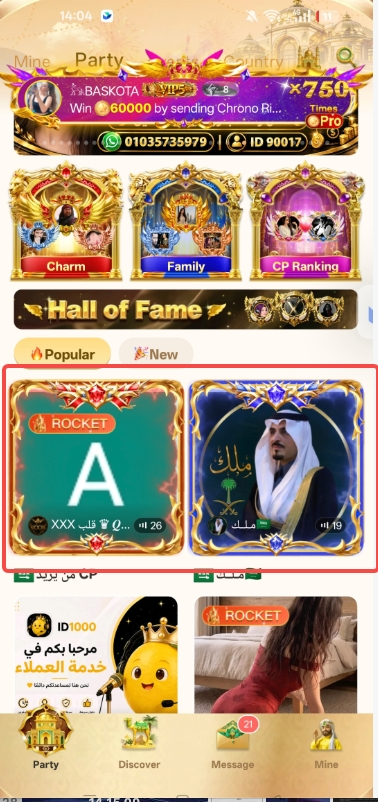
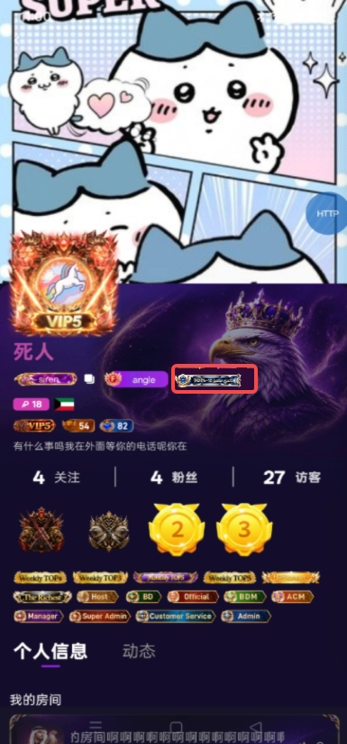

# 荣耀巅峰对决活动\- PRD文档

## 一、 需求背景

- **活动名称：**荣耀巅峰对决

- **活动目的：**提升房间/公会活跃度，刺激用户充值消费（送礼/打赏），通过PK赛级制增强平台内部竞争氛围从而提升整个平台营收流水

- **活动时间：**每周一 00:00:00 开启，当周日 23:59:59 结束（时间为GMT\+3 ），自然周为一个完整活动周期，每周循环开启

- **目标参与用户：**全平台用户

- **目标平台：**iOS / Android双端同步上线

### 1\.1\.   全局规则与名词定义

- 每个周期内包含 3 个赛段：初赛、冲刺赛、总决赛：

    - 初赛（每周一至周三）：海选赛总榜前50名进入初赛

    - 冲刺赛（每周四至周六）：初赛总榜前25名进入冲刺赛

    - 总决赛（每周日）：冲刺赛总榜前10名进入总决赛

    - 各赛段数据活动期间不予清零，统一做累计结算

- **榜单类型：**包含「荣耀榜」、「魅力榜」、「壕气榜」三个独立榜单，互不干扰，独立结算。

- 每个周期内包含 3 个赛段：初赛、冲刺赛、总决赛：

    - 【荣耀殿堂👑】：按照活动期间房间累计流水进行排名统计

    - 【皇后榜👸】：按照活动期间主播累计收礼流水进行排名统计

    - 【国王榜🫅】：按照活动期间用户累计送礼流水进行排名统计

- 同分处理规则：若榜单排行相同，则先达到该排行的用户排名靠前（时间优先原则）

## 二、文档日志

|**期望上线时间**|**版本号**|**需求方**|
|---|---|---|
|2026/11/4|/|Wendy|
||||
||||

## 三\. 需求列表

|**序号**|**功能名称**|**功能概述**|
|---|---|---|
|1|活动入口|1. 活动banner位 2. 房间悬浮窗|
|2  |荣耀巅峰对决|1. 活动为周循环榜单活动，共分为三个结算赛段 - 周一至周三为初赛阶段 - 周四至周六为冲刺赛阶段 - 周日为总决赛 2. 活动每周将根据房间总流水作为统计，当累计流水达成不同档位，房主可解锁领取对应宝箱金币奖励 3. 荣耀殿堂：将按照房间流水作为统计排名，活动结束将于每周一给予上周房间榜前十名房主发放对应榜单奖励 4. 皇后榜：将按照主播收礼金币流水作为统计排名，活动结束将于每周一给予前十名主播对应奖励 5. 国王榜：将按照用户送礼金币流水作为统计排名，活动结束将于每周一给予前十名主播对应奖励 |

## 四\. 功能说明

4\.2 产品流程图

4\.3 原型交互图

原型链接🔗：

UI稿链接🔗：https://mastergo\.com/goto/XeqTSzhr?page\_id=46:04605\&file=208292943409124

**赛段一：「初赛环节」**

**赛段二：「冲刺赛环节」**

**赛段三：「总决赛环节」**

**4\.3\.1\.  巅峰殿堂**

|**所属** **模块**|**页面原型** |**交互说明** |
|---|---|---|
|       活动\-「巅峰殿堂」 |   |  **1️⃣【顶部信息区展示】** - **活动标题：**荣耀巅峰对决 - **活动时间：**每周一 00:00:00 至 周日 23:59:59（GMT\+3） - **活动时间倒计时：**动态显示距离本周活动结束的剩余时间倒计时（按天、时、分、秒进行展示） 2️⃣ 【**规则弹窗**】 点开弹出规则弹窗页面（内容与原型保持一致） 3️⃣ 【**赛段Tab**】 - 分为【初赛】【冲刺赛】【总决赛】，可支持任意切换（选中Tab为高亮状态展示，其他默认置灰）， - 进入活动页切换任意主Tab均默认优先高亮展示【初赛】Tab，每个赛段Tab下方展示该赛段对应的具体日期（例：12\.7\-12\.10为第一赛段时间周期） - **交互：**未开启的赛段 \& 已结束的赛段均支持任意切换Tab并展示对应页面 4️⃣ 【赛段**晋级提示说明】** 原型图中标注的初赛“N进50”为展示预估参与人数\&晋级名次，实际晋级数值需依据具体晋级人数展示） \-冲刺赛\&总决赛展示规则逻辑保持一致 5️⃣【 **当前赛段倒计时提醒 **】 - 动态显示距离当前赛段结束的实时剩余时间（按天、时、分、秒进行展示），格式为：\[X\]天 \[X\]时 \[X\]分 \[X\]秒 - **逻辑：**前端根据当前服务器时间和赛段结束时间实时计算，每秒递减。当前赛段结束时，倒计时重置为下一赛段时间 6️⃣ 【**榜单Tab**】 - 展示【巅峰殿堂】【国王榜】【皇后榜】三个子tab - **状态：**进入活动页默认选中「荣誉榜」高亮展示，其他子Tab置灰 - 点击Tab切换页面下方“排行奖励”及“榜单展示区”数据 7️⃣【**宝箱奖励】** **7\.1\. 规则说明** - **宝箱奖励领取条件：**当房间收入每周（时区为GMT\+3）达到指定宝箱等级，房主将获得对应的宝箱金币奖励 - **发放逻辑：**满足档位条件后，系统将于下周自动发放对应档位金币至房间账户，发放成功推送系统消息提醒 - **周期重置：**每周房间收入进度，收入进度将清零，同时将开启新一轮周期 - **领取限制：**每个等级宝箱，单周周期内仅发奖 1 次；且仅可发放上周达成最高等级宝箱奖励  - 宝箱领取作为单独任务，不与下方榜单做直接关联，即当前房间在赛段晋级中已被淘汰，仍可正常累计计算周流水（即满足达档条件给予正常发放奖励）   **8️⃣【横向宝箱导航栏】** 展示顺序：从左到右依次按照高等级宝箱至低等级宝箱（即Lv8 \~ Lv1）排列 i\.  横向可左右滑动查看所有等级宝箱，点击任意宝箱联动更新下方主宝箱信息详情 ；  ii\.  点击导航栏任意等级宝箱，同步联动刷新下方主宝箱区域，展示对应等级宝箱及房间收入进度达成；   iii\. 默认选中：页面初始化默认展示 Lv1 宝箱； iv\. 主宝箱展示区：大宝箱icon、宝箱等级、奖励数值展示区（当前选中宝箱对应的金币奖励数量，例：120,000金币） \- 左右点击切换箭头展示不同等级宝箱（点击切换上方宝箱导航栏需做联动同步展示）  **9️⃣【房间收入进度达成】** `房间收入达成：{X：当前收入}/{Y：该等级门槛收入}`  - `X：{当前房间总收入}`：统计房间本周累计总收入（GMT\+3 周期内），展示实时数值 - `Y：{该等级奖励领取达标总收入}`：即领取该等级宝箱奖励总房间收入所需达到总金币数 - 示例：选中 Lv8，Lv8 达标总收入4,000,000，当前收入为1000 ，则展示为：`房间收入达成：1000/4,000,000`金币 - 切换上方宝箱等级时，分母“Y”将自动变更为该等级对应奖励达标的门槛值，分子X 是固定本周房间总收入不变 - 数值千分位格式化展示  **【榜单对应排名奖励】** - 展示「巅峰殿堂」榜单前十名房主排行奖励 - 交互形式：可左右横向滑动展示，点击单个奖励可浏览奖励动态详情 - 奖励跟随榜单切页面刷新  🔟【**榜单区域**】： 按照期间内房间榜总收入从高到低进行前五十名排名 - 第一至三名：展示房间头像（需做特殊设计），ID，房间名称，当前房间总收入，具体排名（Top1～Top3） - 第四至五十名：展示房间头像，ID，房间名称，当前房间总收入，具体排名（No\.4\~No\.50），距离上一名还差xx金币 - 点击任意榜单房间头像，可直接跳转至该房主所在房间（如主播不在房则跳转至热门房间） - 当前未创建房间展示：当前未创建房间，未上榜  **“我的”排行区：** - 在前五十名内展示：房间头像，ID，房间名称，当前房间总收入，具体排名，距离上一名还差xx金币 - 不在前五十名展示（但本人已创建房间）：房间头像，ID，房间名称，当前房间总收入，50\+，距离上榜还差xx金币 -  **【榜单状态】：** 若当前赛段初始无人上榜，Top1～Top 3 头像位展示“虚位以待”占位图，榜单下方列表区展示“暂无数据“空状态页 \- \( 皇后榜 \& 国王榜展示逻辑保持一致\)  - 【上周荣耀】：悬浮按钮始终固定，不随中间列表滚动，点击展示上周榜单的总决赛排名数据（即上一周期的历史数据） - 展示逻辑：从活动开启的第二周开始展示（第一周是首期，没有历史数据；第二周开始，每周周期刷新，展示上一周的数据） |
|     赛段Tab切换 | |###  **切换Tab页面状态逻辑：** 状态 1：选中当前进行中赛段Tab - 当前时间处于“初赛”时间内，点击当前时间尚未到达的未来赛段Tab（如冲刺赛或总决赛Tab），页面中下部展示占位空状态：文案“当前赛段待开启，敬请期待\~”  状态 2：当前选中已结束赛段Tab（过去赛段） - 点击当前时间已经结束的过去赛段Tab（如当前在冲刺赛，点击初赛），页面中下部展示占位空状态：文案“当前赛段已结束\~”   |

**4\.3\.2\.  皇后榜 \& 国王榜 **

|**所属** **模块**|**页面原型**|**交互说明**|
|---|---|---|
|      「皇后榜」\&「国王榜」|   | 【**皇后榜**】**区域说明**： 按照活动期间内，主播收礼流水收入从高到低顺序展示前五十名排名  - 第一至三名：展示主播头像（需做特殊设计），ID，房间名称，当前主播总收入数，具体名次（Top1～Top3） - 第四至五十名：展示主播头像，ID，房间名称，当前主播总收入，具体排名（No\.4\~No\.50） - 点击榜单任意主播头像，可直接跳转至该主播所在房间（如主播不在房则跳转至热门房间） -  **“我的”排行区：** - 在前五十名内展示：主播本人头像，ID，昵称，当前总收礼数，具体排名 - 不在前五十名展示：主播本人头像，ID，昵称，当前房间总收入数，50\+， - 当前非主播身份不展示本区域  【**国王榜**】**区域说明**： 按照活动期间内，用户总送礼流水收入从高到低顺序展示前五十名排名 - 第一至三名：展示用户头像（需做特殊设计），ID，房间名称，当前主播总收入数，具体名次（Top1～Top3） - 第四至五十名：展示主播头像，ID，房间名称，当前主播总收入，具体排名（No\.4\~No\.50） - 点击榜单任意用户头像可查看个人名片  **“我的”排行区：** - 在前五十名内展示：用户本人头像，ID，昵称，当前总送礼数，具体排名 - 不在前五十名展示：用户本人头像，ID，昵称，当前用户总送礼数，50\+， - 非用户身份不展示本区域   |

**4\.3\.3\. 上周总决赛排名榜**

|**所属模块**|**页面原型**|**交互说明**|
|---|---|---|
|     上周榜单      |  | 【榜单入口】：点击活动页悬浮的“上周荣耀”按钮唤起。 - 三个Tab可左右切换对应页面，选中Tab默认高亮展示，进入活动页优先展示「荣耀殿堂」 - 弹窗形式：从底部弹出的全屏弹层（带遮罩），点击空白处可关闭。 - 数据属性：展示的是上一周活动结束的静态数据，不随时间实时更新。  榜单排名展示 - 三个榜单分别展示上周前十名榜单排名（前三名需要特殊展示） 「荣誉殿堂」Top1\-10：展示上榜房间头像，ID，昵称，当前房间总送礼数，具体排名 「皇后榜」Top1\-10：上榜主播头像，ID，昵称，当前房间总收礼数，具体排名 「国王榜」Top1\-10：排行用户头像，ID，昵称，当前总送礼数，具体排名  **“我的”排行区：** - 「荣誉殿堂」在前十名内展示：排行房间头像，ID，昵称，当前总送礼数，具体排名 \- 不在前十名展示：本人房间头像，ID，昵称，当前总送礼数，上周排名 \- 不是房主不展示此区域  - 「皇后榜」在前十名内展示：排行主播头像，ID，昵称，当前总送礼数，具体排名 \- 不在前十名展示：主播本人头像，ID，昵称，当前总送礼数，上周排名 \- 不是主播不展示此区域  - 「国王榜」在前十名内展示：排行用户头像，ID，昵称，当前总送礼数，具体排名 \- 不在前十名展示：主播本人头像，ID，昵称，当前总送礼数，上周排名 \- 不是用户不展示此区域 |

## 五\.  活动奖励

- 活动资源配置表详见：[活动奖励表](https://hcnpm5qm8k7q.feishu.cn/wiki/GAWnwJJh2iR15skzyM8cu4Iznsf?from=from_copylink&sheet=kEgHRq)

##### **5\.1\.  宝箱奖励详情（待定）**

|宝箱等级|流水门槛（房间收益）|金币奖励|
|---|---|---|
|LV8|||
|LV7|||
|LV6|||
|LV5|||
|LV4|||
|LV3|||
|LV2|||
|LV1|||

##### **5\.2\.  排行奖励资源详情**

|榜单类型|奖励名次|具体奖励|素材参考|备注|
|---|---|---|---|---|
|    巅峰殿堂 |    第一名 |   房间荣耀边框\*7D 【最强房主】活动标签\*7D Banner位曝光（运营配置） 全服通知📢 |    |  - 房间边框可参照第一张图做设计，颜色UI自由发挥即可 - 勋章样式可做变化和调整，勋章中间需加上【最强房主】称号 \-风格突显荣耀感  \-标签展示按现有排序权重位列最后 活动标签需做三套 聊天气泡做2套 头像框做两套（颜色做区分） 座驾做1套 |
|| 第二\- 四名 |活动标签\*5D 聊天气泡\*5D 头像框\*5D 座驾\*5D|||
|| 第五\-十名|活动标签\*3D 聊天气泡\*3D 头像框\*3D 座驾\*3D|||
|      皇后榜|   第一名 | 「Topstar」活动标签\*7D 「Topstar」头像框\*7D 全服通知📢 座驾\*7D | |  - 勋章和头像框中间需加上「Topstar」称号 \-风格突显华丽风（偏女性化） |
||  第二\- 四名| 活动标签\*5D 头像框\*5D 聊天气泡\*5D 座驾\*5D |  |  活动标签需做三套 聊天气泡做2套 头像框做三套 座驾做一套 |
||  第五\-十名| 活动标签\*3D 头像框\*3D 聊天气泡\*3D 座驾\*3D |||
|     国王榜|  第一名| 最佳贡献TOP1「活动标签」\*7D 荣耀头像框\*7D 全服通知📢 座驾\*7D |   | 活动标签需做三套 头像框需做3套 聊天气泡做2套 座驾做一套|
||  第二\- 四名| 活动标签\*5D 聊天气泡\*5D 头像框\*5D 座驾\*5D |||
||  第五\-十名| 活动标签\*3D 聊天气泡\*3D 头像框\*3D 座驾\*3D |||

##### **5\.3\.** 发奖时间与结算规则

核心发奖时间

- 活动周期统计：每周一 00:00:00 至 每周日 23:59:59（GMT\+3）。

- 数据冻结期：每周日 23:59:59 准时停止计算流水与排名

- 统一发奖时间：下周一（即新周期开始当天）00:00:00 开始批量跑发奖脚本。

- 发放范围：

    - 各阶段达标的金币流水奖励

    - 榜单排名奖励（房间榜/主播榜/用户榜对应的道具奖励等）。

- 发放方式：系统自动发放奖励

##### **5\.4\.** 系统消息

- 系统消息推送：周一 00:00 发奖完成后，系统 IM 推送官方消息（沿用现有通知逻辑）

- ~~背包红点：道具奖励发放成功后，用户“背包”需亮起红点~~

- ~~钱包红点：金币奖励发放后，用户“钱包”需亮起红点~~

---

- 【**金币奖励系统通知】**

恭喜您xxxx\( 房主昵称 \)！在「荣耀巅峰对决」活动中房间收入流水达成 LV\.7（按实际达成档位展示）等级宝箱奖励，金币xxxx （按实际奖励金额展示）金币已到账，请注意查收

- 【**道具奖励系统通知】**

1. 第一名：👑恭喜 \{昵称\} 在「荣耀巅峰对决」活动中荣获上周 \{榜单名称\} 榜首，获得xxx专属座驾\(以实际奖励展示为主\)！”

2. 第二名\-十名：👑恭喜 \{昵称\} 在「荣耀巅峰对决」荣获上周 \{榜单名称\} 第x名，获得xxx专属座驾\(以实际奖励展示为主\)！”

##### **5\.5\.** 【全服公告】

- 触发时间：每周一 00:05:00

- 触发目标对象：上周（周日 23:59:59 结束时）房间榜、主播榜、用户榜，三个榜单的最终第一名（Top 1）

- 播放频次与防刷屏机制：

    - 三个榜主的飘屏需间隔 30 秒依次播放（如 00:05:00 播房间榜，00:05:30 播主播榜，00:06:00 播用户榜）

    - 若某榜首因违规被封禁，该条飘屏直接取消。

    - 若三个榜首是同一个人（比如x是用户榜一，又是某房间的房主），飘屏依然分三次播报，但可以在文案中合并称呼

- 跳转逻辑：支持点击直接跳转至房间

**公告通知文案：**

- 房间榜（荣耀殿堂 ）

👑 荣耀加冕！恭喜房主【\{昵称\}】的【\{房间名称\}】登顶上周荣耀殿堂榜首！

- 主播榜（皇后榜）

👑 荣耀加冕！恭喜主播【\{昵称\}】登顶上周荣耀殿堂「皇后榜」榜首

- 用户榜（国王榜）

👑 荣耀加冕！恭喜用户【\{昵称\}】登顶上周荣耀殿堂「国王榜」榜首

---

## 六 \. 业务规则与逻辑限制

- 数据统计口径：仅统计归属该房间的流水收益。若用户跨房间送礼等，需归属到正确的房间实体上。

- 防作弊机制：系统需有风控策略，剔除异常刷量、自充值退款的虚假流水，违规者取消奖励资格。

- 发奖节点与生命周期：

    - T日（周日 23:59:59）结束；

    - T\+1日（下周一）系统跑批结算；

    - 结算完成后发放到账户，生成系统消息

- 若房主在本周中途开创房间，收益从0开始计算，若房间被封禁则房主累计流水数据将进行清零。

- 禁用/封号状态：若用户处于封禁状态，奖励依然照常发放至背包，但系统消息无法唤起

- 榜单数值展示规则：

|**数值区间 \(真实值\)**|**展示格式**|**示例**|
|---|---|---|
|0 \- 9,999|直接展示，千分位逗号|`9,999` \-\> `9,999`|
|10,000 \- 999,999|K \(千\) / W \(万\)|`125,000` \-\> `125K` `125,000` \-\> `12.5W`|
|1,000,000 \- 999,999,999|M \(百万\)|`8,312,400` \-\> `8.3M`|

- 大小写：英文缩写统一用大写 `K`、`M`、`B`。

## 七 \. 数据埋点相关

|**中文**|**字段定义**|
|---|---|
|每日房间总金币流水|当日所有房间产生的金币流水总和|
|每周房间总金币流水收入|本周所有房间产生的金币流水总和|
|奖励每周发放成功人数|本周成功发放奖励的用户数量（发放成功，不含失败、补发、待发）|
|每日各档位奖励达标房间总数|当日，按奖励档位分组，统计每个档位满足达标条件的房间数量|

###### 事件 1：room\_gold\_flow（房间金币流水事件，服务端埋点）

**埋点时机**：房间内发生金币变动（送礼等金币消耗产生流水时）

|字段名|字段类型|字段说明|
|---|---|---|
|event\_time|string|事件发生时间|
|room\_id|string|房间唯一 ID|
|room\_owner\_id|string|房主 ID|
|user\_id|string|操作用户 ID|
|gold\_amount|bigint|本次流水金币数量|
|room\_status|string|房间状态：online/offline|

###### **事件 2：reward\_issue（奖励发放事件，服务端埋点，核心用于「发放成功人数」）**

**埋点时机**：执行奖励发放结果回调（成功 / 失败都上报）

|字段名|字段类型|字段说明|
|---|---|---|
|event\_time|string|发放时间|
|reward\_id|string|奖励记录 ID|
|user\_id|string|接收奖励用户 ID|
|user\_id|string|关联房间 ID|
|reward\_tier|string|本次流水金币数量|
|flow\_type|string|奖励档位（档位编码，tier1/tier2/tier3）|
|room\_status|string|房间状态：online/offline|
|reward\_gold|bigint|本次发放金币数|
|issue\_type|string|发放类型：normal 正常发放 /reissue 补发|

###### **事件 3：room\_reward\_tier\_check（房间档位达标校验事件，服务端埋点，核心用于【每日各档位奖励达标房间总数】）**

**埋点时机**：每日结算时，校验房间是否满足对应档位奖励达标条件（每日一次结算触发）

|字段名|字段类型|字段说明|
|---|---|---|
|event\_time|string|达标校验时间（结算时间）|
|dt|string|统计日期|
|user\_id|string|接收奖励用户 ID|
|user\_id|string|关联房间 ID|
|reward\_tier|string|本次流水金币数量|
|flow\_type|string|奖励档位（档位编码，tier1/tier2/tier3）|
|room\_status|string|房间状态：online/offline|
|reward\_gold|bigint|本次发放金币数|
|issue\_type|string|发放类型：normal 正常发放 /reissue 补发|
