# 钻石计数器（Diamond Counter）产品需求文档

## 一、文档说明

### 1.1 业务目标

在语聊房内提供限时钻石计数能力，统计用户在有效在麦期间收到的有效钻石，通过麦位计数和房间榜单展示收礼表现，为房间活动及公会内部收礼绩效考核提供数据参考。

本期不与公会绩效系统直接绑定，不自动生成考核结论。

### 1.2 事实来源

| 来源 | 文件/标识 | 用途 |
|---|---|---|
| 业务流程 | `钻石计数器_业务流程图.md` | 业务主链、计数、清零、修改时间、结束、榜单和导出 |
| Axure活源 | `/Users/gorkella/Files/Works/心音/TOP KHALIJ/Axure/礼物计数器.rp` | 页面结构、可见状态和画布旁注 |
| Axure文档ID | `fa1d93c3-62c2-4510-a140-50b3883bcfd7` | 本轮活源标识 |
| 管理视角页面 | `d0dec37a-50d7-4a53-bbf1-023cd94073bc` | 房主/管理员页面 |
| 普通用户页面 | `27836cba-e5bc-4b76-94b6-7dfb6886b74e` | 普通用户只读页面 |

事实源优先级：当前业务流程图中已确认的规则＞当前Axure可见页面及未冲突旁注。原型旧旁注与业务流程冲突时，以业务流程为准并列入原型待同步项；两份材料均未定义的内容不得自行补充。

### 1.3 本期范围

- 所有房间用户可见Diamond Counter入口；
- 房主、管理员配置并开启计数；
- `6h / 12h / 24h`固定时长及1分钟～24小时自定义总时长；
- 运行中倒计时、计划结束时间及修改总计数时长；
- 用户在麦期间有效钻石累计；
- 离麦后保留累计值和参榜资格至本轮结束；
- 普通礼物、幸运礼物、CP结交礼物计数；
- 麦位实时计数；
- 实时Top20、最终Top20和最近一次结果；
- 原生弹窗内嵌H5榜单；
- Clear、自动结束、手动End及结束失败后的人工处置；
- 有数据最终榜单的H5长图导出；
- 房主/管理员和普通用户双视角。

### 1.4 非本期范围

- 多轮历史榜单、筛选和历史导出；
- 第21名及以后榜单展示；
- 实时榜单或空榜单导出；
- 公会绩效系统自动关联；
- 自动结束失败后的自动重试；
- 管理员细分权限配置；
- 修改结束时间历史；
- 人工调整计数或排名；
- 独立后台配置页；
- 数值增长动画和即将结束提醒。

---

## 二、业务模型

### 2.1 核心对象

| 对象 | 定义 | 生命周期 |
|---|---|---|
| 房间计数任务 | 房间内一次独立计数实例 | 未开启→运行中→已结束；结束提交属于服务端内部处理过程，不作为用户可见业务状态 |
| 用户累计记录 | 用户在本轮有效在麦期间收到的有效钻石累计 | 首次有效收礼创建→累计→Clear或最终冻结 |
| 在麦有效区间 | 用户可产生新增计数的时间段 | 成功上麦开始，下麦或退房结束 |
| 实时榜单 | 全部参榜用户排序后截取的前20名 | 运行中持续变化；Clear后重建 |
| 最终榜单 | 完整结束成功后冻结的前20名或空结果 | 保存后不受退款、撤销、冲正影响 |
| 计划结束时间 | 按当前总计数时长计算的预定结束时刻 | 开启时生成；修改总时长后更新 |
| 实际结束时间 | 完整结束最终成功的时刻 | 最终统计、最终榜单和长图使用 |
| 导出快照 | 点击导出时使用的最终Top20冻结结果 | 单次导出生成 |

### 2.2 角色与权限

| 功能 | 房主 | 管理员 | 普通用户 |
|---|---:|---:|---:|
| 查看入口、状态、麦位和榜单 | 是 | 是 | 是 |
| 导出有数据的最终榜单 | 是 | 是 | 是 |
| 配置并Start | 是 | 是 | 否 |
| Clear | 是 | 是 | 否 |
| 修改结束时间 | 是 | 是 | 否 |
| End或重试End | 是 | 是 | 否 |

规则：

1. 操作提交时重新校验身份；打开面板时有权限不代表提交时仍有权限。
2. 本期房主、管理员拥有全部管理操作权限。
3. 由房主配置管理员总权限及Start、Clear、End、修改时间等细分权限属于后续版本。

### 2.3 状态模型

| 状态 | 进入条件 | 状态内行为 | 退出条件 |
|---|---|---|---|
| 未开启 | 无运行中任务 | 可查看入口和最近结果；有权限用户可配置 | Start成功 |
| 运行中 | 任务创建成功，或结束失败后继续运行 | 倒计时、计数、麦位和实时榜单持续更新；服务端可在该状态内执行结束提交 | 完整结束成功 |
| 已结束 | 最终Top20或空结果完整保存 | 停止计数，移除麦位展示，保存最近结果 | 新任务开启 |

本期不设置用户可见的“结束处理中”或“自动重试中”状态。结束处理理论上为短时服务端内部过程，不新增页面、面板状态或前端交互分支；结束成功进入已结束，失败则继续保持运行中。

### 2.4 时间模型

```text
任务有效统计区间 = [开始时间戳, 实际结束时间戳)
用户有效计数区间 = 任务有效统计区间 ∩ 用户各段成功在麦区间
计划结束时间戳 = 开始时间戳 + 当前总计数时长
剩余时长 = max(计划结束时间戳 - 当前服务端时间戳, 00:00:00)
```

- 所有计算、合法性判断和并发裁决依赖服务端时间戳；
- 计划结束时间按查看用户当地时区转换展示；
- 不同用户可能看到不同当地钟点，但实际结束时刻和倒计时一致；
- 修改设备时区只改变展示，不改变任务；
- 导出长图中的实际开始与结束时间固定转换为GMT+3；
- 结束处理开始不等于统计截止；计划结束时间之后、结束成功原子提交之前产生的有效礼物继续计入；进入结束处理后拒绝新的Clear、修改结束时间和重复End请求；
- 服务端以“结束成功原子提交时间”为唯一统计截止点：提交时一次性锁定截止时间、纳入该时间之前已确认到账的有效礼物、冻结累计、生成最终Top20或空结果并更新终态；统计区间不包含截止时刻；
- 截止时间之前到账、但在提交时尚未完成原礼物业务确认的礼物，不进入本轮；截止时间之后完成确认也不追补最终结果；
- 结束失败时任务继续统计至下一次完整结束成功，计划结束时间不等于实际结束时间。

### 2.5 总流程

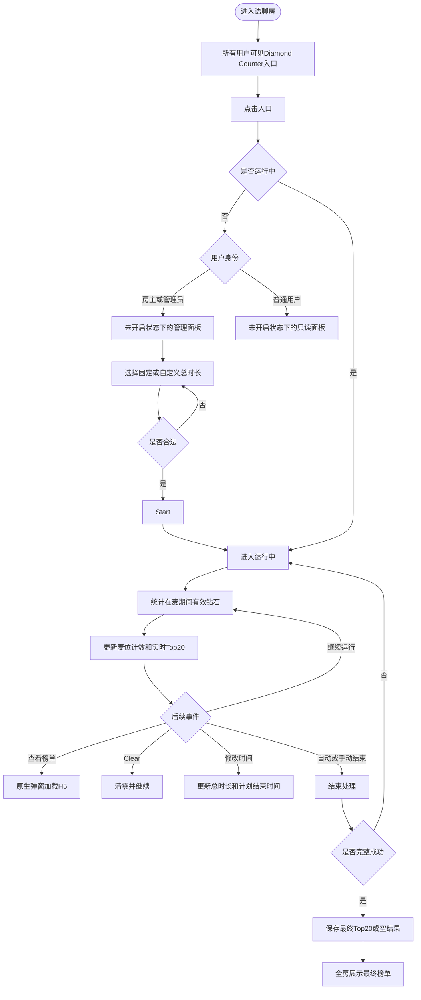

---

## 三、功能入口

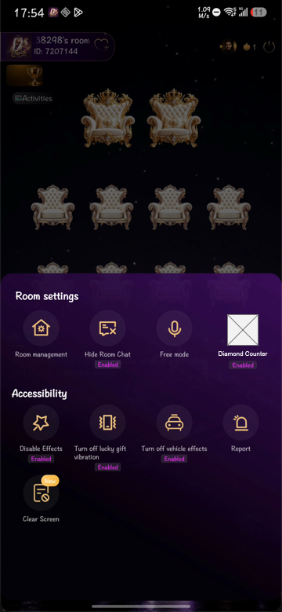

- 入口位于房间设置面板，对所有用户可见。
- 未开启时仅展示功能名称；运行中展示`Enabled`。
- 点击后读取当前任务状态和用户权限，进入对应管理或只读状态。
- 状态获取失败时提示加载失败，不进入错误状态。
- 低版本客户端不展示入口，但不影响服务端任务。

> 原型现状：入口图标仍为占位样式，正式视觉资源待同步。

---

## 四、房主/管理员视角

### 4.1 计数器未开启状态下的管理面板

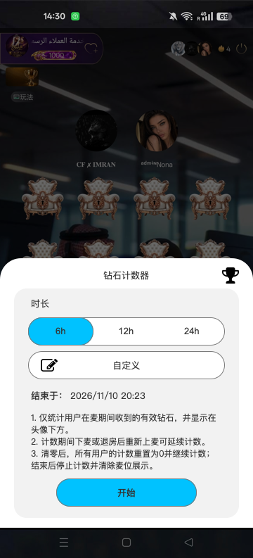

| 区域 | 元素 | 规则 |
|---|---|---|
| 标题栏 | 钻石计数器、榜单奖杯 | 奖杯查看最近一次结果或空态 |
| 时长 | `6h / 12h / 24h` | 同时只选中一个 |
| 自定义 | 编辑图标或确认值 | 打开时间选择器 |
| 时间预览 | `结束于：日期 时间` | 按选中总时长计算，当地时区展示 |
| Rule | 统一Rule | 只读 |
| 底部 | Start | 时长合法且仍有权限时提交 |

交互：

1. 首次进入默认选中`6h`并显示对应计划结束时间。
2. 切换固定时长时实时更新结束时间预览。
3. 自定义仅在Confirm成功后成为选中项。
4. 点击奖杯先展示原生榜单弹窗，再加载H5数据。
5. Start时重新校验权限、任务状态和时长；并发Start只允许一个任务成功。
6. 开启成功仅操作者收到`Diamond Counter已开启`，有人麦位展示钻石图标和`0`。
7. Start成功时，若任一用户已打开榜单弹窗，则关闭当前原生榜单弹窗、重新初始化弹窗并加载本轮实时榜单；未打开榜单的用户不自动弹出。
8. 点击遮罩或系统返回关闭面板，不创建任务。

异常：权限失效则不启动；其他用户已先启动则刷新为运行态；启动失败保留当前选择；重复点击不得重复创建任务。

### 4.2 开启前自定义时长

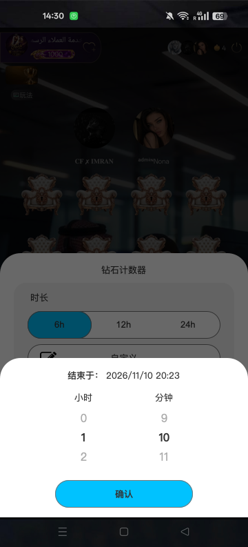

| 元素 | 规则 |
|---|---|
| 结束时间预览 | 随滚轮实时变化，当地时区展示 |
| 小时 | 0～24 |
| 分钟 | 0～59 |
| Confirm | 合法值可提交 |

合法范围：`00h01m～24h00m`；`00h00m`和`24h01m～24h59m`非法。

- 房间首次打开且无历史确认值时默认`6小时0分钟`；
- 有已确认值时回读该值；
- 打开选择器不立即改变主面板原选项；
- 合法值Confirm后保存并选中自定义；
- 点击弹窗外或系统返回，放弃临时值并恢复打开前选项。

### 4.3 已设置自定义时长

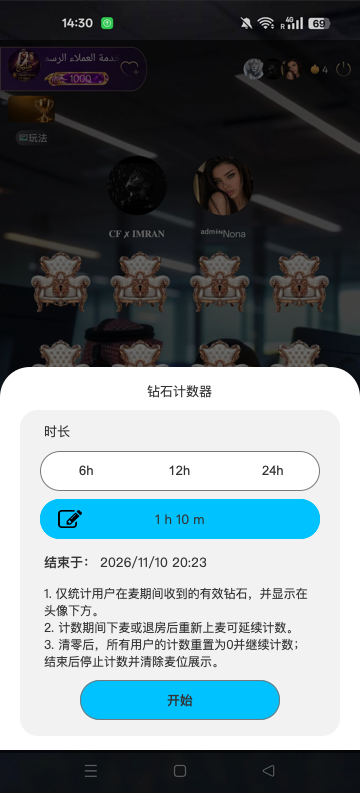

确认后展示自定义选中态、`X h Y m`确认值和对应结束时间。改选固定时长后保留历史自定义值但本次不使用；再次选中自定义时恢复历史值。

> 原型现状：该静态状态完整展示三条Rule，但右上奖杯入口未绘制；完整统一Rule及榜单入口仍以第4.1节和第六章为准。

### 4.4 计数器运行状态下的管理面板

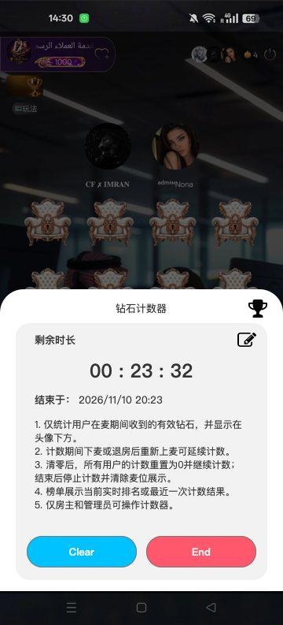

| 元素 | 规则 |
|---|---|
| 榜单奖杯 | 打开原生榜单弹窗并加载H5 |
| 剩余时长 | `hh:mm:ss` |
| 当前总计数时长 | 展示当前生效的任务总时长 |
| 编辑图标 | 修改总计数时长 |
| 计划结束时间 | 当地时区展示 |
| Clear | 打开清零确认 |
| End | 打开结束确认 |

到达计划时间但结束未成功时，倒计时保持`00:00:00`，任务仍为运行中。点击遮罩或系统返回只关闭面板，不影响任务。

### 4.5 运行中修改总计数时长

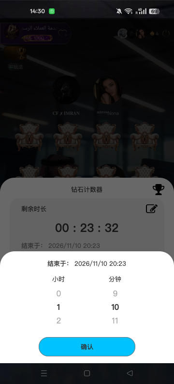

前置条件：任务运行中、服务端尚未开始结束处理、操作者仍为房主或管理员。

| 元素 | 规则 |
|---|---|
| 当前剩余时长 | 当前倒计时 |
| 当前计划结束时间 | 修改前生效时间，当地时区展示 |
| 小时/分钟滚轮 | 回读当前总计数时长 |
| 修改后计划结束时间 | 随滚轮实时计算 |
| Confirm | 合法时进入二次确认 |

```text
修改后计划结束时间戳 = 本轮开始时间戳 + 修改后的总计数时长
本轮已进行时长 = 当前服务端时间戳 - 本轮开始时间戳
```

合法条件：修改后总时长不超过24小时；大于本轮已进行时长；最新计划结束时间晚于当前服务端时间。

- 可延长或缩短；缩短与当前进度冲突时提示`修改后的结束时间必须晚于当前时间`；
- 二次确认正文展示修改后的计划结束时间；
- 成功后全房按最新时间戳刷新倒计时，仅修改者收到`结束时间已修改`；
- 失败时保持原计划时间和倒计时；
- 修改与End/自动结束按服务端先成功者生效；结束处理开始后禁止修改；
- 自动结束失败后允许修改为合法未来时间；
- 本轮已进行满24小时后无法产生合法未来时间，只能手动End。

> 原型待同步：静态示例中当前与修改后结束时间相同，正式实现必须随选择值刷新修改后结束时间。

### 4.6 Clear与End确认

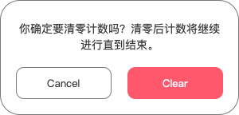

- 文案：`你确定要清零计数吗？清零后计数将继续进行直到结束。`
- Cancel保持原计数；Clear成功后所有用户累计归0，任务和时间不变。

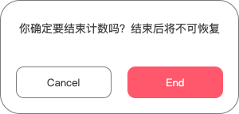

- 文案：`你确定要结束计数吗？结束后将不可恢复`。
- Cancel继续运行；End提交后进入结束处理。

> 原型层级：Clear、End当前仅绘制独立组件，作为组件级证据，不代表完整手机页面。

---

## 五、普通用户视角

### 5.1 计数器未开启状态下的只读面板

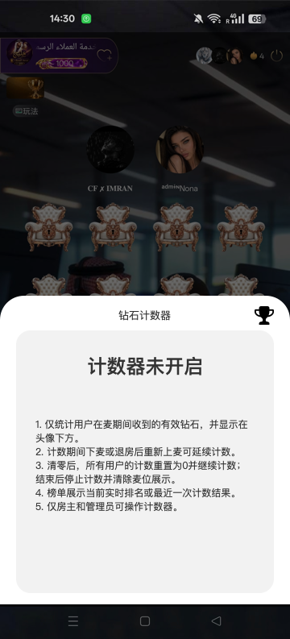

展示标题、榜单奖杯、`计数器未开启`和统一Rule。奖杯查看最近一次结果或空态。不展示时长、Start、Clear、End和修改入口。

### 5.2 计数器运行状态下的只读面板

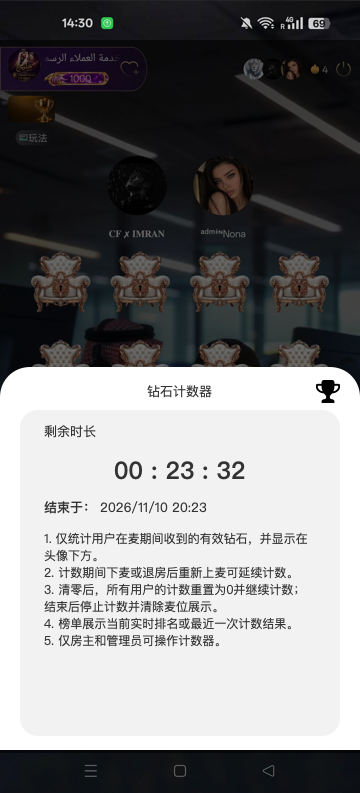

展示标题、榜单奖杯、剩余时长、当地时区计划结束时间和统一Rule。不展示编辑、Clear和End。

| 状态 | 页面表现 |
|---|---|
| 正常运行 | 展示倒计时和计划结束时间 |
| 自动结束失败 | 倒计时`00:00:00`，仍为运行中 |
| 修改时间成功 | 按最新计划结束时间刷新 |
| 结束成功 | 关闭运行态并自动打开最终榜单 |

---

## 六、统一Rule

所有角色和主面板状态统一展示：

1. 仅统计用户在麦期间收到的有效钻石，并显示在头像下方。
2. 用户下麦或退房后停止新增；已累计数值和参榜资格保留至本轮结束，重新上麦后继续累计。
3. Clear后所有用户计数归0并继续；结束后停止计数并清除麦位展示。
4. 榜单展示当前实时排名或最近一次结果，最多前20名。
5. 仅房主和管理员可开启、清零、修改结束时间和结束计数器。

> 当前双视角正式截图已同步为“重新上麦可延续计数”，不再包含10分钟或超时归零规则。管理端开启前状态目前只展示前三条Rule，完整五条Rule仍需在原型中统一。

---

## 七、钻石计数规则

### 7.1 有效计数

计数绑定用户，不绑定固定麦位。换麦只改变展示位置，累计值跟随用户。

一笔钻石必须同时满足：任务尚未完整结束成功；收礼用户到账时在麦；礼物成功且已实际到账；到账时间早于实际结束成功时间；已取得原礼物业务输出的有效统计值；同一到账事件未重复计数。

| 礼物类型 | 计数口径 | 生效时机 |
|---|---|---|
| 普通礼物 | 实际到账钻石 | 成功到账 |
| 幸运礼物 | 直接使用原幸运礼物业务已计算完成的统计值 | 原礼物业务完成计算并成功到账 |
| CP结交礼物 | 关系确认后的实际到账钻石 | 接收者确认关系且最终到账 |

Diamond Counter是原礼物统计结果的呈现功能，不在计数器内重复定义或执行幸运礼物的比例、精度、取整及逐笔换算规则。计数器只累计原幸运礼物业务输出的最终有效统计值，不改变用户真实资产。

CP礼物按最终到账时判断：邀请待确认、拒绝、过期或取消不计；发起时在麦但到账时下麦不计；发起时未开启但到账时任务运行且接收者在麦则计；任务结束后到账不计。

### 7.2 离麦与累计保留

- 下麦或退房立即停止新增并隐藏原麦位计数；
- 离麦期间收礼不计入，也不补记；
- 不限制离麦时长；
- 已累计值和参榜资格保留至本轮结束；
- 本轮结束前重新上麦，在新麦位恢复原累计并继续统计；
- 换麦不清零、不复制。

### 7.3 退款、撤销和冲正

有效礼物计入后，退款、撤销或资产冲正不回退运行中计数，不重排实时榜单，不修正最终结果和最近一次结果。该规则仅约束Diamond Counter，不改变资产系统自身处理。

### 7.4 用户计数流程

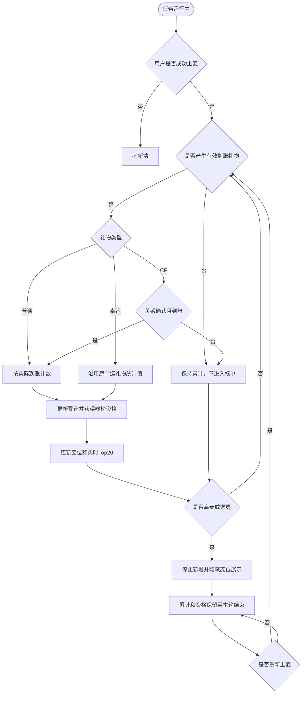

---

## 八、麦位展示


| 麦位状态 | 展示 |
|---|---|
| 有人且累计0 | 钻石图标＋`0` |
| 有人且有累计 | 钻石图标＋格式化值 |
| 无人 | 不展示钻石图标和数额 |
| 下麦或退房 | 原麦位立即隐藏 |
| 重新上麦 | 新麦位恢复原累计 |
| 结束成功 | 全部移除 |

数值小于1,000展示原值；1,000以上依次使用K/M/B。最多两位小数，直接截断不四舍五入，并移除末尾无意义的0。K/M/B仅影响麦位显示；榜单排序始终使用原始值。

---

## 九、Clear

Clear将本轮所有用户累计归0，但不结束任务。

成功后：所有用户退出实时榜单；有人麦位显示钻石图标和`0`；离麦用户保留累计也归0；开始时间、总时长、计划结束时间和倒计时不变；`Enabled`继续；全房提示`Diamond Counter已由{用户名}清零`；后续有效收礼重新获得参榜资格；上一轮最终结果不受影响。

Clear成功时：

- 若用户未打开榜单，不自动弹出榜单；
- 若用户已打开榜单，关闭当前原生榜单弹窗、重新初始化弹窗并重新加载清零后的最新H5实时榜单；
- 重启后的榜单展示`暂无数据`且不展示导出按钮，不沿用清零前的榜单数据。

失败时全部数据保持不变，不允许部分成功；仅操作者收到`清零失败`。

Clear与礼物到账、End的并发规则：

- 服务端一旦进入结束处理，立即拒绝新的Clear请求；
- Clear先成功时，后续End按清零后的累计生成结果；
- 礼物跨越Clear边界时，以原礼物业务记录的到账时间归属Clear前或Clear后；
- 到账时间早于Clear成功时间的礼物属于清零前数据并被清除；到账时间不早于Clear成功时间的礼物计入清零后的新累计；
- 同一礼物事件只能归属Clear前或Clear后其中一侧，不得重复计入。

---

## 十、榜单

### 10.1 承载和打开流程

榜单采用“原生弹窗容器＋内嵌H5榜单”。原生负责遮罩、Loading、关闭、系统返回、加载失败、保存和分享；H5负责业务信息、Top20、空态、导出按钮和长图生成。

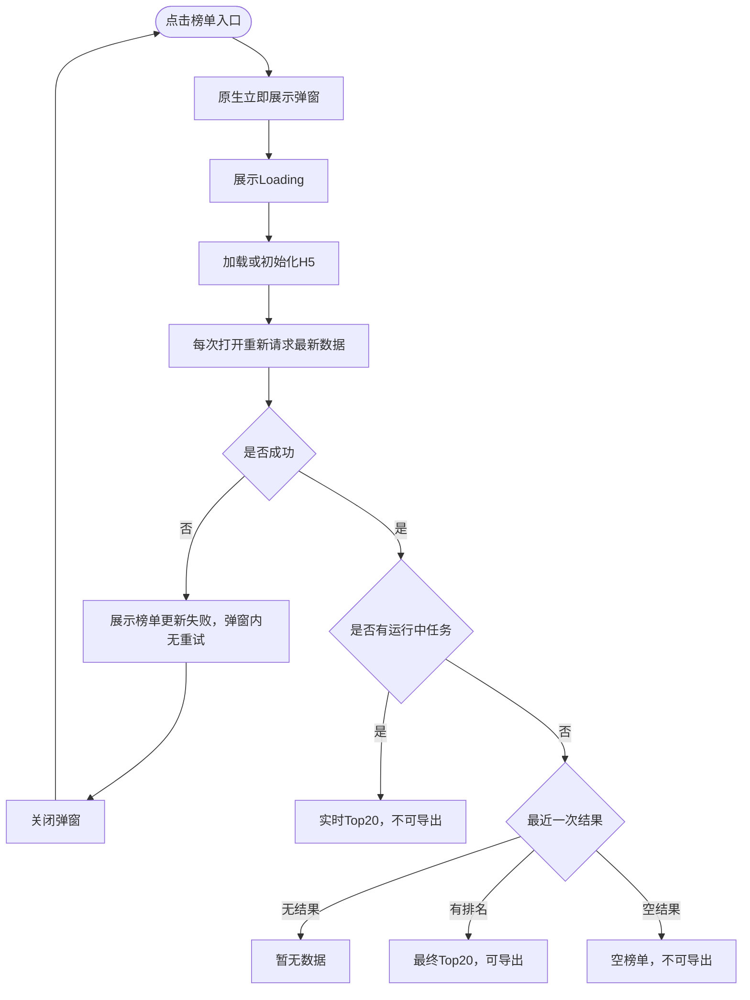

每次打开必须刷新业务数据；H5静态资源可缓存，但不得直接展示上次业务数据。请求失败不等于空态，不展示旧实时榜单冒充最终榜单；用户只能关闭弹窗后重新点击入口加载。

当用户停留在榜单弹窗期间，计数器发生Start成功、Clear成功或End成功时，均关闭当前原生榜单弹窗并重新初始化弹窗，再加载对应状态下的最新H5数据；不得只在原H5内局部刷新。End成功且用户正在导出上一轮最终榜单时，按第十一章规则等待导出进入成功或失败终态后再重启弹窗。

> 当前双视角原型旁注已同步为“先展示原生弹窗，再加载H5榜单数据”；Start、Clear、End成功时按本节规则关闭并重启原生榜单弹窗。

### 10.2 有数据榜单

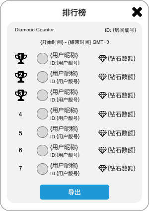

榜单字段和布局以当前原型为准，包括：排行榜标题、时间范围、排名、用户头像、用户昵称、用户靓号和完整钻石数。前三名使用金银铜样式，其余使用数字；超长昵称省略。点击用户信息进入资料页。导出按钮仅在有数据最终榜单展示。

榜单时间统一使用GMT+3：

- 实时榜单展示`实际开始时间 - 最新计划结束时间（当前总计数时长）`；
- 最终榜单展示`实际开始时间 - 实际结束成功时间（最终总计数时长）`；
- 时间范围不按查看用户当地时区转换；GMT+3仅约束榜单及导出，主面板计划结束时间仍按用户当地时区展示。

### 10.3 空态

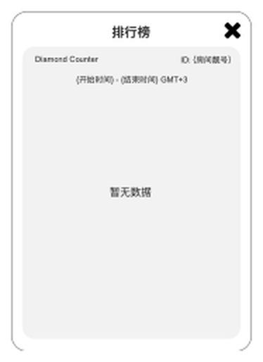

无运行任务且无最近结果、运行中暂无参榜用户、Clear后暂无新有效收礼、最近一次结果为空，均展示`暂无数据`；空榜单不展示导出按钮。

> 当前双视角空态文案已同步为`暂无数据`。原型空态组件的外层边框底部中央为开放式样式；正式配图忠实保留当前源画面，不视为截图裁切。

### 10.4 参榜与排序

参榜条件：本轮成功上过麦；在麦期间收到过有效礼物；Clear后的累计值大于0。仅上麦但未有效收礼不参榜；离麦后已取得的资格保留。

```text
全部参榜用户
→ 有效钻石原始值降序
→ 同值时先达到当前累计值者优先
→ 达到时间仍相同时按用户ID从小到大
→ 截取前20名
```

必须先对全部参榜用户排序，再截取Top20；不足20人按实际人数展示；第21名及以后不展示。实时和最终榜单使用同一规则。

“达到当前累计值时间”以服务端记录本次累计结果成功的时间为准；每次累计值变化时更新。Clear成功后，原达到时间随累计值一并清除，用户产生新的有效累计时重新记录。

---

## 十一、结束与结果

到达最新计划结束时间自动尝试结束；房主或管理员也可End并二次确认。

完整结束成功以一次原子提交完成：锁定统计截止时间及该时点前已确认到账的有效礼物、冻结累计、生成并保存最终Top20或空结果、将任务更新为已结束。任一步失败则整次提交失败，不产生部分最终结果，任务继续保持运行中。

成功后记录实际结束时间；停止新增；隐藏`Enabled`；移除麦位钻石；保存本轮结果并替换上一轮结果；全房在线用户打开或重启原生榜单。结果有排名时展示最终Top20和导出按钮，无排名时展示空榜单且无导出按钮。

结束成功触发最终榜单时：

- 用户未打开榜单：直接打开最终榜单弹窗；
- 用户已打开榜单但未导出：关闭当前弹窗并重新初始化榜单弹窗，再请求和展示最终榜单，不叠加第二个弹窗；
- 用户正在导出上一轮最终榜单：不打断导出；待本次导出成功或失败进入终态后，再关闭并重新初始化榜单弹窗，加载本轮最终榜单；
- 重启弹窗时必须重新请求本轮最终数据，不沿用弹窗重启前的实时榜单或上一轮结果。

结束失败后：恢复运行中；继续累计有效钻石；倒计时保持`00:00:00`；`Enabled`、麦位和实时榜单继续；不展示半成品、不覆盖上一轮；不自动重试；房主或管理员可重试End或修改为合法未来结束时间。

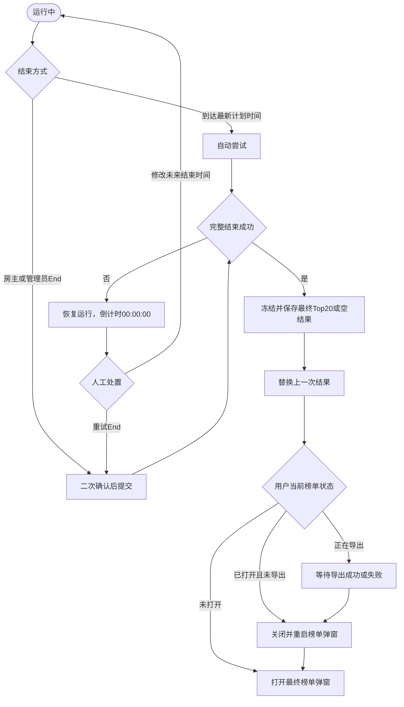

系统只保留当前运行任务和最近一次完整结束成功的结果。新一轮完整结束后，无论有排名还是空结果，都替换上一轮；不提供更早历史结果。

---

## 十二、最终榜单长图导出

所有用户均可导出，但仅有数据的最终榜单展示导出按钮；实时榜单、空榜单、Loading和失败态不可导出。

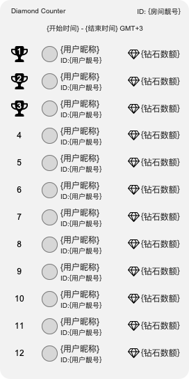

> 原型长图仅示意至第12名；正式导出必须按最终Top20快照生成完整内容，不以示意行数为业务上限。

长图只保留H5榜单UI，不含原生弹窗外框、关闭按钮、遮罩、房间底图、手机状态栏、系统导航、导出按钮、Loading和失败提示。榜单外只展示：

```text
Diamond Counter
Room ID：{房间ID}
{实际开始时间} - {实际结束时间} GMT+3
```

使用实际开始时间和实际结束成功时间；不展示房间名称、计划结束时间、导出时间、修改历史或导出用户。

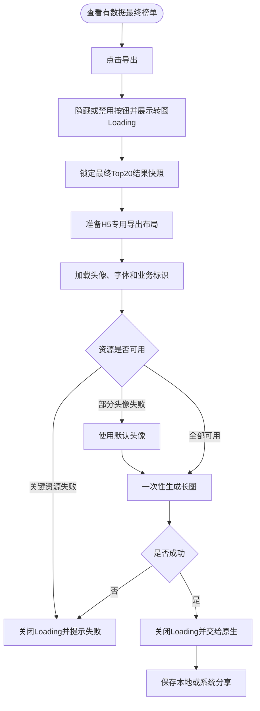

Loading覆盖快照锁定、布局准备、资源加载和生成全过程，持续到成功、失败或用户取消。失败提示`图片生成失败，请重试`并恢复按钮；生成中关闭榜单则取消任务、关闭Loading并忽略迟到结果。

每次导出使用一次冻结快照，不对滚动中的WebView逐屏截图拼接；H5以专用导出布局一次性生成。头像失败使用默认头像，不阻断整图。

---

## 十三、异常与并发

| 场景 | 处理 |
|---|---|
| 多人同时Start | 只允许一个任务创建成功 |
| 多人同时End | 先进入结束处理者生效 |
| Clear与End | 进入结束处理后拒绝Clear；Clear先成功则End按清零后数据生成结果 |
| 礼物跨越Clear | 按原礼物业务记录的到账时间归属Clear前后 |
| 修改时间与结束 | 结束处理前按先成功者生效；处理开始后禁止修改 |
| 榜单打开期间Start成功 | 关闭并重启原生榜单弹窗，加载本轮实时榜单 |
| 榜单打开期间Clear成功 | 关闭并重启原生榜单弹窗，加载清零后的实时空榜单 |
| 用户断网或退出App | 任务继续；重进读取最新状态 |
| 房间无人 | 倒计时、任务和自动结束继续 |
| 离麦期间收礼 | 不计入、不补记 |
| 自动结束失败 | 继续运行和计数，不自动重试 |
| H5加载/请求失败 | 弹窗内无重试；关闭后重新打开 |
| 最终榜单加载失败 | 不展示旧实时数据 |
| 长图失败 | 关闭Loading并恢复按钮 |
| 导出中关闭弹窗 | 取消导出并忽略迟到结果 |
| 结束成功时榜单已打开 | 未导出则关闭并重启弹窗；导出中则等待导出终态后再重启 |
| 修改设备时区 | 仅重新转换UI时间，不改变任务 |
| 权限被撤销 | 管理操作失败并刷新为只读视角 |
| 低版本客户端 | 不展示入口和麦位计数，不影响服务端任务 |

---

## 十四、反馈文案

| 场景 | 文案 | 对象 |
|---|---|---|
| 开启成功 | `Diamond Counter已开启` | 操作者 |
| 清零确认 | `你确定要清零计数吗？清零后计数将继续进行直到结束。` | 操作者 |
| 清零成功 | `Diamond Counter已由{用户名}清零` | 全房 |
| 清零失败 | `清零失败` | 操作者 |
| 修改确认 | `确认修改本轮计数时长吗？修改后将按新的结束时间继续计数。` | 操作者 |
| 修改成功 | `结束时间已修改` | 修改者 |
| 修改冲突 | `修改后的结束时间必须晚于当前时间` | 修改者 |
| 结束处理中修改 | `任务正在结束，无法修改` | 修改者 |
| 结束确认 | `你确定要结束计数吗？结束后将不可恢复` | 操作者 |
| 结束失败 | `结束失败` | 操作者 |
| 榜单失败 | `榜单更新失败` | 查看用户 |
| 空态 | `暂无数据` | 查看用户 |
| 生成中 | `正在生成图片…` | 导出用户 |
| 生成失败 | `图片生成失败，请重试` | 导出用户 |

所有用户可见文案接入多语言资源。

---

## 十五、原型旁注覆盖与待同步

### 15.1 已覆盖

| 旁注意图 | PRD位置 |
|---|---|
| 所有用户可见入口 | 二、三 |
| 固定/自定义时长及回读 | 四 |
| 结束时间预览 | 二、四、五 |
| 运行中修改时长 | 四 |
| 麦位有人展示、无人隐藏、K/M/B | 七、八 |
| Clear、End确认 | 四、九、十一 |
| 榜单业务名、房间ID、用户靓号 | 十 |
| 导出按钮、Loading和长图内容 | 十二 |

### 15.2 原型待同步

| 原型当前内容 | 正式规则 |
|---|---|
| 管理端开启前状态仅展示前三条Rule，运行态和普通用户状态展示五条 | 所有角色和主面板状态统一使用第六章五条Rule |
| 已设置自定义时间状态未绘制右上奖杯入口 | 与其他未开启管理面板一致展示榜单入口 |
| 修改前后结束时间示例相同 | 修改后时间随滚轮实时变化 |
| 导出长图示意12名 | 正式导出最终Top20 |
| 有数据榜单静态示意7名，普通用户榜单字段尚未完全同步用户靓号 | 正式H5最多Top20并支持滚动；双视角字段均以第十章为准 |
| 运行中管理面板未单独显示当前总计数时长 | 正式页面需展示当前生效总计数时长 |
| 当前榜单组件使用房间靓号，导出口径写Room ID | 房间ID与房间靓号字段关系需在原型中统一；正式导出按第十二章Room ID执行 |

---

## 十六、业务流程索引

完整流程见`钻石计数器_业务流程图.md`：业务总览、用户计数、Clear、修改结束时间、结束与结果、榜单查看、最终榜单导出及双视角结果。

## 十七、后续版本

- 房主配置管理员Diamond Counter总权限；
- Start、Clear、End和修改结束时间细分权限；
- 长图业务标识和视觉布局后续按新原型优化。
