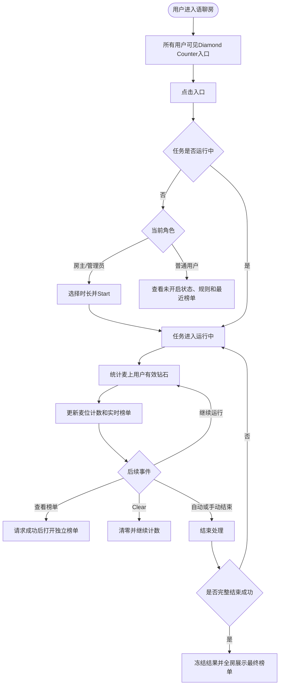
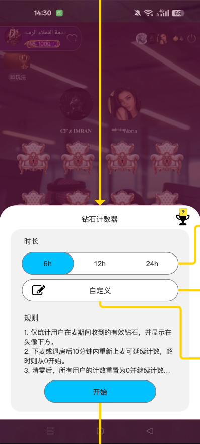
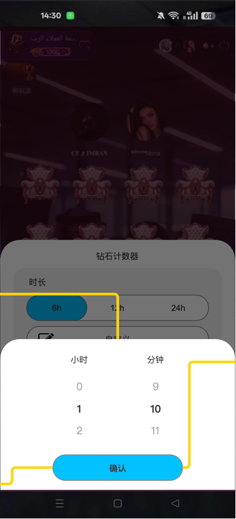
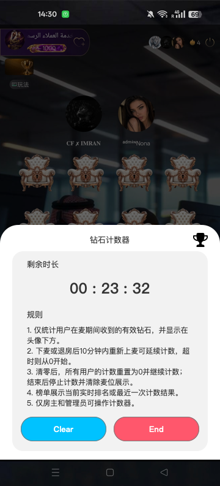
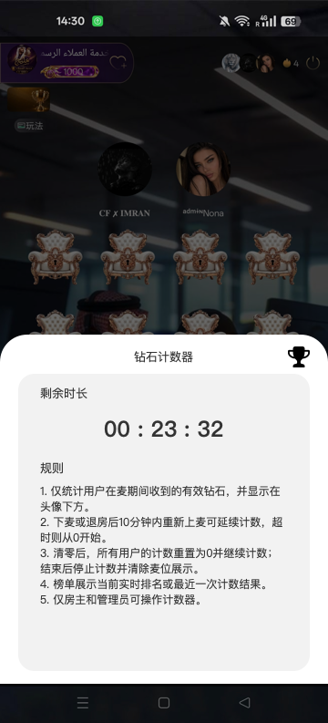
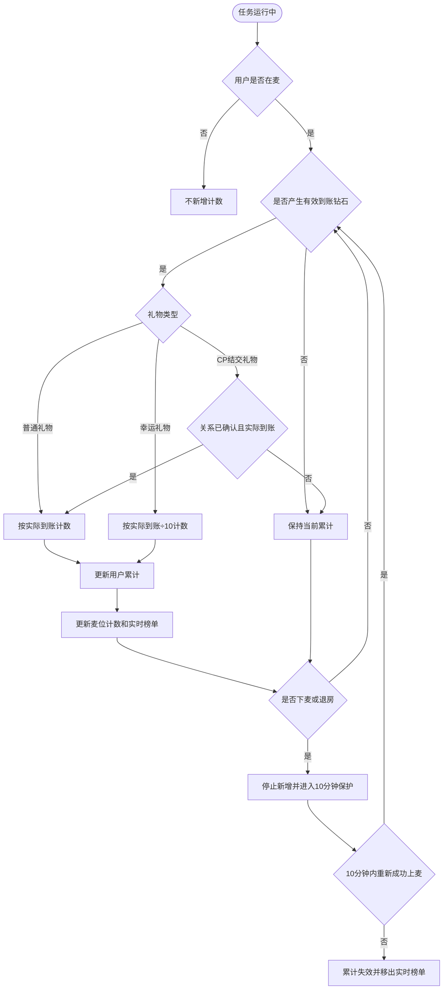
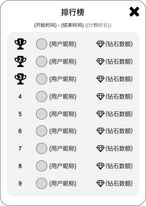
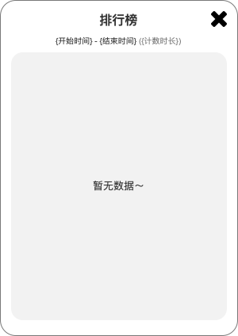
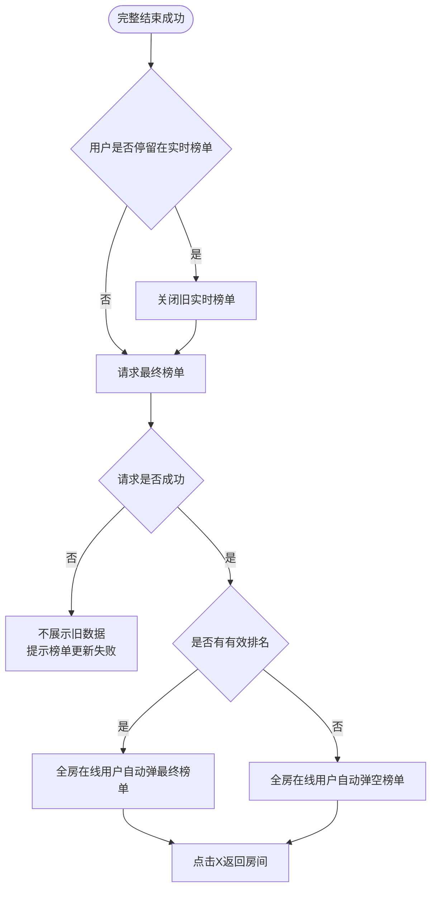

# 钻石计数器（Diamond Counter）产品需求文档

## 一、文档说明

### 1.1 业务目标

在语聊房内提供限时钻石计数能力，统计用户在有效在麦期间收到的有效钻石，并通过麦位计数与房间榜单展示收礼表现。

该功能可用于房间娱乐竞争，也可作为公会内部绩效考核的辅助工具；本期不与公会绩效系统直接绑定，不自动生成公会考核结果。

### 1.2 事实来源

| 来源 | 文件/标识 | 用途 |
|---|---|---|
| 业务建模与流程 | `钻石计数器_业务流程图.md` | 业务主链、计数口径、清零、结束、榜单及双视角结果 |
| Axure活源 | `/Users/gorkella/Documents/Axure/TOP KHALIJ/礼物计数器.rp` | 页面结构、状态、可见控件和画布旁注 |
| 房主/管理员页面 | `d0dec37a-50d7-4a53-bbf1-023cd94073bc` | 配置、开启、运行、清零、结束、榜单及麦位计数 |
| 普通用户页面 | `27836cba-e5bc-4b76-94b6-7dfb6886b74e` | 计数器未开启状态下的只读面板、计数器运行状态下的只读面板和榜单查看 |

本PRD使用的事实优先级：

1. 当前业务流程中已经明确的业务规则；
2. 当前Axure原型可见页面和画布旁注；
3. 两者未定义的边界进入待确认事项，不自行补充。

### 1.3 本期范围

- 房间设置中的Diamond Counter入口；
- 房主、管理员配置并开启计数；
- `6h / 12h / 24h`固定时长和自定义时长；
- 运行中倒计时；
- 用户在麦期间的有效钻石累计；
- 下麦或退房后的10分钟累计保护；
- 普通礼物、幸运礼物、CP结交礼物计数；
- 麦位实时计数展示；
- 当前实时榜单和最近一次结果榜单；
- 运行中清零；
- 自动结束、手动结束、结束失败后的重试；
- 房主/管理员与普通用户双视角。

### 1.4 非本期范围

- 多轮历史榜单及历史筛选；
- 榜单导出；
- 与公会绩效系统自动关联；
- 运行中修改或延长时长；
- 数值增长动画；
- 即将结束提醒；
- 人工修改计数结果；
- 独立的后台配置页面。

---

## 二、业务模型

### 2.1 核心对象

| 对象 | 业务定义 | 主要生命周期 |
|---|---|---|
| 房间计数任务 | 某房间内一次独立的钻石计数实例 | 未开启 → 运行中 → 结束处理中 → 已结束；失败后继续运行 |
| 用户累计记录 | 用户在本轮任务中的有效钻石累计值 | 创建 → 累计 → 清零/保护 → 失效或冻结 |
| 在麦有效区间 | 用户允许产生有效计数的时间范围 | 成功上麦开始，下麦或退房结束 |
| 累计保护 | 下麦或退房后保留累计值的10分钟窗口 | 进入保护 → 恢复累计或超时失效 |
| 实时榜单 | 当前任务运行期间的用户排名 | 随有效计数变化；清零后重新形成 |
| 最终榜单 | 本轮完整结束成功后冻结的排名结果 | 生成并保存后不可被运行态继续修改 |
| 最近一次结果 | 无运行任务时可查看的最近一轮成功结果 | 被下一轮成功结果替换；空结果替换规则待确认 |

### 2.2 角色

| 角色 | 业务职责 |
|---|---|
| 房主 | 配置、开启、清零、结束计数；查看麦位和榜单 |
| 管理员 | 与房主具备相同的计数器操作权限 |
| 普通用户 | 查看计数器状态、麦位计数、规则和榜单，不可改变任务 |
| 系统 | 维护任务时间、累计有效钻石、生成排名、自动结束并保存结果 |

### 2.3 权限矩阵

| 功能 | 房主 | 管理员 | 普通用户 |
|---|---:|---:|---:|
| 查看功能入口 | 是 | 是 | 是 |
| 查看运行状态 | 是 | 是 | 是 |
| 查看麦位钻石 | 是 | 是 | 是 |
| 查看实时/最近榜单 | 是 | 是 | 是 |
| 查看时长选择 | 是 | 是 | 否 |
| 开启计数 | 是 | 是 | 否 |
| 清零计数 | 是 | 是 | 否 |
| 手动结束 | 是 | 是 | 否 |
| 结束失败后手动重试 | 是 | 是 | 否 |

权限规则：

1. 入口对所有房间用户可见。
2. 时长选择、Start、Clear和End仅对房主、管理员展示。
3. 用户身份在操作提交前发生变化时，以提交时身份为准。
4. 隐藏操作按钮不替代权限校验；无权限用户不得通过其他方式执行操作。

### 2.4 任务状态

| 状态 | 进入条件 | 状态内行为 | 退出条件 |
|---|---|---|---|
| 未开启 | 房间不存在运行中任务 | 可查看入口、规则和最近结果；有权限用户可配置时长 | 开启成功 |
| 运行中 | 任务创建成功或结束失败 | 倒计时、计数、麦位展示和实时榜单持续更新 | 完整结束成功 |
| 结束处理中 | 到时自动结束或有权限用户确认End | 截止并尝试冻结数据、生成结果 | 成功进入已结束；失败恢复运行中 |
| 自动重试中 | 自动结束失败且仍允许自动重试 | 任务继续运行并继续计数 | 重试成功或自动重试耗尽 |
| 等待手动重试 | 自动重试耗尽 | 继续运行；房主、管理员可再次End | 手动结束成功 |
| 已结束 | 最终结果生成并保存成功 | 停止计数、清除麦位钻石、展示最终榜单 | 新任务开始时进入新一轮运行状态 |

### 2.5 时间模型

| 时间 | 定义 | 业务用途 |
|---|---|---|
| 开始时间 | 任务成功开启的时间 | 本轮统计起点 |
| 配置时长 | 开启前确认的固定或自定义时长 | 计算计划结束时间、榜单时间信息 |
| 计划结束时间 | 开始时间＋配置时长 | 触发首次自动结束 |
| 实际结束时间 | 完整结束成功的时间 | 最终统计截止点、结果展示 |
| 用户上麦时间 | 用户成功进入麦位的时间 | 用户有效计数区间起点 |
| 用户下麦/退房时间 | 用户成功离开麦位或房间的时间 | 停止新增并启动10分钟保护 |

```text
任务有效统计区间 = [开始时间, 实际结束时间)
用户有效计数区间 = 任务有效统计区间 ∩ 用户各段成功在麦区间
```

时间规则：

- 倒计时和任务结束以统一时间口径为准，客户端本地时间只负责展示；
- 结束失败时，计划结束时间不等于实际结束时间；
- 任务在结束失败后继续运行，因此计划结束时间之后产生的有效钻石继续计入；
- 最终结果使用实际结束时间，不以原计划时间截断。

### 2.6 业务总流程



---

## 三、页面结构与入口

### 3.1 Diamond Counter功能入口


#### 页面定位

入口位于房间设置面板，作为所有用户进入钻石计数器主面板的统一入口。

#### 前置条件

- 用户已进入语聊房；
- 当前客户端版本支持Diamond Counter。

#### 页面字段

| 元素 | 展示规则 | 操作结果 |
|---|---|---|
| Diamond Counter图标 | 所有房间用户可见 | 点击进入主面板 |
| 功能名称 | 固定展示 | 无 |
| Enabled | 任务运行中时展示；未运行时隐藏 | 只表达状态，不承载操作 |

#### 交互逻辑

1. 点击入口时读取房间当前任务状态和用户当前权限。
2. 房主、管理员进入管理视角；普通用户进入只读视角。
3. 房主、管理员根据任务状态进入“计数器未开启状态下的管理面板”或“计数器运行状态下的管理面板”。
4. 普通用户根据任务状态进入“计数器未开启状态下的只读面板”或“计数器运行状态下的只读面板”。
5. 入口本身不展示排名或钻石数。

#### 状态定义

| 状态 | 页面表现 |
|---|---|
| 未开启 | 仅展示功能名称 |
| 运行中 | 功能名称下方展示`Enabled` |
| 状态获取失败 | 不进入错误状态面板，提示加载失败后允许重试 |

> 原型现状：当前入口图标仍为占位样式。本PRD按当前活源保留，不将占位图视为最终视觉资源。

---

## 四、房主/管理员视角

### 4.1 计数器未开启状态下的管理面板



#### 页面定位

用于房主、管理员在任务未运行时选择时长、查看规则并开启计数。

#### 前置条件

- 当前房间无运行中的Diamond Counter；
- 当前用户在进入面板时为房主或管理员。

#### 页面字段

| 区域 | 元素 | 展示/操作规则 |
|---|---|---|
| 标题栏 | 钻石计数器 | 固定展示 |
| 标题栏 | 榜单奖杯 | 点击后查看最近一次结果或空态 |
| 时长 | 6h、12h、24h | 同一时间只选中一个 |
| 自定义 | 编辑图标或已确认时长 | 点击打开时间选择器 |
| Rule | 统一规则文案 | 只读 |
| 底部 | Start | 时长有效且当前仍有权限时可提交 |

#### 统计/计算口径

```text
计划结束时间 = 开始成功时间 + 已确认配置时长
```

固定时长和自定义时长属于同一单选组，不叠加计算。

#### 交互逻辑

1. 用户选择固定时长时，取消其他时长的选中状态。
2. 用户点击自定义区域时打开自定义时间选择器。
3. 用户点击榜单奖杯时，先请求榜单；成功后再打开独立榜单弹窗。
4. 用户点击Start时重新校验角色、任务状态和时长合法性。
5. 开启成功后切换到“计数器运行状态下的管理面板”。
6. 点击面板外遮罩或使用系统返回关闭面板，返回房间页面；关闭面板不创建任务。

#### 业务处理规则

- 同一房间同一时间只允许存在一个运行中任务；
- 多个有权限用户同时Start时，只生成一个有效任务；
- 开启成功后，仅开启操作者收到`Diamond Counter已开启`提示；
- 有人麦位开始展示钻石图标和数额；无人麦位不展示。

#### 异常与边界

| 场景 | 处理 |
|---|---|
| 提交时权限已失效 | 不开启，提示无操作权限 |
| 已被其他用户先开启 | 返回当前真实运行状态并切换到“计数器运行状态下的管理面板” |
| 开启失败 | 保持“计数器未开启状态下的管理面板”，保留当前已选时长 |
| 重复点击Start | 不重复创建任务 |

### 4.2 自定义时间选择器



#### 页面定位

用于在固定时长之外选择小时和分钟。

#### 前置条件

- 用户拥有管理权限；
- 当前任务未开启；
- 用户从“计数器未开启状态下的管理面板”点击自定义选项。

#### 页面字段

| 元素 | 范围/文案 | 规则 |
|---|---|---|
| 小时滚轮 | 0～24 | 逐小时选择 |
| 分钟滚轮 | 0～59 | 逐分钟选择 |
| Confirm | 确认 | 合法时长可提交；非法时不可提交 |

#### 合法范围

| 场景 | 是否合法 |
|---|---:|
| `00h00m` | 否 |
| `00h01m～23h59m` | 是 |
| `24h00m` | 是 |
| `24h01m～24h59m` | 否 |

#### 交互逻辑

1. 打开选择器时不立即改变主面板原选中时长。
2. 房间首次使用且从未确认过自定义时长时，首次打开默认展示`6小时0分钟`，与当前最小固定时长`6h`保持一致。
3. 已存在确认过的自定义时长时，重新打开选择器回读该值。
4. 合法值点击Confirm后，保存该值、关闭选择器并选中自定义项。
5. 非法值不允许确认，选择器保持打开。
6. 点击选择器外部或使用系统返回关闭时，不保存临时滚轮值，并恢复打开前的时长选中状态。

#### 状态定义

| 状态 | 页面表现 |
|---|---|
| 初始 | 展示小时、分钟滚轮及当前值 |
| 合法 | Confirm可用 |
| 非法 | Confirm不可提交 |
| 已确认 | 返回主面板并展示自定义时长 |
| 已取消 | 返回主面板并恢复原选中项 |

### 4.3 已设置自定义时长


#### 页面定位

表示用户已经确认合法自定义时长，并返回“计数器未开启状态下的管理面板”。

#### 页面字段

| 元素 | 展示规则 |
|---|---|
| 自定义选项 | 切换为选中态 |
| 时长值 | 按`X h Y m`或等价多语言格式展示 |
| 编辑图标 | 继续展示，允许再次编辑 |
| Start | 使用当前确认的自定义时长开启 |

#### 交互逻辑

- 再次点击自定义选项时回读当前值；
- 改选固定时长后，自定义历史值仍保留，但不参与本次开启；
- 只有再次选中自定义后，历史值才作为本次配置时长。

> 原型差异：当前静态状态未绘制标题栏奖杯，且Rule首句在源控件中被截断。正式功能仍沿用“计数器未开启状态下的管理面板”的完整标题栏和统一Rule，本图只用于证明自定义选中及回填状态。

### 4.4 计数器运行状态下的管理面板



#### 页面定位

用于房主、管理员查看剩余时间、打开实时榜单、清零或结束任务。

#### 前置条件

- 房间存在运行中的Diamond Counter；
- 当前用户为房主或管理员。

#### 页面字段

| 区域 | 元素 | 规则 |
|---|---|---|
| 标题栏 | 榜单奖杯 | 请求成功后打开实时榜单 |
| 时间区 | 剩余时长 | 格式`hh:mm:ss` |
| Rule | 统一规则 | 只读 |
| 底部 | Clear | 打开清零确认组件 |
| 底部 | End | 打开结束确认组件 |

#### 统计/计算口径

```text
剩余时长 = max(计划结束时间 - 当前时间, 00:00:00)
```

达到计划结束时间但结束尚未成功时，展示`00:00:00`，任务仍为运行中。

#### 交互逻辑

1. 每次打开面板时读取当前任务状态和剩余时间。
2. 点击Clear进入清零二次确认。
3. 点击End进入结束二次确认。
4. 点击榜单入口，先请求当前实时榜单，成功后再展示。
5. 点击遮罩或系统返回关闭主面板，不影响任务运行。

#### 异常与边界

- 权限在面板打开期间被撤销时，下一次操作提交失败并刷新为普通用户视角；
- 任务已被其他管理员结束时，刷新为未开启状态并进入最终榜单展示流程；
- 房间无人时，任务和倒计时继续运行。

### 4.5 Clear确认组件


#### 页面定位

用于防止房主、管理员误清零当前实时计数。

#### 页面字段

| 元素 | 文案/结果 |
|---|---|
| 正文 | `你确定要清零计数吗？清零后计数将继续进行直到结束。` |
| Cancel | 关闭确认组件，保持原计数 |
| Clear | 提交清零 |

#### 交互逻辑

- Cancel不改变任务和累计值；
- Clear成功后，所有用户当前累计值归0，任务继续运行；
- Clear失败时保留清零前数据，仅操作者收到`清零失败`。

> 原型层级：当前Axure仅绘制独立确认组件，未组合完整的“房间底图→遮罩→运行中主面板→确认组件”整屏状态。

### 4.6 End确认组件


#### 页面定位

用于防止房主、管理员误结束当前任务。

#### 页面字段

| 元素 | 文案/结果 |
|---|---|
| 正文 | `你确定要结束计数吗？结束后将不可恢复` |
| Cancel | 关闭确认组件并继续运行 |
| End | 提交结束 |

#### 交互逻辑

- Cancel不影响任务；
- End提交后进入结束处理；
- 完整结束成功后停止计数并生成最终结果；
- 结束失败时任务继续运行，可进入自动或手动重试。

> 原型层级：当前Axure仅绘制独立确认组件，未组合完整的“房间底图→遮罩→运行中主面板→确认组件”整屏状态。

---

## 五、普通用户视角

### 5.1 计数器未开启状态下的只读面板


#### 页面定位

用于普通用户在任务未开启时查看规则及最近一次榜单。

#### 前置条件

- 当前房间无运行中的任务；
- 当前用户无管理权限。

#### 页面字段

| 元素 | 展示规则 |
|---|---|
| 标题 | 钻石计数器 |
| 榜单奖杯 | 可查看最近一次结果或空态 |
| 状态 | `计数器未开启` |
| Rule | 展示统一规则 |

不展示固定时长、自定义时长、Start、Clear和End。

#### 交互逻辑

- 点击榜单奖杯，先请求数据，成功后打开独立榜单；
- 点击遮罩或系统返回关闭面板；
- 普通用户不能通过该面板改变任何任务状态。

### 5.2 计数器运行状态下的只读面板



#### 页面定位

用于普通用户查看当前运行状态、剩余时间、规则和实时榜单。

#### 页面字段

| 元素 | 展示规则 |
|---|---|
| 标题 | 钻石计数器 |
| 榜单奖杯 | 查看当前实时榜单 |
| 剩余时长 | `hh:mm:ss` |
| Rule | 展示统一规则 |

不展示Clear和End。

#### 状态定义

| 状态 | 页面表现 |
|---|---|
| 正常运行 | 展示剩余倒计时 |
| 计划到时但结束失败 | 展示`00:00:00`，仍为运行中 |
| 结束成功 | 关闭运行态并进入最终榜单展示流程 |

---

## 六、统一Rule文案

所有角色和主面板状态统一展示：

1. 仅统计用户在麦期间收到的有效钻石，并显示在头像下方。
2. 下麦或退房后10分钟内重新上麦可延续计数，超时则从0开始。
3. 清零后，所有用户的计数重置为0并继续计数；结束后停止计数并清除麦位展示。
4. 榜单展示当前实时排名或最近一次计数结果。
5. 仅房主和管理员可操作计数器。

---

## 七、钻石计数规则

### 7.1 统计对象

计数绑定用户，不绑定固定麦位。

```text
用户当前累计有效钻石
= 本轮开始或最近一次清零后
  用户各段有效在麦期间产生的有效钻石之和
```

换麦只改变展示位置，累计值跟随用户，不复制、不清零。

### 7.2 有效计数条件

一笔钻石同时满足以下条件才计入：

1. Diamond Counter处于运行中；
2. 收礼用户在到账时处于麦上；
3. 礼物已成功；
4. 用户已实际获得钻石；
5. 已按礼物类型应用对应计数口径；
6. 同一到账事件未被重复计数。

### 7.3 礼物类型

| 礼物类型 | 计数口径 | 生效时机 |
|---|---|---|
| 普通礼物 | 实际到账钻石 | 礼物成功且钻石到账 |
| 幸运礼物 | 实际到账钻石÷10 | 礼物成功且钻石到账 |
| CP结交礼物 | 关系确认后的实际到账钻石 | 接收者确认关系且礼物最终成功到账 |

幸运礼物只改变计数器统计值，不改变用户真实资产。

### 7.4 CP结交礼物

CP结交礼物不能按发起、邀请或预扣时间提前计数。以接收者确认关系并实际到账的时刻判断：

| 场景 | 是否计入 |
|---|---:|
| 邀请待确认 | 否 |
| 接收者确认，到账时任务运行且接收者在麦 | 是 |
| 拒绝、过期或取消 | 否 |
| 发起时在麦，到账时已下麦 | 否 |
| 发起时未开启，到账时任务已运行且接收者在麦 | 是 |
| 发起时运行，到账时任务已结束 | 否 |

### 7.5 上下麦与10分钟保护

| 场景 | 处理 |
|---|---|
| 开启时用户已在麦 | 从任务开启成功后累计 |
| 运行中首次上麦 | 从成功上麦后累计 |
| 换麦 | 累计值跟随用户迁移 |
| 下麦但仍在房间 | 立即停止新增，进入10分钟保护 |
| 退房 | 立即停止新增，进入10分钟保护 |
| 10分钟内重新成功上麦 | 恢复原累计值并继续 |
| 只重新进房但未上麦 | 不恢复新增计数，保护期继续 |
| 超过10分钟仍未重新上麦 | 原累计失效并从实时榜单移除；再次上麦从0开始 |

保护期内未在麦时收到的钻石不计入，也不在重新上麦后补记。

### 7.6 用户计数流程



---

## 八、麦位计数展示


### 8.1 展示规则

| 麦位状态 | 展示 |
|---|---|
| 有人且累计为0 | 钻石图标＋`0` |
| 有人且有累计 | 钻石图标＋格式化累计值 |
| 无人麦位 | 不展示钻石图标和数额 |
| 用户下麦或退房 | 原麦位立即隐藏钻石信息 |
| 保护期内重新上麦 | 在新麦位恢复原累计值 |
| 任务结束成功 | 所有麦位移除钻石展示 |

钻石信息显示在用户名称下方，并随有效到账实时更新。

### 8.2 数值格式

| 原始值范围 | 麦位展示 |
|---:|---|
| 小于1,000 | 原值 |
| 1,000～999,999 | K |
| 1,000,000～999,999,999 | M |
| 1,000,000,000及以上 | B |

格式规则：

- 最多保留两位小数；
- 直接截断，不四舍五入；
- 移除末尾无意义的0；
- K/M/B仅影响麦位显示；
- 榜单排序和同值判断始终使用原始数值。

示例：`10.567 → 10.56`、`1,250 → 1.25K`、`1,000,000 → 1M`。

---

## 九、清零功能

### 9.1 清零定义

Clear在不结束任务的情况下，将本轮所有用户当前累计值归零，并继续按原结束时间计数。

### 9.2 清零成功

- 所有用户当前累计值归0；
- 有人麦位显示钻石图标和`0`；
- 无人麦位继续不展示；
- 保护期内用户的保留累计同步归0；
- 实时榜单清空并显示空态；
- 开始时间、计划结束时间和倒计时不变；
- `Enabled`继续展示；
- 全房在线用户收到`Diamond Counter已由{用户名}清零`；
- 后续有效钻石从0重新累计；
- 最近一次已结束结果不受影响。

### 9.3 清零失败

- 清零前数据全部保留；
- 不允许部分用户成功、部分用户失败；
- 仅操作者收到`清零失败`；
- 任务继续运行；
- 操作者可再次清零。

### 9.4 清零与结束并发

| 先成功的操作 | 后续处理 |
|---|---|
| End先成功 | 任务已结束，后续Clear不再生效 |
| Clear先成功 | 先归零，End按归零后的累计生成结果 |
| 任一操作失败 | 不改变另一个已成功操作的结果 |

---

## 十、榜单功能

### 10.1 榜单入口

榜单入口为主面板标题栏右上角奖杯。入口本身不承载排名。

```text
点击入口 → 请求当前应展示的榜单 → 请求成功 → 打开独立榜单弹窗
```

请求失败时不打开弹窗，不把失败当作空态。

### 10.2 榜单有数据



#### 页面定位

用于展示当前实时榜单或最近一次最终榜单。

#### 页面字段

| 字段 | 规则 |
|---|---|
| 标题 | 排行榜 |
| 关闭按钮 | 点击X关闭并返回房间页面 |
| 时间信息 | 根据实时或最终结果切换 |
| 排名 | 前三名使用金、银、铜样式；其余使用数字 |
| 用户信息 | 头像、昵称；超长昵称省略 |
| 钻石数 | 展示完整原始数值，不使用K/M/B |

点击用户头像或昵称进入对应用户资料页。

### 10.3 榜单空态



| 场景 | 页面表现 |
|---|---|
| 无运行任务且无最近结果 | 展示空态 |
| 运行中但暂无参榜数据 | 展示空态 |
| 清零成功且暂无新计数 | 重新加载后展示空态 |

榜单空态基准文案统一使用`暂无数据`，各语言版本按该语义配置。

> 原型层级：榜单在Axure中以组件形式绘制。正式配图使用干净组件，不将画布黄色说明线作为App界面。

### 10.4 数据选择

| 当前任务状态 | 展示内容 | 时间信息 |
|---|---|---|
| 存在运行中任务 | 当前实时榜单 | 当前倒计时＋配置时长，如`00:23:21 (12h)` |
| 无运行任务且有最近结果 | 最近一次最终榜单 | 开始时间－实际结束时间＋配置时长 |
| 无运行任务且无结果 | 空态 | 空态文案 |

### 10.5 排序规则

1. 按用户有效钻石原始值降序；
2. 同值时，先达到当前累计值的用户优先；
3. 达到当前累计值的时间仍相同时，按用户ID从小到大排序。

### 10.6 实时刷新

- 有效计数变化后更新实时榜单；
- 换麦不生成新的用户排名对象；
- 清零成功后，已打开榜单重新加载并显示最新空态；
- 用户停留在榜单期间发生开始、清零或结束时，重新加载该状态对应的最新数据；
- 重新加载失败时不使用旧数据冒充最新结果。

---

## 十一、结束与最终结果

### 11.1 自动结束

到达计划结束时间后，系统自动尝试结束任务。

### 11.2 手动结束

房主或管理员点击End并在确认组件中再次确认后提交结束。Cancel则继续运行。

### 11.3 完整结束成功条件

只有以下步骤全部完成才视为结束成功：

1. 截止本轮统计；
2. 冻结本轮累计；
3. 生成最终排名或空结果；
4. 保存最终结果；
5. 将任务更新为已结束。

### 11.4 结束成功后

- 记录实际结束时间；
- 停止新增计数；
- 隐藏入口`Enabled`；
- 移除所有麦位钻石展示；
- 清除运行态累计保护；
- 榜单入口切换为最近一次结果；
- 房间内所有在线用户进入最终榜单展示流程。

### 11.5 全房最终榜单



### 11.6 结束失败与重试

结束失败时：

- 任务继续保持运行中；
- 后续有效钻石继续累计；
- 倒计时保持`00:00:00`；
- `Enabled`、麦位计数和实时榜单继续展示；
- 不生成或展示半成品最终榜单；
- 不覆盖最近一次成功结果；
- 系统进入自动重试；自动重试耗尽后，任意房主或管理员可手动重试。

自动重试次数、间隔和耗尽条件由待确认事项冻结前补充。

---

## 十二、结果保留

服务端仅保留：

1. 当前进行中的任务；
2. 最近一次完整结束成功的结果。

规则：

- 当前任务运行时，前台榜单优先展示当前实时结果；
- 结束失败不覆盖最近一次成功结果；
- 新一轮完整结束成功后更新最近一次结果；
- 不提供第二轮及更早历史记录的筛选、查询或导出；
- 本轮空结果是否替换上一轮最近结果，列入待确认。

---

## 十三、异常与边界

| 场景 | 业务处理 |
|---|---|
| 重复点击Start | 只允许一个任务创建成功 |
| 多个管理员同时End | 仅第一个成功结束生效，其他操作返回真实终态 |
| Clear与End并发 | 以先成功完成的操作为准 |
| 用户退出App或断网 | 房间任务继续；重进后读取最新状态 |
| 房间无人 | 任务、倒计时和自动结束继续 |
| 用户下麦期间收礼 | 不计入，也不补记 |
| 计划到时但结束失败 | 继续运行，倒计时保持0，继续计数 |
| 榜单请求失败 | 不展示缓存数据冒充最新榜单；允许再次请求 |
| 最终榜单请求失败 | 提示`榜单更新失败`，不展示旧实时榜单 |
| 低版本客户端 | 不展示入口和麦位计数；不影响服务端已有任务 |
| 用户头像或昵称变化 | 榜单展示最新用户信息 |
| 任务运行中房主离房 | 任务继续运行；管理员仍可操作 |
| 操作者权限被撤销 | 后续管理操作失败，切换普通用户视角 |

---

## 十四、页面反馈文案

| 场景 | 文案 | 展示对象 |
|---|---|---|
| 开启成功 | `Diamond Counter已开启` | 开启操作者 |
| 清零确认 | `你确定要清零计数吗？清零后计数将继续进行直到结束。` | 操作者 |
| 清零成功 | `Diamond Counter已由{用户名}清零` | 全房在线用户 |
| 清零失败 | `清零失败` | 操作者 |
| 结束确认 | `你确定要结束计数吗？结束后将不可恢复` | 操作者 |
| 结束失败 | `结束失败` | 对应操作者 |
| 榜单更新失败 | `榜单更新失败` | 对应用户 |
| 榜单空态 | `暂无数据` | 榜单查看用户 |

所有用户可见文案均需纳入多语言资源。

---

## 十五、原型旁注覆盖

当前Axure正式Note字段为空，业务说明通过画布独立黄色文本控件表达。黄色旁注不进入正式UI截图，其业务含义映射如下：

| 旁注业务含义 | PRD落点 | 状态 |
|---|---|---|
| 入口对所有房间用户可见 | 2.3、3.1 | 已覆盖 |
| 房主/管理员可选择固定或自定义时长 | 2.3、4.1、4.2 | 已覆盖 |
| 自定义区域回读历史值并展示确认值 | 4.2、4.3 | 已覆盖 |
| 取消自定义后恢复原选择 | 4.2 | 已覆盖 |
| 自定义时长合法范围 | 4.2 | 已覆盖 |
| 已设置自定义值时切换选中态 | 4.3 | 已覆盖 |
| 运行中展示倒计时 | 4.4、5.2 | 已覆盖 |
| 有人麦位展示钻石、K/M/B、实时更新 | 7、8 | 已覆盖 |
| Clear二次确认、全房提示、倒计时不变 | 4.5、9 | 已覆盖 |
| End二次确认、成功后全房展示榜单 | 4.6、11 | 已覆盖 |
| 运行中/已结束榜单时间信息切换 | 10.4 | 已覆盖 |
| 实时榜单与最近一次结果切换 | 10.4、12 | 已覆盖 |
| 榜单字段与资料页跳转 | 10.2 | 已覆盖 |
| 先请求后弹窗；开始、结束、清零后重新加载 | 10.1、10.6、11.5 | 已覆盖 |

---

## 十六、待确认事项

| 编号 | 优先级 | 待确认项 | 影响 |
|---|---|---|---|
| TBC-01 | P0 | 已计入钻石发生礼物退款、撤销或资产冲正时，运行中计数是否回退；已冻结结果是否修正 | 影响计数、排名与最终结果稳定性 |
| TBC-02 | P0 | 当前累计为0的在麦用户是否进入实时榜单和最终榜单 | 决定参榜范围和空态判断 |
| TBC-03 | P0 | 本轮无有效排名时，空结果是否替换上一轮最近结果 | 决定最近结果保存策略 |
| TBC-04 | P0 | 自动结束失败后的自动重试次数、间隔和耗尽条件 | 决定任务能否可靠进入终态 |


待确认事项没有明确结论前，不得由客户端或服务端自行选择对业务结果有影响的实现口径。
