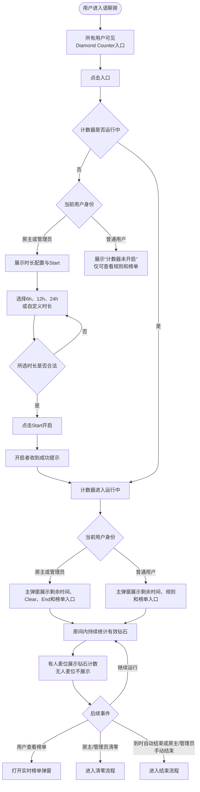
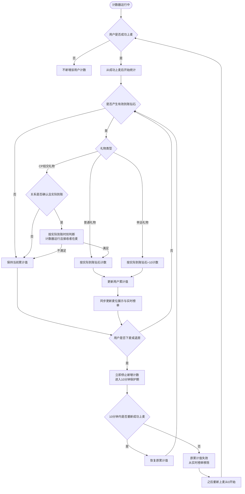
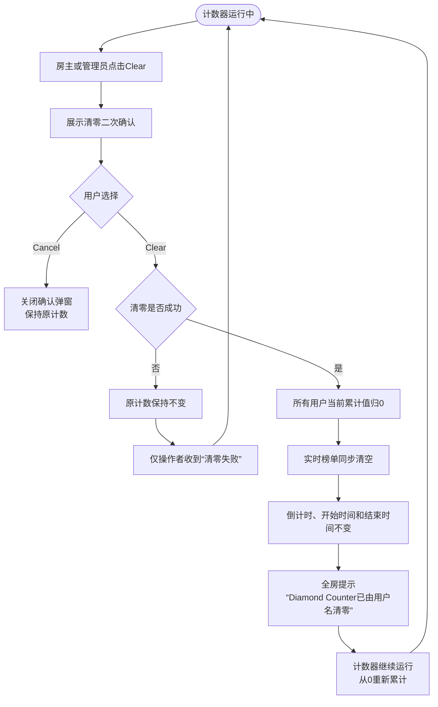
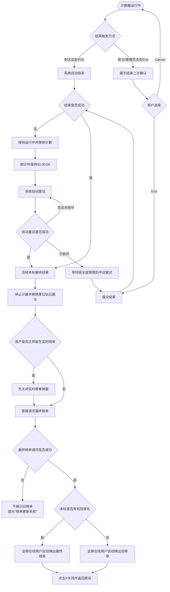
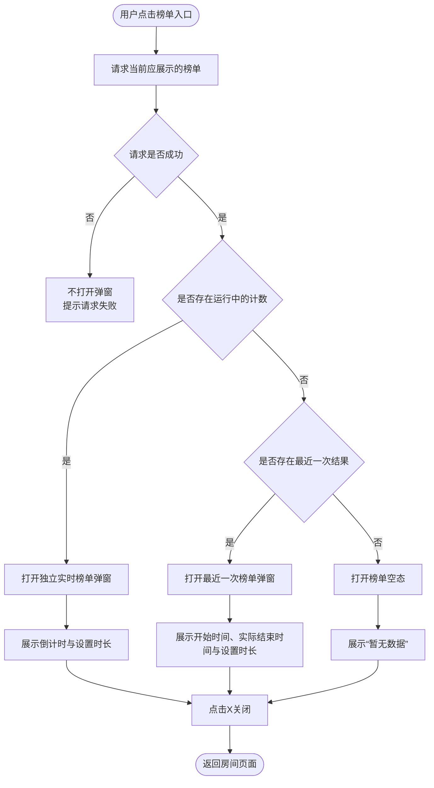

# Diamond Counter 最新业务流程图

> 本稿按当前PRD与两个Axure视角整理，仅表达业务规则，不展开接口、字段和技术实现。  
> 为保证可读性，拆为：业务总览、用户计数、管理操作与结果三个流程。

---

## 一、业务总览

### 总览说明

- 所有房间用户都能看到入口。
- 仅房主、管理员展示时长、Start、Clear和End。
- 普通用户只能查看运行状态、麦位计数和榜单。
- 榜单入口只负责打开独立榜单弹窗，不直接展示榜单内容。

---

## 二、用户计数流程

### 计数口径

- 计数绑定用户，不绑定麦位。
- 只统计用户在麦期间产生的有效钻石。
- 下麦、退房期间收到的钻石不计入，也不在重新上麦后补记。
- 换麦时累计值跟随用户移动。
- 页面计数采用K/M/B缩写；榜单排序使用服务端原始值。
- 榜单按有效钻石原始值降序；同值时先达到当前累计值者优先；达到时间仍相同时，按用户ID从小到大排序。

---

## 三、清零流程

### 清零结果

- 有人麦位显示钻石图标和`0`。
- 无人麦位继续不展示钻石信息。
- 榜单已打开时，重新加载最新实时榜单并展示空态。
- 清零不影响最近一次已结束榜单。

---

## 四、结束与结果流程

### 结束规则

- 只有完整生成并保存最终结果后，才算结束成功。
- 结束失败时计数器继续运行，不弹出最终榜单。
- 任意房主或管理员都可以承接手动重试，不限于开启者。
- 本轮无有效排名时是否用空结果覆盖最近一次结果，仍为待确认项。

---

## 五、榜单查看流程

### 榜单内容

- 排名；
- 用户头像、昵称；
- 完整钻石数额；
- 前三名使用金、银、铜样式；
- 点击用户信息进入用户资料页。

---

## 六、双视角页面结果

| 业务状态 | 房主/管理员 | 普通用户 |
|---|---|---|
| 未开启 | 时长、自定义、Start、Rule、榜单入口 | 未开启状态、Rule、榜单入口 |
| 运行中 | 剩余时间、Clear、End、Rule、榜单入口 | 剩余时间、Rule、榜单入口 |
| 清零成功 | 可操作；收到全房清零提示 | 不可操作；收到全房清零提示 |
| 清零失败 | 操作者收到失败提示 | 页面无变化，不接收失败提示 |
| 结束失败 | 可继续查看运行状态并重试 | 继续只读查看，不弹最终榜单 |
| 结束成功 | 自动查看最终榜单 | 自动查看最终榜单 |
| 榜单关闭 | 返回房间页面 | 返回房间页面 |

---

## 七、当前待确认

1. 本轮无有效排名时，空结果是否覆盖最近一次成功结果。

## 八、已确认展示规则

1. 榜单空态基准文案统一使用`暂无数据`，各语言版本按该语义配置。
2. 自定义时间选择器首次打开且房间从未确认过自定义时长时，默认展示`6小时0分钟`，跟随当前最小固定时长`6h`。
