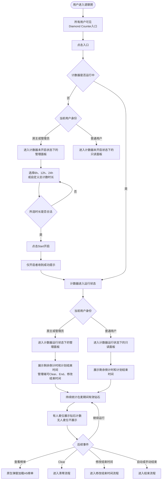
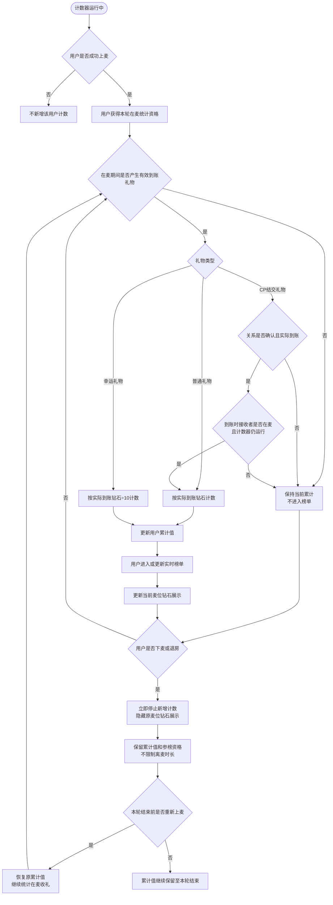
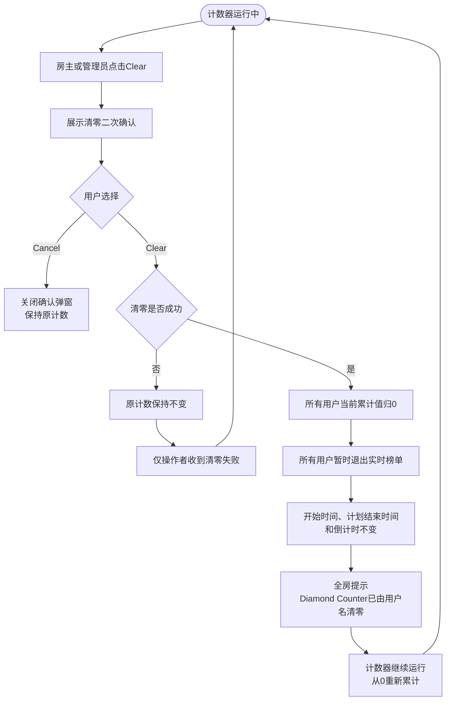
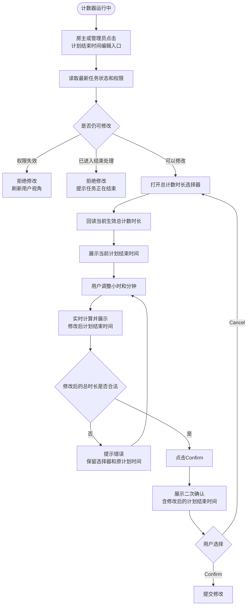
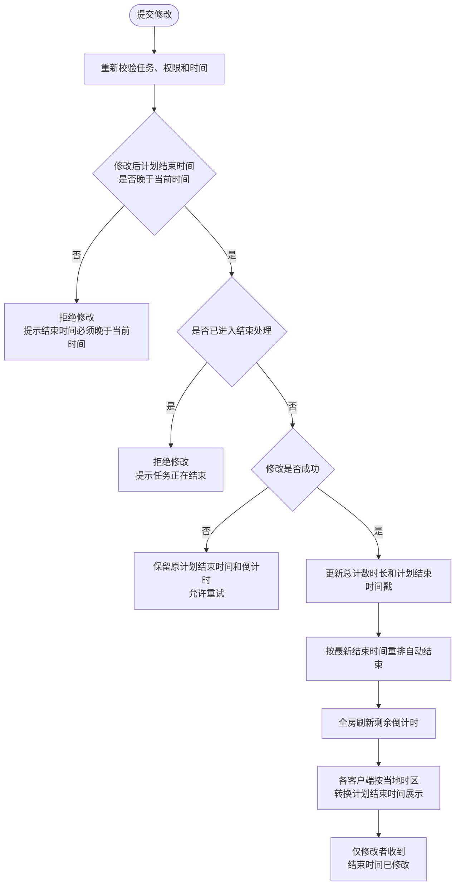
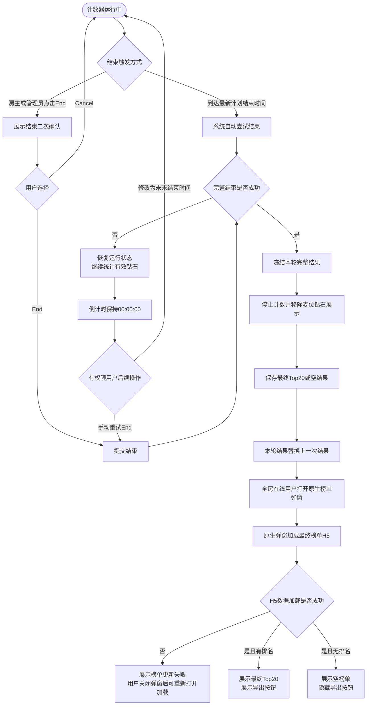
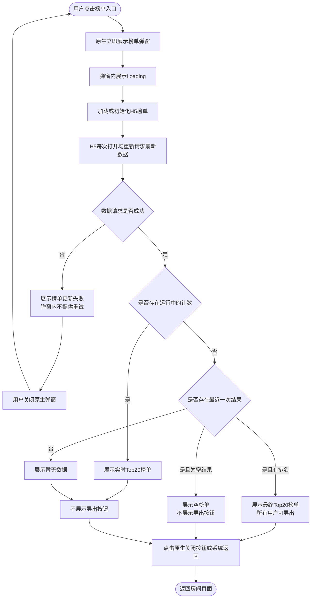
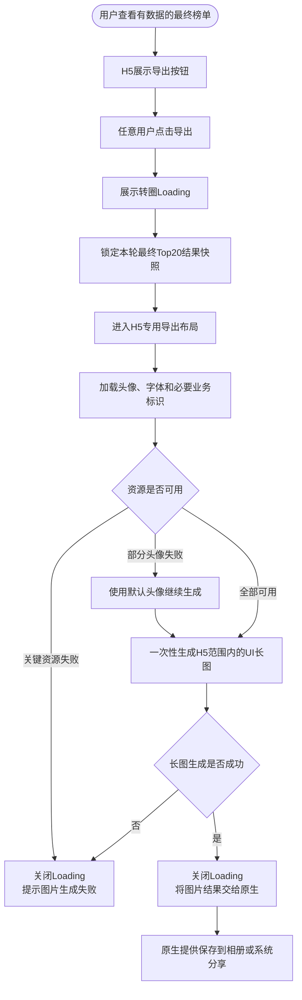

# Diamond Counter 业务流程图

> 本稿按当前已确认规则整理，仅表达业务流程和状态边界，不展开接口、字段或代码实现。
> 为保证可读性，拆为：业务总览、用户计数、清零、修改结束时间、结束与结果、榜单查看、最终榜单导出七条流程。

---

## 一、业务总览



### 总览说明

- 入口对所有房间用户可见。
- 房主、管理员拥有Start、Clear、End和修改结束时间权限。
- 普通用户只能查看状态、麦位计数和榜单。
- 后续版本再支持由房主配置管理员总权限及Start、Clear、End等细分权限。
- 运行状态面板同时展示剩余倒计时和计划结束时间。
- 倒计时按同一个结束时间戳计算；计划结束时间在UI中按各用户当地时区转换展示。

---

## 二、用户计数与参榜流程



### 计数与参榜口径

- 计数绑定用户，不绑定麦位。
- 只统计用户在麦期间收到的有效礼物。
- 下麦或退房后停止新增；离麦期间收到的礼物不计入，也不补记。
- 取消10分钟保护和超时清零规则；离麦多久都保留累计值和参榜资格至本轮结束。
- 用户重新上麦后延续原累计值。
- 用户必须在本轮在麦期间实际收到过有效礼物，且当前累计值大于0，才进入榜单。
- 仅上过麦但未收到有效礼物的用户不参榜。
- 礼物计入后，后续退款、撤销或资产冲正不回退运行中计数，也不修正最终结果。
- 换麦时累计值跟随用户移动。

### 排序与Top20

```text
全部参榜用户
→ 有效钻石原始值降序
→ 同值时先达到当前累计值者优先
→ 达到时间仍相同时按用户ID从小到大
→ 截取前20名供榜单展示
```

- 必须先对全部参榜用户排序，再截取前20名。
- 不足20人按实际人数展示。
- 第21名及以后不在H5榜单中展示。
- 麦位可使用K/M/B缩写；榜单展示完整钻石数，排序使用原始值。

---

## 三、清零流程



### 清零结果

- 有人麦位显示钻石图标和`0`；无人麦位不展示。
- 清零后所有用户累计归0，因此实时榜单变为空态。
- 后续用户在麦期间重新收到有效礼物后，再次获得参榜资格。
- 已打开的H5榜单重新获取最新数据，展示`暂无数据`并隐藏导出按钮。
- 清零不影响上一轮已结束结果。

---

## 四、修改结束时间流程

### 4.1 打开与选择



### 4.2 提交与结果



### 修改规则

- 修改的是本轮总计数时长，不是“从现在起再运行多久”。
- 最新计划结束时间戳 = 本轮开始时间戳 + 修改后的总计数时长。
- 修改后的总计数时长不得超过24小时。
- 允许延长，也允许缩短。
- 修改后的总时长必须大于本轮已进行时长；最新计划结束时间必须晚于当前时间。
- 缩短时间与当前进度冲突时，报错并拒绝修改。
- 修改时同时展示“当前计划结束时间”和随滚轮变化的“修改后计划结束时间”，方便对比。
- UI时间由时间戳按当前用户当地时区转换；底层判断、自动结束和并发裁决只依赖时间戳。
- 修改成功后，开始时间、累计值、参榜资格和实时榜单不变。
- 最终榜单使用修改后的最终总计数时长。
- 本期暂不展示或查询修改历史。

### 并发规则

```text
结束处理开始前：修改结束时间与End/自动结束按服务端先成功者生效。
结束处理开始后：禁止修改结束时间。
```

- 修改先成功：按新计划结束时间继续运行。
- End或自动结束先进入结束处理：拒绝修改。
- 自动结束失败后，房主或管理员可手动End，也可设置新的未来结束时间；修改成功后恢复倒计时。
- 若本轮已进行时长达到24小时，则无法再设置合法的未来时间，只能手动End。

---

## 五、结束与结果流程



### 结束规则

- 只有截止统计、冻结数据、生成排名或空结果、保存结果及更新终态全部成功，才算结束成功。
- 本期不做自动重试；结束失败后任务继续运行，由房主或管理员手动重试End或修改结束时间。
- 计划结束时间之后、结束成功之前产生的有效礼物继续计入。
- 最终统计时间范围使用实际开始时间至实际结束成功时间。
- 空结果保存并替换上一次结果，全房仍展示空榜单。
- 结束后发生的礼物退款、撤销或资产冲正不修正最终结果。

---

## 六、榜单查看流程



### 榜单承载与刷新

- 榜单采用“原生弹窗容器＋内嵌H5列表”。
- 原生负责弹窗、Loading、关闭、系统返回、加载失败和保存/分享能力。
- H5负责榜单标题、时间信息、Top20列表、空态、样式和长图生成。
- 每次打开原生弹窗时，H5必须重新请求最新榜单数据；数据返回前不展示上次缓存榜单。
- H5静态资源可以缓存，但榜单业务数据不能直接沿用上一次打开结果。
- H5榜单加载或数据请求失败时，弹窗内不提供重试按钮；用户需关闭榜单弹窗，再次点击榜单入口重新打开并加载。
- 实时榜单和最终榜单均最多展示前20名。
- 实时榜单不提供导出；只有加载成功且有数据的最终榜单展示导出按钮。

### 榜单字段

- 排名；
- 用户头像；
- 用户昵称；
- 完整钻石数额；
- 前三名使用金、银、铜样式；
- 点击用户信息进入用户资料页。

### 时间展示

- 运行中面板和实时榜单展示剩余倒计时、计划结束时间及当前总计数时长。
- 计划结束时间根据时间戳按查看用户当地时区转换。
- 最终榜单页面时间展示规则可按产品UI设计；导出长图固定使用GMT+3。

---

## 七、最终榜单长图导出流程



### 导出资格

- 房主、管理员和普通用户均可导出。
- 仅有数据的最终榜单展示导出按钮。
- 实时榜单、空榜单、Loading、加载失败和生成中状态均不展示导出按钮。

### 导出Loading

- 用户点击导出后立即展示转圈Loading，并隐藏或禁用导出按钮，防止重复提交。
- Loading覆盖最终Top20快照锁定、导出布局准备、头像与字体加载以及长图生成全过程。
- 导出成功后关闭Loading，再进入原生保存或分享流程。
- 导出失败后关闭Loading，提示`图片生成失败，请重试`，并恢复导出按钮。
- 用户在生成过程中关闭原生榜单弹窗时，立即结束Loading、取消导出并忽略迟到结果。

### 导出范围

长截图仅包含H5范围内的UI，不包含：

- 原生弹窗外框；
- 原生关闭按钮；
- 原生遮罩；
- 房间底图；
- 手机状态栏和系统导航；
- 导出按钮本身；
- Loading或失败提示控件。

### 长图必要业务标识

除榜单内容外，仅展示：

```text
Diamond Counter
Room ID：{房间ID}
{实际开始时间} - {实际结束时间}（GMT+3）
```

- 使用本轮实际开始时间和实际结束成功时间。
- 长图时间固定转换为GMT+3，不随导出用户当地时区变化。
- 不展示房间名称、计划结束时间、导出时间、修改历史或导出用户信息。

### 数据一致性

- 导出必须基于一次最终Top20快照生成。
- 不对滚动中的WebView逐屏截图再拼接。
- H5使用独立导出布局一次性生成长图。
- 导出期间不合并页面刷新或其他数据变化。
- 用户关闭原生弹窗时取消导出，并忽略迟到的生成结果。
- 头像加载失败使用默认头像，不因单个头像失败阻断整张长图。

---

## 八、双视角页面结果

| 业务状态 | 房主/管理员 | 普通用户 |
|---|---|---|
| 未开启 | 计数器未开启状态下的管理面板：时长、自定义、Start、Rule、榜单入口 | 计数器未开启状态下的只读面板：未开启状态、Rule、榜单入口 |
| 运行中 | 计数器运行状态下的管理面板：倒计时、计划结束时间、修改入口、Clear、End、Rule、榜单入口 | 计数器运行状态下的只读面板：倒计时、计划结束时间、Rule、榜单入口 |
| 清零成功 | 可继续操作；收到全房清零提示 | 不可操作；收到全房清零提示 |
| 清零失败 | 仅操作者收到失败提示 | 页面无变化 |
| 结束失败 | 可手动End或修改结束时间 | 继续只读查看，不弹最终榜单 |
| 结束成功且有排名 | 自动打开最终H5榜单，可导出 | 自动打开最终H5榜单，可导出 |
| 结束成功且为空结果 | 自动打开空榜单，不可导出 | 自动打开空榜单，不可导出 |
| 实时榜单 | 展示Top20，不可导出 | 展示Top20，不可导出 |
| 榜单关闭 | 返回房间页面 | 返回房间页面 |

---

## 九、已确认规则汇总

1. 自定义时间选择器首次打开且房间从未确认过自定义时长时，默认展示`6小时0分钟`，跟随最小固定时长`6h`。
2. 榜单空态基准文案统一使用`暂无数据`。
3. 礼物计入后发生退款、撤销或资产冲正，不回退计数，不修正最终结果。
4. 榜单只包含本轮在麦期间收到过有效礼物且累计值大于0的用户。
5. 取消10分钟保护；离麦后累计值和参榜资格保留至本轮结束。
6. 空结果保存并替换上一轮结果，结束后仍展示空榜单。
7. 本期忽略自动重试；结束失败后由房主或管理员手动End或修改结束时间。
8. 修改结束时间后，全房倒计时按最新结束时间戳刷新；UI计划结束时间按各用户当地时区展示。
9. 榜单为原生弹窗内嵌H5，每次打开重新请求最新数据。
10. 实时榜单和最终榜单最多展示前20名。
11. 所有用户都可以导出，但只允许导出有数据的最终榜单。
12. 导出使用一次最终Top20快照，仅生成H5范围内的UI长图。
13. 长图仅额外展示Diamond Counter、房间ID及GMT+3的实际开始—结束时间。

---

## 十、后续版本优化

- 房主可配置管理员是否拥有Diamond Counter总权限；
- 可进一步拆分Start、Clear、End和修改结束时间权限；
- 长图业务标识的最终视觉布局以后续原型为准。
