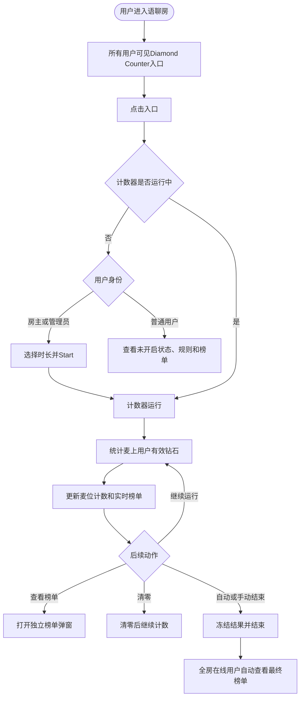
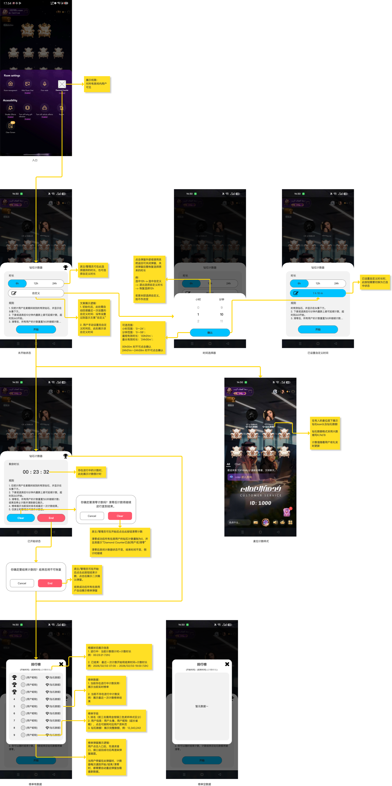
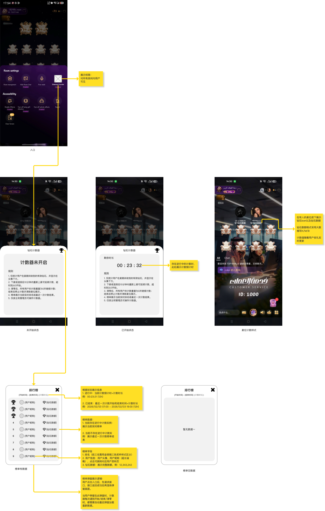
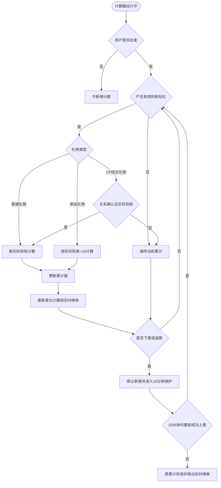
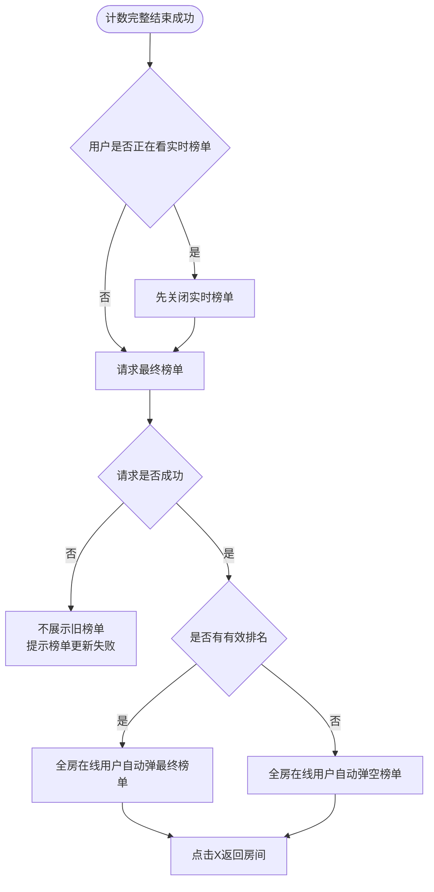

# 钻石计数器（Diamond Counter）需求文档

## 一、文档说明

### 1.1 业务目标

在语聊房内提供限时钻石计数能力，统计麦上用户在有效在麦期间收到的钻石，并通过麦位计数和房间榜单展示当前收礼表现。该功能可用于房间娱乐竞争，也可作为公会内部绩效评估的辅助工具，但本期不与公会绩效系统直接绑定。

### 1.2 事实来源

| 来源 | 路径/标识 | 用途 |
|---|---|---|
| MVP方案 | `钻石计数器_MVP方案.md` | 权限、时长、计数、清零、结束、榜单及异常规则 |
| 业务流程 | `钻石计数器_业务流程图.md` | 总流程、计数链、清零链、结束与榜单链 |
| Axure活源 | `/Users/gorkella/Documents/Axure/TOP KHALIJ/礼物计数器.rp` | 页面结构、可见状态和交互表现 |
| Axure页面 | `房主/管理员视角`、`普通用户视角` | 双视角页面定义 |

事实源优先级：最新明确确认规则 ＞ 当前Axure原型 ＞ MVP方案及业务流程中的未冲突内容。

### 1.3 本期范围

- Diamond Counter房间入口；
- 房主、管理员配置并开启计数；
- 固定时长与自定义时长；
- 用户在麦期间的有效钻石累计；
- 下麦或退房后的10分钟累计保护；
- 麦位实时计数展示；
- 当前轮实时榜单与最近一次最终榜单；
- 运行中清零；
- 自动结束、手动结束及结束失败重试；
- 房主/管理员与普通用户双视角。

### 1.4 非本期范围

- 多轮历史榜单；
- 历史筛选、查询和导出；
- 与公会绩效系统直接关联；
- 运行过程中修改或延长计数时长；
- 后台配置自动重试次数和间隔；
- 数值增长动画；
- 即将结束提醒；
- 统计结果人工修正。

---

## 二、业务模型

### 2.1 核心对象

| 对象 | 定义 | 生命周期 |
|---|---|---|
| 房间计数任务 | 某房间内一次独立的Diamond Counter运行实例 | 未开启 → 运行中 → 结束处理中 → 已结束；失败则回到运行中 |
| 用户累计记录 | 用户在当前任务内的有效钻石累计结果 | 首次上麦创建；计数、清零、保护期到期或任务结束时更新 |
| 在麦有效区间 | 用户可产生有效计数的时间段 | 成功上麦开始，成功下麦或退房结束 |
| 累计保护 | 用户下麦或退房后保留原累计值的10分钟窗口 | 下麦/退房进入；重新成功上麦恢复；超时失效 |
| 实时榜单 | 当前运行任务按用户有效钻石排序的结果 | 任务运行期间持续更新，清零后重新形成 |
| 最近一次结果 | 最近一次完整结束成功的最终榜单 | 新一轮完整结束后替换；空结果替换规则待确认 |

### 2.2 任务状态

| 状态 | 进入条件 | 状态内行为 | 退出条件 |
|---|---|---|---|
| 未开启 | 房间无运行中任务 | 展示入口；房主/管理员可配置时长 | 成功开启任务 |
| 运行中 | 开启成功，或结束失败后恢复 | 计时、统计、展示麦位计数和实时榜单 | 完整结束成功 |
| 结束处理中 | 自动到时或手动确认结束 | 尝试冻结数据、生成并保存结果 | 成功进入已结束；失败恢复运行中 |
| 自动重试中 | 自动结束失败且未耗尽重试 | 继续统计，按规则重试结束 | 成功结束或重试耗尽 |
| 等待手动重试 | 自动重试全部失败 | 继续统计；房主/管理员可再次End | 手动结束成功 |
| 已结束 | 结果完整生成并保存成功 | 移除麦位计数，展示最终榜单 | 新一轮任务开启不改变该历史结果，直至被新结果替换 |

### 2.3 业务总览



### 2.4 时间模型

| 时间 | 定义 | 用途 |
|---|---|---|
| 开始时间 | 服务端成功创建本轮任务的时间 | 统计起点、结果展示 |
| 计划结束时间 | 开始时间＋配置时长 | 触发首次自动结束 |
| 实际结束时间 | 完整结束流程最终成功的服务端时间 | 最终统计截止点、结果展示 |
| 用户上麦时间 | 用户成功进入麦位的服务端时间 | 用户有效计数起点 |
| 用户下麦/退房时间 | 用户成功离开麦位或房间的服务端时间 | 停止新增计数、启动10分钟保护期 |

```text
任务有效统计区间 = [开始时间, 实际结束时间)
用户有效计数区间 = 任务有效统计区间 ∩ 用户各段成功在麦区间
```

- 倒计时、计划结束和实际结束均以服务端时间为准；客户端本地时间不作为结束依据。
- 结束失败时，计划结束时间不等于实际结束时间；任务继续运行，直至完整结束成功。
- 最终榜单展示实际开始时间与实际结束时间，不用计划结束时间替代实际结束时间。

---

## 三、角色与权限

| 功能 | 房主 | 管理员 | 普通用户 |
|---|---:|---:|---:|
| 查看入口与运行状态 | 是 | 是 | 是 |
| 查看麦位钻石计数 | 是 | 是 | 是 |
| 查看实时榜单 | 是 | 是 | 是 |
| 查看最近一次结果 | 是 | 是 | 是 |
| 查看时长选择区域 | 是 | 是 | 否 |
| 开启计数 | 是 | 是 | 否 |
| 清零当前计数 | 是 | 是 | 否 |
| 手动结束 | 是 | 是 | 否 |
| 结束失败后手动重试 | 是 | 是 | 否 |

权限规则：

1. Diamond Counter入口对房间内所有用户可见。
2. 时长、Start、Clear和End仅向房主、管理员展示。
3. 普通用户只能查看运行状态、麦位计数、规则和榜单。
4. 用户操作前身份发生变化时，以提交操作时的实时身份为准。
5. 前端隐藏操作控件后，服务端仍需校验操作权限。

---

## 原型截图使用说明

- 本版PRD使用当前Axure页面的完整画布截图。
- 截图完整保留手机状态、独立组件、Connector、黄色旁注、引导线和画布状态标题。
- 不对原型图中的控件、说明、连线或状态做删减、清理、拼接或重新绘制。
- 业务规则仍以正文及最新明确确认口径为准；画布内旧文案或源控件缺陷在正文差异说明中处理。

### 房主/管理员视角完整画布



### 普通用户视角完整画布



---

## 四、房主/管理员视角

### 4.1 功能入口


> 原型现状：当前Axure入口图标仍为图片占位样式；完整画布按活源实际呈现保留，未伪造正式图标资源。

入口位于房间设置面板，对房间内所有用户可见。房主、管理员点击后，根据任务状态进入未开启配置面板或运行中管理面板。

### 4.2 页面定位

房主和管理员通过Diamond Counter面板完成时长配置、开启、清零、结束和榜单查看。

主面板统一支持以下关闭方式：

- 点击主面板外的遮罩；
- 使用系统返回；
- 关闭后返回房间页面；
- 关闭只影响面板展示，不改变已选时长、运行任务、倒计时、麦位计数或榜单状态。

### 4.3 未开启状态


#### 页面结构

| 区域 | 展示内容 | 交互 |
|---|---|---|
| 标题栏 | 钻石计数器、榜单奖杯入口 | 点击奖杯查看榜单 |
| 时长区 | `6h / 12h / 24h` | 单选 |
| 自定义区 | 编辑图标或已确认的自定义时长 | 点击打开时间选择器 |
| Rule区 | 统一规则文案 | 只读 |
| 底部 | Start | 开启计数 |

#### 默认选中

- 房间首次使用默认选中`6h`；
- 后续默认选中该房间上次成功开启时采用的时长；
- 仅修改但未成功开启，不覆盖上次默认时长。

### 4.4 自定义时间选择器


#### 时长范围

| 配置项 | 范围 |
|---|---|
| 小时 | 0～24 |
| 分钟 | 0～59 |
| 最短有效时长 | `00h01m` |
| 最长有效时长 | `24h00m` |
| 非法值 | `00h00m`、`24h01m～24h59m` |

#### 交互规则

1. 自定义时长与`6h / 12h / 24h`属于同一单选组。
2. 从未设置过自定义时长时，自定义区域仅展示编辑图标。
3. 存在已确认自定义时长时，显示对应值，如`01h10m`。
4. 当前已选中自定义时长时，再次点击后，选择器自动回读当前值。
5. 当前选中固定时长，但存在历史自定义值时，打开选择器回读历史自定义值。
6. 当前值合法时，Confirm可点击；确认后保存并选中自定义项。
7. 当前值非法时，Confirm置灰不可点击，弹窗保持打开。
8. 点击弹窗外部或系统返回关闭时，不保存临时调整，恢复打开前的选中时长。

#### 已设置自定义时长


> 原型现状：该静态状态未绘制标题栏奖杯入口，Rule第一条文案开头也已被源控件截断。完整画布忠实保留当前源状态，不以截图加工补齐；正式业务规则仍以4.3页面结构和第六章完整Rule文案为准。

确认合法自定义时长后，自定义选项切换为选中态并展示已确认值。用户仍可切换回固定时长；再次点击自定义时，回读当前已确认值。

### 4.5 开启计数

房主或管理员点击Start后：

1. 校验房间当前不存在其他运行中任务；
2. 创建本轮任务；
3. 记录开始时间、配置时长和计划结束时间；
4. 入口下方展示`Enabled`；
5. 仅开启操作者收到Toast：`Diamond Counter已开启`；
6. 有人麦位开始显示钻石图标和计数；
7. 无人麦位保持原空麦位样式。

同一房间同一时间只允许一个运行中的Diamond Counter。

### 4.6 运行中状态


| 区域 | 展示内容 | 交互 |
|---|---|---|
| 标题栏 | 钻石计数器、榜单入口 | 点击查看实时榜单 |
| 时间区 | 剩余时长`hh:mm:ss` | 服务端时间同步 |
| Rule区 | 统一规则文案 | 只读 |
| 底部 | Clear、End | 清零或结束 |

达到计划结束时间但结束失败时，倒计时保持`00:00:00`，任务仍属于运行中。

### 4.7 Clear确认


> 原型层级说明：当前Axure仅单独绘制Clear确认组件，未将其与“房间底图→遮罩→运行中主面板”组合为完整手机状态；本图仅证明确认组件自身的正文和按钮，不代表原型已完成整屏层级。

点击Clear后显示二次确认：

```text
你确定要清零计数吗？清零后计数将继续进行直到结束。
```

按钮：`Cancel / Clear`

- Cancel：关闭确认弹窗，原计数不变；
- Clear：提交清零；
- 清零成功后继续运行；
- 清零失败时原数据不变，仅操作人收到`清零失败`，可再次操作。

### 4.8 End确认


> 原型层级说明：当前Axure仅单独绘制End确认组件，未将其与“房间底图→遮罩→运行中主面板”组合为完整手机状态；本图仅证明确认组件自身的正文和按钮，不代表原型已完成整屏层级。

点击End后显示二次确认：

```text
你确定要结束计数吗？结束后将不可恢复。
```

按钮：`Cancel / End`

- Cancel：关闭弹窗并继续运行；
- End：提交结束；
- 结束成功后停止本轮计数；
- 结束失败后继续运行，并进入自动或手动重试流程。

---

## 五、普通用户视角

### 5.1 功能入口

普通用户与房主、管理员共用房间设置中的Diamond Counter入口，但进入后仅展示只读状态，不展示任何管理操作。

### 5.2 页面定位

普通用户只能查看Diamond Counter状态、麦位计数和榜单，不具备时长配置、开启、清零、结束及重试权限。

### 5.3 未开启只读面板


展示：

- 标题及榜单入口；
- `计数器未开启`；
- Rule规则。

不展示：

- 固定时长；
- 自定义时长；
- Start；
- Clear；
- End。

### 5.4 运行中只读面板


展示：

- 标题及榜单入口；
- 剩余时长；
- Rule规则。

不展示Clear或End。结束失败时继续显示运行中状态，倒计时保持`00:00:00`，且不自动弹出最终榜单。

### 5.5 结束成功

计数完整结束成功后：

1. 移除麦位上的钻石图标和数额；
2. 请求本轮最终榜单；
3. 请求成功后，普通用户与房间内其他在线用户自动看到最终榜单；
4. 点击榜单X关闭并返回房间页面；
5. 请求失败时不展示旧实时榜单，提示`榜单更新失败`。

### 5.6 主面板关闭

- 点击主面板外的遮罩：关闭主面板并返回房间页面；
- 使用系统返回：关闭主面板并返回房间页面；
- 关闭主面板只影响页面展示，不改变计数器运行、倒计时、麦位计数或榜单状态；
- 房主、管理员和普通用户使用同一关闭规则。

---

## 六、统一Rule文案

所有视角、所有计数器面板状态统一展示以下规则：

1. 仅统计用户在麦期间收到的有效钻石，并显示在头像下方。
2. 下麦或退房后10分钟内重新上麦可延续计数，超时则从0开始。
3. 清零后，所有用户的计数重置为0并继续计数；结束后停止计数并清除麦位展示。
4. 榜单展示当前实时排名或最近一次计数结果。
5. 仅房主和管理员可操作计数器。

---

## 七、钻石计数规则

### 7.1 统计对象

计数绑定用户，不绑定麦位。

```text
用户当前累计有效钻石
= 本轮开始或最近一次清零后
  用户各段有效在麦期间产生的有效钻石之和
```

### 7.2 有效条件

一笔钻石需同时满足：

1. Diamond Counter处于运行中；
2. 收礼用户当时处于麦上；
3. 礼物成功结算；
4. 用户获得实际到账钻石；
5. 已按礼物类型完成计数换算；
6. 同一到账事件未被重复处理。

### 7.3 礼物类型

| 礼物类型 | 计数口径 | 说明 |
|---|---|---|
| 普通礼物 | 实际到账钻石 | 以礼物系统最终到账结果为准 |
| 幸运礼物 | 实际到账钻石÷10 | 仅改变计数器口径，不改变真实资产 |
| CP结交礼物 | 关系确认后实际到账钻石 | 接收者确认关系并实际到账后才判定 |

### 7.4 CP结交礼物到账时机

CP结交礼物以接收者确认关系后、礼物系统确认成功并产生实际到账钻石的服务端时间作为计数时机。

| 场景 | 处理 |
|---|---|
| 邀请待确认 | 不产生有效到账，不计入 |
| 接收者确认并实际到账 | 按到账时计数器状态和在麦状态判断 |
| 拒绝、过期或取消 | 礼物未成功，不计入 |
| 发起时在麦，到账时已下麦 | 不计入 |
| 发起时未开启，到账时运行且在麦 | 计入 |
| 发起时运行，到账时已结束 | 不计入 |

不得按邀请发起时间、预扣时间或待确认状态提前计数。

### 7.5 在麦与10分钟保护

| 场景 | 处理 |
|---|---|
| 开启时用户已在麦 | 从任务开启成功后累计 |
| 运行中首次上麦 | 从成功上麦后累计 |
| 换麦 | 累计值跟随用户，不重置 |
| 下麦但仍在房间 | 停止新增并进入10分钟保护期 |
| 退房 | 停止新增并进入10分钟保护期 |
| 10分钟内重新成功上麦 | 恢复原累计值，从本次上麦后继续 |
| 仅重新进房但未上麦 | 不恢复新增，保护期继续 |
| 超过10分钟 | 原累计值失效并从实时榜单移除；之后从0开始 |

保护期从最后一次成功下麦或退房的服务端时间开始。保护期内未在麦时收到的钻石不计入，也不补记。

### 7.6 用户计数流程



---

## 八、麦位展示与数值格式

### 8.1 麦位展示


| 麦位状态 | 展示 |
|---|---|
| 有人且累计为0 | 钻石图标＋`0` |
| 有人且有累计 | 钻石图标＋当前累计值 |
| 无人麦位 | 不展示钻石图标和数额 |
| 用户下麦或退房 | 原麦位立即隐藏钻石信息 |
| 保护期内重新上麦 | 新麦位恢复原累计值 |
| 计数结束 | 所有麦位移除钻石展示 |

钻石信息展示在用户名称下方。

### 8.2 数值格式

| 原始数值范围 | 展示单位 |
|---:|---|
| 小于1,000 | 原数值 |
| 1,000～999,999 | K |
| 1,000,000～999,999,999 | M |
| 1,000,000,000及以上 | B |

格式规则：

- 最多保留两位小数；
- 直接截断，不四舍五入；
- 去除末尾无意义的0和小数点；
- K/M/B只用于麦位展示；
- 排名和同值判断使用服务端原始数值。

示例：`10.567 → 10.56`、`1,250 → 1.25K`、`1,000,000 → 1M`。

---

## 九、清零功能

### 9.1 功能定义

Clear用于在不结束任务的情况下，将本轮所有用户当前累计值归零。

### 9.2 清零成功

- 所有用户当前累计值归0；
- 有人麦位显示钻石图标和`0`；
- 无人麦位继续不展示钻石信息；
- 实时榜单清空并展示空态；
- 保护期内用户累计值同步清除，保护期仍继续计时；
- 开始时间、计划结束时间和倒计时不变；
- `Enabled`继续展示；
- 全房在线用户收到Toast：`Diamond Counter已由{用户名}清零`；
- 后续有效钻石从0重新累计；
- 最近一次已结束结果不受影响。

榜单弹窗已打开时，重新加载最新实时榜单并显示空态，后续新计数产生后重新形成排名。

### 9.3 清零失败

- 保留清零前全部数据；
- 不允许部分用户成功、部分用户失败；
- 仅操作人收到`清零失败`；
- 任务继续运行；
- 操作人可以再次清零。

### 9.4 清零与结束并发

- 结束先成功：任务已结束，后续清零无效；
- 清零先成功：先归零，结束时按清零后的累计结果生成榜单；
- 任一操作失败：不改变另一个已成功操作的结果。

---

## 十、榜单功能

### 10.1 榜单入口

榜单入口为计数器标题栏右上角奖杯图标。入口本身不展示排名内容。

```text
点击入口 → 请求榜单 → 成功后打开独立榜单弹窗
```

请求失败时不打开弹窗，提示通用请求失败文案。

### 10.2 榜单数据选择

#### 榜单有数据


#### 榜单空态


> 完整画布保留榜单组件、房间底图、遮罩、黄色旁注、Connector、引导线及状态标题，作为当前Axure源内容的完整证据。

| 任务状态 | 弹窗内容 | 时间信息 |
|---|---|---|
| 运行中 | 当前实时榜单 | 当前倒计时＋配置时长，如`00:23:21 (12h)` |
| 无运行任务且有结果 | 最近一次最终榜单 | 开始时间－实际结束时间＋配置时长 |
| 无运行任务且无结果 | 空态 | `暂无数据～` |

### 10.3 榜单字段

| 字段 | 规则 |
|---|---|
| 排名 | 前三名使用金、银、铜样式，其他显示数字 |
| 用户信息 | 头像、昵称；超长昵称省略 |
| 钻石数额 | 展示完整数值，不使用K/M/B |
| 时间信息 | 根据实时或已结束状态切换 |

点击用户头像或昵称进入对应用户资料页。

### 10.4 排序

1. 有效钻石原始值降序；
2. 同值时，先达到当前值的用户优先；
3. 达到时间相同时，按用户ID稳定排序。

### 10.5 实时刷新

- 每次有效计数变化后更新实时榜单；
- 换麦不产生新榜单对象；
- 清零成功后榜单重新加载并变为空态；
- 榜单打开期间发生开始、清零或结束时，重新加载最新数据；
- 点击X关闭榜单并返回房间页面。

### 10.6 榜单请求失败

- 不用缓存数据冒充最新结果；
- 不将请求失败展示为“暂无数据”；
- 最终榜单请求失败时提示`榜单更新失败`；
- 用户可再次点击入口重试。

---

## 十一、结束与结果

### 11.1 自动结束

到达计划结束时间后，系统自动尝试结束。

### 11.2 手动结束

房主或管理员点击End并二次确认后提交结束。取消则继续运行。

### 11.3 结束成功

只有以下步骤全部成功才视为结束成功：

1. 截止本轮统计；
2. 冻结本轮数据；
3. 生成最终排名；
4. 保存最终结果；
5. 更新任务为已结束。

结束成功后：

- 记录实际结束时间；
- 停止新增计数；
- 隐藏`Enabled`；
- 移除所有麦位钻石展示；
- 清除运行态累计缓存和保护状态；
- 榜单入口切换为最近一次结果查看入口；
- 房间内所有在线用户进入最终榜单展示流程。

### 11.4 全房最终榜单



### 11.5 结束失败与重试

自动结束失败后，按以下节奏重试：

| 次数 | 时间 |
|---|---|
| 第1次 | 首次失败10秒后 |
| 第2次 | 上次失败30秒后 |
| 第3次 | 上次失败60秒后 |

失败期间：

- 任务继续运行；
- 后续有效钻石继续累计；
- `Enabled`继续展示；
- 倒计时保持`00:00:00`；
- 麦位计数和实时榜单继续更新；
- 不覆盖最近一次成功结果；
- 不自动弹出最终榜单。

3次自动重试均失败后，停止自动重试。任意房主或管理员均可手动重试，不限于开启者。手动结束失败时，仅本次操作者收到`结束失败`。

---

## 十二、记录保留

服务端仅保留：

1. 当前进行中的任务；
2. 最近一次完整结束成功的结果。

规则：

- 当前任务运行期间，前台榜单只展示当前实时结果；
- 结束失败不覆盖上一轮结果；
- 新一轮完整结束成功后，替换上一轮结果；
- 不提供第二轮及更早结果的查询、筛选或导出。

> 本轮无有效排名数据时，是否以空结果覆盖上一轮最近结果，仍为待确认项。

---

## 十三、异常与边界

| 场景 | 处理 |
|---|---|
| 重复点击Start | 同一房间只创建一个运行任务，返回真实运行状态 |
| 多个管理员同时End | 第一个成功结束生效，后续返回同一最终状态 |
| Clear与End并发 | 以服务端最先成功执行的操作为准 |
| 用户退出App或断网 | 计数任务继续运行，重进时重新获取真实状态 |
| 房间无人 | 任务和倒计时继续 |
| 用户下麦期间收礼 | 不计入，也不补记 |
| 结束失败 | 继续运行和计数，不弹最终榜单 |
| 榜单请求失败 | 不展示旧榜单，提示失败并允许重试 |
| 低版本客户端 | 不展示入口和麦位计数，不影响服务端任务运行 |
| 用户昵称变化 | 榜单展示最新头像和昵称 |

---

## 十四、页面规则与反馈文案

### 14.1 Rule

1. 仅统计用户在麦期间收到的有效钻石，并显示在头像下方。
2. 下麦或退房后10分钟内重新上麦可延续计数，超时则从0开始。
3. 清零后，所有用户的计数重置为0并继续计数；结束后停止计数并清除麦位展示。
4. 榜单展示当前实时排名或最近一次计数结果。
5. 仅房主和管理员可操作计数器。

### 14.2 反馈文案

| 场景 | 文案 | 展示对象 |
|---|---|---|
| 开启成功 | `Diamond Counter已开启` | 开启操作者 |
| 清零确认 | `你确定要清零计数吗？清零后计数将继续进行直到结束。` | 操作者 |
| 清零成功 | `Diamond Counter已由{用户名}清零` | 全房在线用户 |
| 清零失败 | `清零失败` | 操作者 |
| 结束确认 | `你确定要结束计数吗？结束后将不可恢复。` | 操作者 |
| 结束失败 | `结束失败` | 操作者 |
| 最终榜单失败 | `榜单更新失败` | 对应在线用户 |
| 榜单空态 | `暂无数据～` | 榜单查看用户 |

全部文案需接入多语言资源。

### 14.3 原型旁注覆盖核对

Axure两页的正式`Note`字段当前为空；业务说明以画布上的独立黄色文本控件呈现。旁注只作为规则证据，不进入正式UI截图。当前覆盖如下：

| 原型旁注业务含义 | PRD落点 | 覆盖结论 |
|---|---|---|
| Diamond Counter入口对所有房间内用户可见 | 3.1权限表、3.2权限规则、4.1功能入口、5.1功能入口 | 已覆盖 |
| 房主/管理员可选择固定时长或自定义时长 | 3.1权限表、4.3未开启状态、4.4自定义时间选择器 | 已覆盖 |
| 自定义区域初始化时回读最近一次设置；设置后展示自定义时间 | 4.3默认选中、4.4交互规则及已设置状态 | 已覆盖 |
| 关闭自定义选择器后恢复原选中时长；原本选中自定义时保持不变 | 4.4交互规则第8条 | 已覆盖 |
| 自定义小时0～24、分钟0～59；`00h00m`和`24h01m～24h59m`不可确认 | 4.4时长范围及交互规则 | 已覆盖 |
| 已设置自定义时长时，自定义选项切换为选中态 | 4.4“已设置自定义时长” | 已覆盖 |
| 存在进行中计数时展示剩余倒计时 | 4.6运行中状态、5.4运行中只读面板 | 已覆盖 |
| 有人麦位展示钻石图标和数额，使用K/M/B并随收礼实时更新 | 7.6用户计数流程、8.1麦位展示、8.2数值格式 | 已覆盖 |
| Clear需二次确认；成功后全房归零提示；任务、结束时间和倒计时不变 | 4.7 Clear确认、9.2清零成功 | 已覆盖 |
| End需二次确认；结束成功后全房自动展示榜单 | 4.8 End确认、11.3结束成功、11.4全房最终榜单 | 已覆盖 |
| 进行中榜单展示倒计时和计数时长；已结束榜单展示起止时间和计数时长 | 10.2榜单数据选择、10.3榜单字段 | 已覆盖 |
| 有运行任务时展示实时榜单；无运行任务时展示最近一次结果 | 10.2榜单数据选择、12记录保留 | 已覆盖 |
| 榜单字段包含排名、头像、昵称和完整钻石数；前三名区分样式；用户信息可跳资料页 | 10.3榜单字段、10.4排序 | 已覆盖 |
| 点击榜单入口后先请求，成功后再打开；停留期间遇到开始、结束或清零时重新加载 | 10.1榜单入口、10.5实时刷新、10.6榜单请求失败 | 已覆盖 |

核对结论：当前可识别的14类画布旁注业务含义均已进入PRD逻辑。旁注原文没有整段复制进正文；正文以结构化规则、状态和异常处理承接其业务含义。

---

## 十五、业务流程索引

完整高可读性流程见：`钻石计数器_业务流程图.md`。

| 流程 | 对应章节 |
|---|---|
| 业务总览 | 二、业务模型 |
| 用户计数 | 七、钻石计数规则 |
| 清零 | 九、清零功能 |
| 结束与结果 | 十一、结束与结果 |
| 榜单查看 | 十、榜单功能 |

---

## 十六、待确认事项

| 编号 | 待确认项 | 影响 |
|---|---|---|
| TBC-01 | 本轮无有效排名时，空结果是否覆盖上一轮最近结果 | 决定最近一次榜单的替换规则 |
| TBC-03 | 已计入钻石后发生礼物撤销、退款或资产冲正时，运行中计数及已冻结结果是否回退 | 影响实时计数、最终排名和最近一次结果的稳定性 |
| TBC-04 | 当前累计值为0的在麦用户是否进入实时榜单及最终榜单 | 决定榜单空态与参与用户范围 |

待确认项处理原则：

- 本轮结束后仍可向全房展示本轮空榜单；
- 服务端是否将该空结果写为“最近一次结果”不得由开发自行决定；
- 礼物撤销、退款或冲正及0值用户参榜范围确认前，不得由客户端自行修正或推断；
- 业务流程中只能标记为待确认分支。
