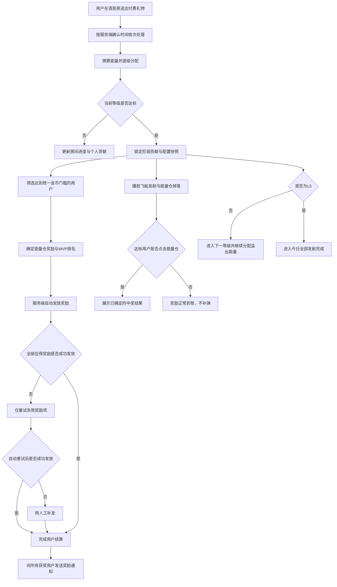
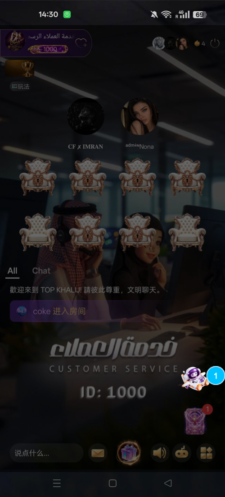
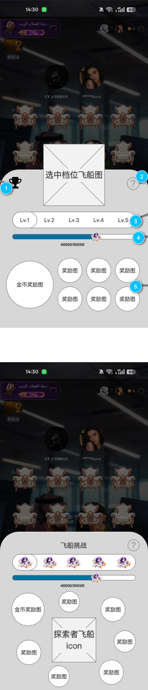
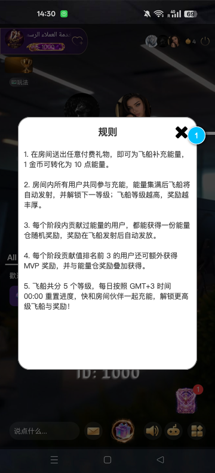
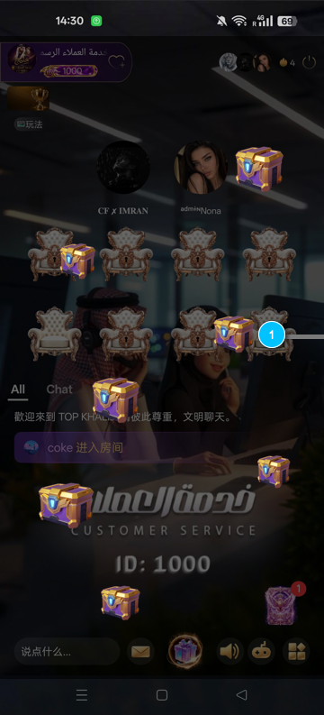
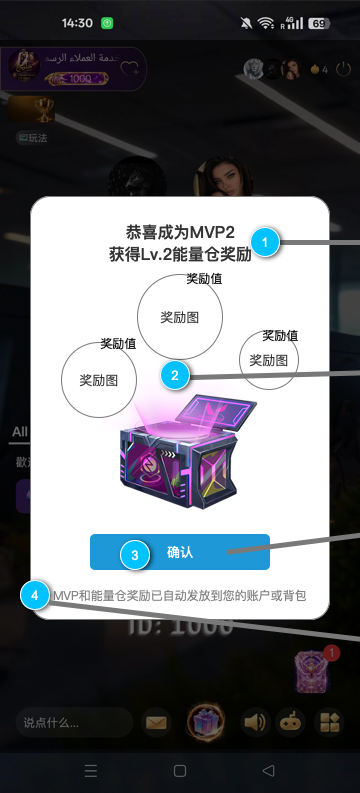
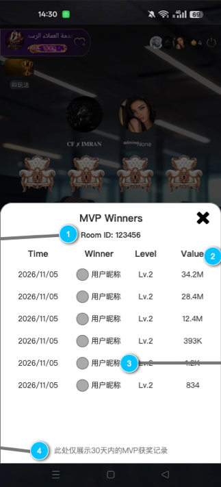

# 房间飞船挑战 PRD

## 一、文档信息

| 项目 | 内容 |
|---|---|
| 需求名称 | 房间飞船挑战 |
| 适用端 | iOS、Android |
| 生效场景 | 语音房 |
| 需求方 | Wendy |
| 期望上线时间 | 2026/11/12 |
| 原型文件 | `房间飞船挑战.rp` |
| 业务建模 | `房间飞船挑战-业务流程图.mmd` |
| 统一时区 | GMT+3 |

### 1.1 事实来源与优先级

1. 当前已确认的产品规则；
2. 当前 Axure 文件 `房间飞船挑战.rp`；
3. 业务建模文件 `房间飞船挑战-业务流程图.mmd`；
4. 既有《星际飞船 PRD》中未与以上材料冲突的规则。

> 原型中的数值仅用于页面示意。五级目标能量、奖励内容和准入金币门槛以最终运营配置为准，不按原型示例值写死。

### 1.2 原型与已确认规则差异

| Axure当前可见标注 | 正式需求口径 | 处理结论 |
|---|---|---|
| 规则页写“每个阶段贡献过能量的用户都能获得奖励” | 仅本阶段累计贡献达到统一金币门槛的用户获得能量仓奖励 | 以正式需求为准，规则页文案需在UI交付时同步修改 |
| 开奖弹窗旁注写“结算后在房用户自动弹出” | 仅在掉落期间由达标用户点击能量仓打开；未点击、离房或后台不补弹 | 以正式需求为准，开奖弹窗不是自动弹出 |
| 主弹窗奖励布局标注为“待定样式” | 页面需展示当前等级MVP奖励与能量仓奖池预览 | 布局仍列待确认，不影响奖励数据与结算规则 |
| 原型示例进度为40000/50000 | 五级初始目标能量已按等级配置表确定，运营可调整 | 示例值不作为正式配置，页面读取当日配置快照 |
| 原型主图中出现金币奖励圈和6个奖励圈 | 实际奖励项读取当日配置快照 | 原型只表达布局容量，不限制正式奖励类型 |

## 二、需求背景与目标

通过语音房内多人共同送礼，为房间飞船积攒能量。飞船按等级逐级发射，每个阶段向达到贡献门槛的用户发放能量仓随机奖励，并向贡献值排名前 3 的用户额外发放 MVP 奖励。

业务目标：

- 让不同付费层级用户共同参与房间阶段目标；
- 通过逐级解锁、掉落效果和开奖反馈增强参与感；
- 通过 MVP 展示与记录强化高贡献用户荣誉；
- 在不依赖用户抢领的前提下，保证奖励发放稳定、可追溯、可补发。

## 三、需求范围

| 模块 | 本期内容 |
|---|---|
| 房间入口 | 房间右下角展示当前阶段飞船入口 |
| 飞船主弹窗 | 展示五级飞船、阶段状态、进度与奖励预览 |
| 规则弹窗 | 展示面向用户的玩法规则 |
| 送礼充能 | 付费礼物换算能量，按房间、阶段累计 |
| 等级推进 | L1 至 L5 顺序推进，支持溢出能量跨级 |
| 能量仓奖励 | 达到统一金币门槛的用户获得随机奖励 |
| MVP 奖励 | 达标用户中贡献值 Top1—Top3 获得额外奖励 |
| 能量仓掉落 | 发射后播放可点击的能量仓掉落效果 |
| 开奖弹窗 | 点击能量仓后展示服务端已确定的奖励结果 |
| 奖励通知 | 奖励入账后向所有获奖用户发送通知 |
| MVP 获奖记录 | 展示当前房间近 30 天 MVP 记录 |
| 每日重置 | GMT+3 00:00 重置进行中数据 |

### 3.1 非本期范围

- 礼物退款后的能量、贡献和已发奖励回退；
- 免费礼物参与充能；
- 非语音房场景；
- 用户主动领取奖励；
- 点击能量仓后重新抽奖或改变奖励结果。

## 四、模块地图与核心对象

### 4.1 页面地图

```text
语音房
└─ 飞船入口
   └─ 飞船主弹窗
      ├─ 五级飞船状态与奖励预览
      ├─ 规则弹窗
      └─ MVP获奖记录弹窗

阶段能量充满
├─ 飞船发射动效
├─ 能量仓掉落效果
│  └─ 点击能量仓 → 开奖弹窗
├─ 服务端自动发奖
└─ 奖励发放通知
```

### 4.2 核心对象

| 对象 | 定义 | 生命周期 |
|---|---|---|
| 房间实例 | 一次独立存在的语音房业务实例 | 创建房间至房间解散；房间号码复用时视为新实例 |
| 自然日 | GMT+3 00:00 至次日 00:00 | 每日重置并生成配置快照 |
| 飞船等级 | L1 至 L5 的阶段对象 | 按顺序启动、充能、达标并结束 |
| 充能阶段 | 某房间实例、某自然日、某等级的一次完整充能周期 | 等级启动至达到目标能量并锁定 |
| 阶段贡献 | 用户实际分配到该等级的贡献能量与金币值 | 随礼物累计，阶段达标后锁定 |
| 阶段结算结果 | 阶段达标后形成的资格、排名和奖励快照 | 锁定后不可被后续配置或送礼改变 |
| 奖励项 | 能量仓或 MVP 来源下的具体金币、物料或道具 | 待发放、已发放、异常待处理 |
| MVP 记录 | 阶段 Top1—Top3 的展示记录 | 保留并展示近 30 天 |

### 4.3 用户角色

| 角色 | 定义 | 可获得内容 |
|---|---|---|
| 普通房间用户 | 进入语音房但未送出有效付费礼物 | 可查看入口、主弹窗、规则和 MVP 记录 |
| 未达标贡献用户 | 本阶段有贡献，但未达到统一金币门槛 | 贡献计入房间进度，不获得奖励、不参与 MVP 排名 |
| 达标贡献用户 | 本阶段累计贡献达到统一金币门槛 | 一份能量仓随机奖励 |
| MVP 用户 | 达标贡献用户中的 Top1—Top3 | 能量仓奖励与对应名次 MVP 奖励，可叠加 |

## 五、核心业务规则

### 5.1 能量换算

- 任意付费礼物均参与充能；免费礼物不参与。
- 换算比例：`1 金币 = 10 能量值`。
- 礼物能量同时用于：
  - 增加当前房间当前等级进度；
  - 记录送礼用户在该阶段的个人贡献。
- 不同房间实例独立累计，不跨房间继承。

### 5.2 奖励准入门槛

- 五个等级采用统一固定金币门槛，不按阶段目标能量比例动态增长。
- 当前业务口径暂定为每阶段累计贡献达到 `0.1 USD` 等值金币。
- 运营需将 0.1 USD 折算为唯一金币值；玩法运行时只比较金币值，不实时换算美元或汇率。
- 门槛按单个房间、单个等级阶段累计，不要求单笔礼物达到门槛。
- 用户达到门槛后，以本阶段完整贡献值参与 MVP 排名，而不是只计算超过门槛的部分。
- 未达门槛的贡献仍计入房间总进度和个人贡献，但不获得奖励、不参与 MVP 排名。

### 5.3 等级顺序

五级飞船按顺序解锁，不可跳级。等级越高，所需房间总能量越大，能量仓随机奖励池价值越高。下表为初始配置，运营可调整，客户端读取当日配置快照，不写死数值。

| 等级 | 飞船名称 | 所需房间总能量 | 能量仓随机奖励池 | MVP额外奖励 | 阶段状态 |
|---|---|---:|---|---|---|
| L1 | 探索者飞船 | 10,000 | 小额金币、初级道具 | 能量仓（Top1—Top3） | 每日初始等级 |
| L2 | 星际飞船 | 30,000 | 中额金币、中级道具 | 能量仓（Top1—Top3） | L1达标后启动 |
| L3 | 星翰飞船 | 80,000 | 高额金币、高级道具、概率特效 | 能量仓（Top1—Top3） | L2达标后启动 |
| L4 | 银河飞船 | 200,000 | 大额金币、稀有道具、限时座驾 | 能量仓（Top1—Top3） | L3达标后启动 |
| L5 | 宇宙飞船（满级） | 500,000 | 巨额金币、传说道具、专属头像框 | 能量仓（Top1—Top3） | L4达标后启动，最高等级 |

- 五级飞船按顺序推进，不可跳级。
- 各等级目标能量必须配置为 10 的整数倍。
- 表中“金币额度档位”和“道具等级”为奖池价值层级，具体金币数量、道具清单、物料有效期及抽取概率由运营配置。
- 表中“MVP额外奖励”为Top1—Top3额外获得的能量仓；Top1、Top2、Top3对应能量仓内容是否区分，以最终运营配置为准。
- L1 至 L4 达标后立即进入下一等级，不等待动效或奖励发放完成。
- L5 达标后进入“今日已全部发射完成”，当日后续送礼不再计入飞船玩法。

### 5.4 单笔礼物跨级拆分

- 单笔礼物的能量按 L1 至 L5 顺序逐级分配。
- 当前等级只分配达到目标值所需的能量，剩余能量继续进入下一等级。
- 每个等级的个人贡献只记录该笔礼物实际分配至本等级的能量。
- 公式：`阶段贡献金币 = 本等级实际分配能量 ÷ 10`。
- 准入资格、个人贡献和 MVP 排名均使用拆分后的阶段贡献金币。
- 同一笔礼物不得在多个等级重复记录完整贡献。
- 一笔礼物连续触发多个等级达标时，每个等级分别生成独立阶段结算结果。
- L5 达标后的剩余能量及对应贡献金币不再计入。

### 5.5 送礼事件顺序与跨天归属

- 同一房间内的有效礼物按照服务端确认成功时间从早到晚依次处理。
- 时间相同时，按照稳定的唯一事件顺序处理。
- 每笔礼物需完成能量分配、阶段锁定、下一等级创建和溢出分配，才处理下一笔。
- 阶段达标时先锁定贡献数据与配置快照，再进入下一等级。
- 礼物所属自然日以服务端确认成功时间为准：
  - 早于 GMT+3 00:00：归属旧自然日；
  - 等于或晚于 GMT+3 00:00：归属新自然日。
- 每笔礼物只能归属一个自然日。

### 5.6 奖励模型

| 奖励来源 | 获奖对象 | 奖励数量 | 发放方式 | 是否可叠加 |
|---|---|---:|---|---|
| 能量仓奖励 | 本阶段所有达标贡献用户 | 每人 1 份随机奖励 | 服务端自动发放 | 可与 MVP 叠加 |
| MVP Top1 | 达标用户贡献值第 1 名 | 1 个MVP额外能量仓 | 服务端自动发放 | 可与普通能量仓叠加 |
| MVP Top2 | 达标用户贡献值第 2 名 | 1 个MVP额外能量仓 | 服务端自动发放 | 可与普通能量仓叠加 |
| MVP Top3 | 达标用户贡献值第 3 名 | 1 个MVP额外能量仓 | 服务端自动发放 | 可与普通能量仓叠加 |

- 达标用户不足 3 名时，按实际人数发放对应名次奖励，不保留空缺名额。
- 无达标用户时，不产生能量仓奖励和 MVP 获奖者。
- 排名顺序：阶段贡献值降序 → 达到最终贡献值时间升序 → 稳定唯一用户顺序。

### 5.7 配置快照

- 每个 GMT+3 自然日开始时生成当日配置快照。
- 快照包含五级目标能量、统一金币门槛、各级能量仓随机奖励池和 MVP 额外能量仓配置。
- 当日运营修改统一在下一自然日 00:00 生效。
- 当日正在充能、已锁定和待补发阶段继续使用原配置快照。
- 历史记录和后续补发不得使用最新配置反算。

## 六、核心业务流程

> 业务流程来源：`房间飞船挑战-业务流程图.mmd`。



## 七、页面需求

### 7.1 房间飞船入口

#### 页面定位

在语音房主界面提供飞船挑战的常驻入口，展示当前阶段飞船缩略图，并承接进入飞船主弹窗的操作。

#### 对应原型



#### 前置条件

- 用户已进入语音房；
- 当前房间支持飞船挑战；
- 当日配置快照已生成。

#### 页面字段定义

| 字段/元素 | 展示规则 |
|---|---|
| 飞船入口 | 位于房间右下角、原活动悬浮入口上方 |
| 当前飞船缩略图 | 跟随房间当前实际充能等级变化 |
| 入口点击区域 | 覆盖飞船缩略图完整范围 |

#### 统计与计算口径

- 当前等级读取房间实例在当前自然日的实时等级。
- 页面重进或网络恢复后，以服务端最新状态刷新。

#### 交互逻辑

1. 用户点击飞船入口；
2. 打开飞船主弹窗；
3. 房间音频继续播放；
4. 弹窗打开期间，底层房间麦位和聊天区不可点击。

#### 状态定义

| 状态 | 页面表现 |
|---|---|
| 充能中 | 展示当前充能等级缩略图 |
| 等级切换 | 更新为新等级缩略图 |
| 今日全部完成 | 展示 L5 完成态缩略图 |
| 数据刷新失败 | 保留上次状态；恢复后同步最新等级 |

#### 系统处理规则

- 入口只展示当前房间实例状态，不跨房间继承。
- 用户是否具备奖励资格不影响入口可见性。

#### 异常与测试关注点

- 房间关闭、切换房型后再次进入，入口需恢复当前进度；
- 房间解散后原入口和进度终止；
- 房间号码复用时不得读取旧房间实例数据。

### 7.2 飞船主弹窗

#### 页面定位

展示五级飞船、当前及历史阶段状态、能量进度、奖励预览，并提供规则与 MVP 获奖记录入口。

#### 对应原型



> Axure 页面包含“充能中、待启动、已充满”三个动态状态。截图为整页画布，部分设计标注区域存在纵向拼接，不代表最终页面需纵向滚动。

#### 前置条件

- 用户通过房间飞船入口打开；
- 房间当前自然日配置与等级状态可读取。

#### 页面字段定义

| 区域 | 字段/元素 | 展示规则 |
|---|---|---|
| 顶部 | 页面标题 | 飞船挑战 |
| 顶部左侧 | MVP记录入口 | 点击打开当前房间 MVP 获奖记录弹窗 |
| 顶部右侧 | 规则入口 | 点击打开规则弹窗 |
| 档位区 | Lv.1—Lv.5 | 支持点击切换查看 |
| 飞船区 | 飞船主图 | 展示当前选中等级飞船图 |
| 进度区 | 当前能量/目标能量 | 仅充能中状态展示实时数值 |
| 奖励区 | MVP奖励与能量仓奖池预览 | 根据选中等级展示当日配置快照 |
| 结果区 | MVP Top1—Top3 | 已发射状态展示实际获奖人数 |

#### 统计与计算口径

- 档位切换仅改变查看对象，不改变房间当前实际充能等级。
- 进度数值读取选中等级在当前自然日的状态快照。
- 奖励预览读取当日配置快照；原型中的奖励圈和示例数值不作为正式奖励配置。
- MVP贡献值展示阶段锁定后的最终值，使用大数缩写规则。

#### 交互逻辑

1. 默认选中房间当前实际充能等级；
2. 用户点击 Lv.1—Lv.5 切换查看对应状态；
3. 点击规则入口打开规则弹窗；
4. 点击 MVP记录入口打开 MVP 获奖记录弹窗；
5. 点击弹窗外空白区域关闭主弹窗并返回房间。

#### 状态定义

| 状态 | 进入条件 | 页面表现 | 退出条件 |
|---|---|---|---|
| 充能中 | 选中等级为当前实际等级且未达标 | 展示当前值/目标值及实时进度 | 目标能量达成 |
| 待启动 | 选中等级高于当前实际等级 | 展示“飞船待启动”，不展示可贡献进度 | 前置等级达标 |
| 已发射 | 选中等级已完成结算 | 展示“飞船已发射！”及 MVP结果 | 每日重置 |
| 今日全部完成 | L5 已达标 | 所有等级均为已发射态 | 次日00:00重置 |

#### 系统处理规则

- 未启动等级允许预览，但不能通过页面操作提前启动。
- 已发射阶段读取锁定结果，不因后续送礼或配置修改变化。
- 达标用户不足3名时，MVP区域按实际人数展示；无达标用户时展示无MVP结果状态。

#### 异常与测试关注点

- 送礼后进度目标刷新延迟不超过1秒；
- 连续跨级时等级状态按实际结算顺序更新；
- 客户端状态落后时，以服务端结果覆盖本地展示；
- 奖励预览与当天生效配置必须一致。

### 7.3 规则弹窗

#### 页面定位

向用户说明能量换算、等级推进、奖励资格、MVP奖励及每日重置规则。

#### 对应原型



#### 前置条件

- 用户已打开飞船主弹窗；
- 点击右上角规则入口。

#### 页面字段定义

| 字段/元素 | 展示规则 |
|---|---|
| 标题 | 规则 |
| 规则正文 | 按当前正式用户规则展示，支持阿拉伯语和英语 |
| 关闭按钮 | 点击关闭规则弹窗，返回主弹窗原查看等级 |

#### 用户规则文案

1. 在房间送出任意付费礼物，即可为飞船补充能量，1金币可转化为10点能量。
2. 房间用户共同参与充能，能量集满后飞船自动发射并进入下一等级；飞船等级越高，奖励越丰厚。
3. 每个阶段累计贡献达到奖励门槛的用户，都能获得一份能量仓随机奖励。奖励由系统自动发放，离开房间也不会错过。
4. 每个阶段达标贡献用户中，贡献值排名前3的用户还可获得MVP奖励，并与能量仓奖励叠加。
5. 飞船共5个等级，每日GMT+3 00:00重置进度。

#### 交互逻辑

- 点击关闭按钮后关闭当前弹窗；
- 返回飞船主弹窗，并保留进入规则前选中的等级。

#### 状态定义

| 状态 | 页面表现 |
|---|---|
| 正常 | 完整显示规则正文 |
| 多语言 | 跟随 App 当前语言，阿拉伯语采用 RTL 排版 |
| 内容超出 | 弹窗正文区域支持纵向查看，关闭按钮固定可操作 |

#### 系统处理规则

- 规则中的门槛文案使用正式金币门槛，不实时展示美元汇率换算。
- 配置数值发生变化时，规则页在新配置生效后同步更新。

#### 异常与测试关注点

- 规则页不得出现“点击领取”口径；
- 不得把所有贡献值大于0的用户描述为必然获奖，必须保留准入门槛；
- 文案与正式配置、PRD正文保持一致。

### 7.4 能量仓掉落效果

#### 页面定位

阶段达标后，在房间内播放能量仓自上而下掉落的互动效果；达标用户点击能量仓可查看已确定的奖励结果。

#### 对应原型



#### 前置条件

- 当前等级已达到目标能量并锁定阶段数据；
- 飞船发射动效进入房间动效队列；
- 用户仍在当前房间且 App 位于前台。

#### 页面字段定义

| 字段/元素 | 展示规则 |
|---|---|
| 半透明遮罩 | 覆盖房间内容，但不停止房间音频 |
| 能量仓元素 | 多个能量仓从顶部向下掉落 |
| 点击区域 | 每个掉落能量仓均可点击 |
| 阶段绑定 | 本轮掉落只绑定一个等级的阶段结算结果 |

#### 统计与计算口径

- 掉落效果不参与定奖，奖励在阶段能量充满时已由服务端确定。
- 同一轮内点击任意能量仓，均读取当前用户在该阶段的同一份中奖结果。

#### 交互逻辑

1. 飞船发射动效播放；
2. 进入能量仓掉落效果；
3. 达标用户点击任意能量仓；
4. 打开本阶段开奖弹窗；
5. 点击不重新抽奖、不领取、不触发二次发奖。

#### 状态定义

| 用户状态 | 点击结果 |
|---|---|
| 达标贡献用户 | 打开普通开奖弹窗 |
| MVP用户 | 打开MVP开奖弹窗 |
| 未达门槛用户 | 不打开开奖弹窗，不生成奖励 |
| 用户未点击 | 奖励正常到账，效果结束后不补弹 |
| 用户不在房/后台 | 奖励正常到账，不播放个人开奖弹窗 |

#### 系统处理规则

- 当前有其他房间动效播放时，飞船发射动效插入为下一个播放项，不打断当前动效。
- 阶段结果与掉落批次必须唯一对应；连续跨级时按等级从低到高排队播放。
- 掉落效果与发奖相互独立，效果异常不得阻断奖励入账和通知。

#### 异常与测试关注点

- 重复点击不得重复发奖；
- 掉落效果结束后不再接受本阶段点击；
- 连续跨级时不能点击L1掉落打开L2结果；
- 动画降级时仍需保留可识别的能量仓点击入口。

### 7.5 开奖弹窗

#### 页面定位

展示用户当前阶段已确定、已自动发放的奖励结果。普通达标用户和MVP用户复用同一弹窗容器，以状态区分内容。

#### 对应原型



#### 前置条件

- 用户已达到当前阶段奖励准入门槛；
- 当前阶段中奖结果已锁定；
- 用户在掉落效果期间点击能量仓。

#### 页面字段定义

| 区域 | 普通达标用户 | MVP用户 |
|---|---|---|
| 标题 | 恭喜中奖！ | 恭喜成为MVP Top{名次} |
| 等级文案 | 获得{飞船等级}能量仓奖励 | 获得{飞船等级}能量仓及MVP奖励 |
| 中央视觉 | 打开的能量仓 | 打开的能量仓 |
| 奖励区 | 能量仓奖励图标及数量 | 能量仓与MVP奖励图标及数量 |
| 到账提示 | 能量仓奖励已自动发放到您的账户或背包 | MVP和能量仓奖励已自动发放到您的账户或背包 |
| 按钮 | 确认 | 确认 |

#### 统计与计算口径

- 弹窗读取本阶段锁定的中奖结果，不在客户端重新计算。
- MVP额外能量仓开奖后最多展示7项奖励，加1项普通能量仓奖励后最多8项。
- MVP状态使用4列×2行奖励网格；不足8项时按实际奖励数展示，不保留空位。
- 金币奖励进入账户，物料或道具进入背包。

#### 交互逻辑

- 点击“确认”仅关闭弹窗，不发送领取、抽奖或发奖请求。
- 关闭后返回房间；若存在连续跨级待展示结果，则展示下一等级对应的结果。

#### 状态定义

| 状态 | 进入条件 | 页面表现 |
|---|---|---|
| 普通中奖 | 获得能量仓奖励、未获得MVP | 展示能量仓奖励 |
| MVP中奖 | 同时获得能量仓和MVP奖励 | 展示MVP名次及双重奖励 |
| 奖励发放中 | 存在未成功奖励项 | 不展示完整中奖弹窗，进入补发流程 |
| 已全部发放 | 全部奖励成功入账 | 允许展示完整结果 |

#### 系统处理规则

- 同一房间实例、自然日、等级、用户只生成一条中奖结果。
- 补发成功更新原结果，不新增中奖记录、不主动补弹。
- 同一用户重复点击只读取同一结果，不改变奖励内容。

#### 异常与测试关注点

- 部分奖励失败时不得展示“全部已到账”；
- 奖励图标加载失败时保留数量和通用占位图；
- 弹窗关闭失败或客户端崩溃不影响已到账奖励；
- 普通与MVP状态不得串用标题和到账提示。

### 7.6 MVP获奖记录弹窗

#### 页面定位

展示当前房间近30天的MVP获奖记录，供用户查看不同阶段的MVP用户和贡献值。

#### 对应原型



> Axure页面标题为“MVP Winners”；画布右侧存在“能量仓中奖记录”字样，但当前正式范围按已确认方案仅展示MVP记录，不展示全体能量仓获奖流水。

#### 前置条件

- 用户已打开飞船主弹窗；
- 点击MVP记录入口。

#### 页面字段定义

| 字段 | 展示规则 |
|---|---|
| 标题 | MVP Winners，多语言跟随App语言 |
| 房间ID | 展示当前房间ID，便于问题反馈 |
| 时间 | `YYYY/MM/DD HH:mm`，精确到分钟，使用GMT+3 |
| Winner | 用户头像+昵称，昵称超宽省略 |
| Level | 获奖所属飞船等级 |
| Value | 本次阶段贡献值，使用K/M/B缩写 |
| 底部提示 | 仅展示30天内的MVP获奖记录 |

#### 统计与计算口径

- 仅展示当前房间实例及其可追溯记录，不混入其他房间。
- 一次阶段结算最多形成3条MVP记录；达标用户不足3名时按实际人数形成。
- 无达标用户时不形成MVP记录。
- 时间使用奖励发放完成时间；贡献值使用阶段锁定值。
- 列表按发放时间倒序展示；同一分钟内按实际结算顺序稳定排列。

#### 交互逻辑

1. 点击MVP记录入口打开弹窗；
2. 点击用户头像或昵称进入该用户个人资料页；
3. 点击关闭按钮返回主弹窗原查看等级。

#### 状态定义

| 状态 | 页面表现 |
|---|---|
| 有记录 | 展示近30天列表 |
| 无记录 | 展示空状态，不显示占位用户 |
| 用户资料发生变化 | 昵称和头像读取当前可展示资料；贡献值、等级和时间保持历史快照 |
| 加载失败 | 显示失败提示并允许重新加载 |

#### 系统处理规则

- MVP记录在阶段排名锁定后生成；奖励补发不新增第二条记录。
- 每日重置、配置修改和房间解散不删除已生成记录。
- 房间号码被新实例复用时，不继承旧房间实例记录。

#### 异常与测试关注点

- 时间必须精确到分钟，不只显示日期；
- Value展示贡献值，不展示七项MVP奖励明细；
- 用户头像和昵称点击需进入正确用户资料页；
- 列表只展示MVP，不扩展为所有能量仓获奖用户。

## 八、奖励发放与通知

### 8.1 发放状态

| 状态 | 定义 |
|---|---|
| 发放中 | 已确定奖励，存在尚未成功入账的奖励项 |
| 已全部发放 | 用户全部应得奖励均成功入账 |
| 发放异常待处理 | 自动重试3次后仍存在失败奖励项 |

### 8.2 防重规则

同一奖励项的唯一性由以下业务维度共同确定：

- 玩法；
- 房间实例；
- 自然日；
- 飞船等级；
- 阶段结算；
- 获奖用户；
- 奖励来源；
- 具体奖励项。

同一具体奖励项只允许成功发放一次。

### 8.3 失败重试与补发

- 多奖励部分成功时，仅重试失败奖励项。
- 自动重试分别在首次失败后的第1、5、15分钟执行。
- 自动重试不重新抽奖，不改变奖励内容。
- 3次后仍失败，进入“发放异常待处理”，转人工补发。
- 人工补发只处理失败项。
- 跨天补发继续归属原自然日、原房间实例、原等级和原阶段结算。
- 补发成功更新原中奖结果，不新增记录、不主动补弹。

### 8.4 奖励发放通知

| 用户类型 | 发送时机 | 通知文案 |
|---|---|---|
| 普通达标用户 | 能量仓奖励全部入账并完成结算后立即发送 | 飞船开奖完成！您在{飞船等级}获得的能量仓奖励已到账，请前往账户或背包查看。 |
| MVP用户 | 能量仓和MVP奖励全部入账并完成结算后立即发送 | 飞船开奖完成！恭喜您成为{飞船等级} MVP Top{名次}，能量仓奖励及MVP奖励已到账，请前往账户或背包查看。 |

- 通知面向本阶段所有获奖用户，不仅限于MVP。
- 通知发送不等待用户点击能量仓或关闭开奖弹窗。
- 同一阶段、同一用户只允许成功发送一条通知。
- 通知发送失败不回滚奖励；在首次失败后的第1、5、15分钟独立重试。
- 3次后仍失败时记录通知异常。

## 九、每日重置与配置生效

### 9.1 每日重置

- 重置时区：GMT+3。
- 重置时间：每日00:00。
- 重置内容：进行中的等级、当前进度、未锁定贡献、当日奖励次数和完成状态。
- 重置后所有房间从L1开始。

### 9.2 不随重置删除的数据

- 已锁定阶段结算快照；
- 已确定奖励；
- 待补发奖励；
- 已发奖励明细；
- 通知状态；
- MVP获奖记录。

### 9.3 跨天事件

- 00:00时正在播放的发射动效可继续播放。
- 旧日已锁定结算继续使用旧自然日数据和配置快照。
- 00:00后确认成功的礼物进入新自然日L1。

## 十、异常与边界处理

| 场景 | 处理规则 |
|---|---|
| 用户掉线或离房 | 不取消已锁定资格，奖励继续自动发放 |
| 用户未点击能量仓 | 奖励正常到账，不补弹开奖弹窗 |
| 未达门槛用户点击能量仓 | 不打开弹窗，不产生奖励 |
| 重复点击能量仓 | 读取同一中奖结果，不重复发奖 |
| 单笔礼物跨级 | 按实际分配能量逐级拆分贡献 |
| 发射期间继续送礼 | L1—L4达标后新礼物进入下一等级；L5达标后不再计入 |
| 多个等级连续结算 | 动效与阶段结果按等级从低到高排队 |
| 房间关闭或切换房型 | 不影响进度、资格和已锁定结算 |
| 房间解散 | 未达标进度终止；已锁定结算继续发奖和补发 |
| 房间ID复用 | 视为新房间实例，不继承旧数据 |
| 奖励部分失败 | 仅重试失败项，成功项不重复发放 |
| 通知失败 | 独立重试，不回滚奖励 |
| 客户端进度落后 | 以服务端最新状态覆盖 |

## 十一、多语言与兼容

- 支持英语、阿拉伯语，并跟随App当前语言。
- 阿拉伯语使用RTL布局，表格列、数字和等级信息需保持可读。
- iOS与Android业务规则一致。
- 中低端Android设备支持动画降级；降级后仍需保留飞船发射反馈及可点击能量仓入口。
- 页面用语统一为“飞船”，不与“火箭”混用。

## 十二、待确认事项

| 编号 | 优先级 | 待确认事项 | 影响范围 |
|---|---|---|---|
| T-02 | P0 | 0.1 USD等值对应的正式金币门槛 | 奖励资格、MVP排名、规则文案 |
| T-03 | P1 | 主弹窗奖励区最终采用当前规则布局，还是Axure标注中的“飞船居中、奖励气泡环绕”待定布局 | UI设计、前端布局 |
| T-04 | P0 | 各等级随机奖励池中的具体金币数量、道具/物料清单、有效期和抽取概率 | 奖励成本、结算配置、页面展示 |
| T-05 | P1 | Top1、Top2、Top3的MVP额外能量仓是否使用相同内容，还是按名次区分价值 | MVP成本、弹窗展示、配置表 |

> T-02与T-04未确认前，不建议冻结奖励资格配置和奖励成本；页面框架、状态、动效与结算主链可以先行评审。
